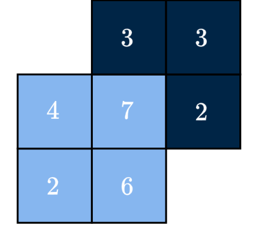
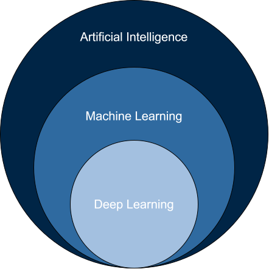
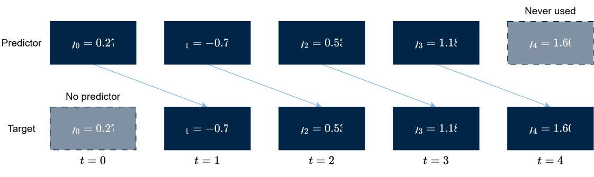
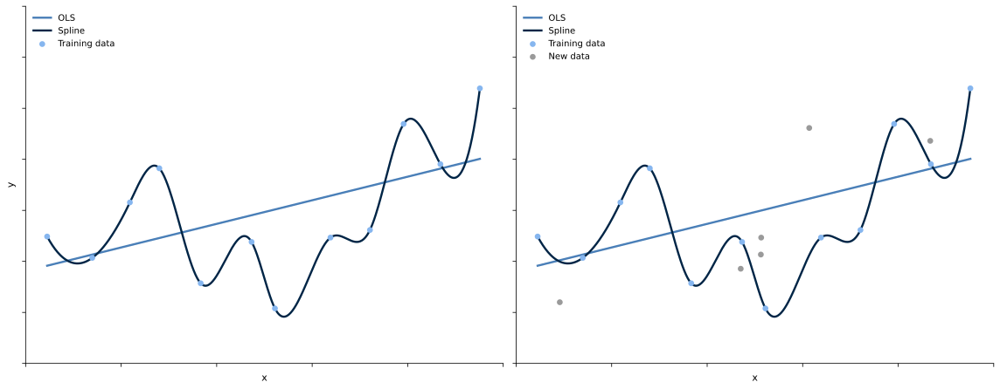
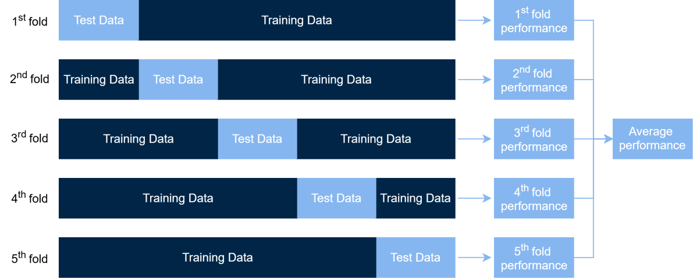
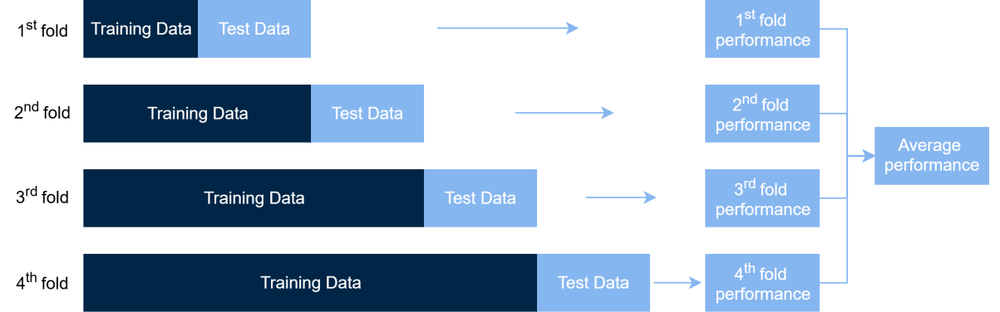
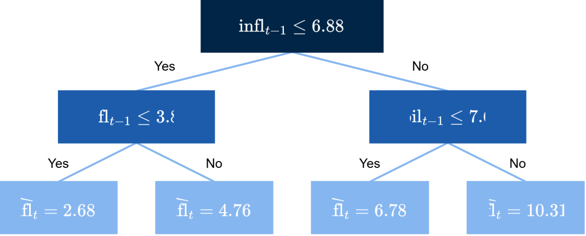
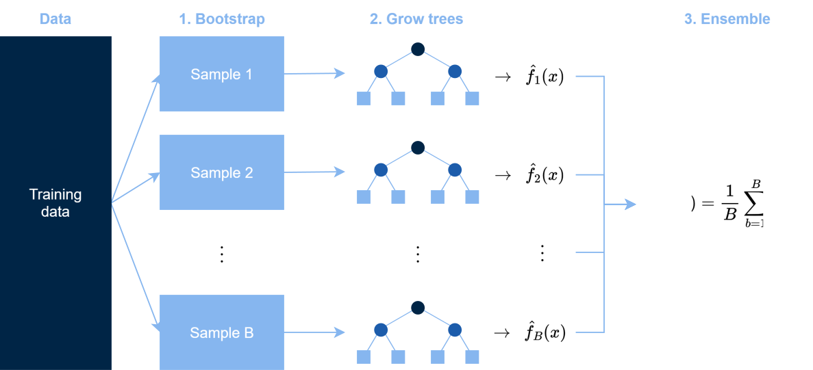

# Introduction {.divider}

## Today's Lecture

::: {.overview}
::: {.ov-row}
::: {.ov-label}
NumPy
:::
::: {.ov-desc}
Arrays, operations, subsetting, NaNs, random draws, lagging
:::
:::
::: {.ov-row}
::: {.ov-label}
pandas
:::
::: {.ov-desc}
Data frames, wrangling, time-indexed data
:::
:::
::: {.ov-row}
::: {.ov-label}
Machine learning
:::
::: {.ov-desc}
Definitions and scope
:::
:::
::: {.ov-row}
::: {.ov-label}
The forecasting pipeline
:::
::: {.ov-desc}
Data wrangling, model selection, evaluation
:::
:::
::: {.ov-row}
::: {.ov-label}
scikit-learn
:::
::: {.ov-desc}
OLS, LASSO, ridge, random forests, pipelines
:::
:::
:::

## Practical Information
- Colab is used in course instruction and exercises
- Exam must be handed in notebook (.ipynb) format
- Slides are .html-based to facilitate embedded code
  - Allows you to manipulate code directly in the slides
- .pdf versions are available on Brightspace
- "Up to you" slides provide small exercises

## Why Python?

Python is the programming language used in this course.

- Large array of libraries for **data wrangling** and **machine learning**
- (Nearly) exclusive language of deep learning
- Aligns with your prerequisite courses
- Favored in both academia and industry
- Free and open-source

::: {.notes}
While R is used for machine learning, Python is used (nearly) exclusively for deep learning implementations. Today: pandas and NumPy as work-horses for data wrangling, scikit-learn for all non-deep-learning modelling, PyTorch for deep learning (brief now; neural networks in two days).
:::

## The Four Libraries

::: {.cards}
::: {.card-box}
[NumPy]{.t}
[Arrays and numerical tasks]{.d}
:::
::: {.card-box}
[pandas]{.t}
[Data frames and wrangling]{.d}
:::
::: {.card-box}
[scikit-learn]{.t}
[All non-deep-learning models]{.d}
:::
::: {.card-box}
[PyTorch]{.t}
[Deep learning]{.d}
:::
:::

# NumPy -- Numerical Python {.divider}

## What is NumPy?

- Go-to library for numerical tasks -- mean, logs, etc.

- Data is stored in **arrays**, say `arr`

Arrays general term for scalars, vectors, matrices and tensors:

$$
\texttt{arr}\in\mathbb{R},\quad \texttt{arr}\in\mathbb{R}^n,\quad \texttt{arr}\in\mathbb{R}^{n\times m},\quad \texttt{arr}\in\mathbb{R}^{m_1\times \cdots \times m_n}
$$

::: {.callout-tip}
If not quite confident in ***scalars, vectors, matrices, tensors***, refer to the [Maths Brush-Up](https://github.com/nvilladsen/fml-2026/blob/main/Maths_Brush_Up__FwML.pdf)
:::

Always import library with the standard alias,

```{pyodide}
import numpy as np
```

## Defining Arrays

```{pyodide}
arrS = np.array(4)                       # scalar
arrV = np.array([4, 7, 2])               # vector
arrM = np.array([[4, 7, 2],
                 [6, 3, 3]])             # matrix
arrT = np.array([[[4, 7], 
                  [2, 6]],  
                  [[3, 3], 
                  [1, 2]]])              # tensor
print(arrS.shape, arrV.shape, arrM.shape, arrT.shape)
```

::: {.notes}
Print of dimension arrT is number of matrices, number of rows, number of columns
:::

## Visualizing a 3D Array
::: {.figblock}
::: {.fig-title}
:::



::: {.fig-src}
Associated NumPy code: `arrT = np.array([[[4, 7], [2, 6]], [[3, 3], [1, 2]]])`
:::
:::

## Functions on Arrays

```{pyodide}
print(np.var(arrV))
print(np.log(arrM).round(2))
print(np.sum(arrT, axis=0))
```

::: {.notes}
axis=0 means summing across indices: [1, 1] + [1, 1] for each matrix, [1, 2] + [1, 2] for each matrix (positions), etc.
res[j,k] = arrT[0,j,k] + arrT[1,j,k] for each j, k.
axis=1 means summing across rows within each matrix: [1, 1] + [2, 1] for each matrix, [1, 2] + [2, 2] for each matrix (positions), etc.
res[i,k] = arrT[i,0,k] + arrT[i,1,k] for each i, k.
axis=2 means summing across the third dimension: [1, 1, 1] + [1, 1, 2] for each position, etc.
res[i,j] = arrT[i,j,0] + arrT[i,j,1] for each i, j.
So in this example, axis=0 is [[7, 10], [3, 8]], axis=1 is [[6, 13], [4, 5]], and axis=2 is [[11, 8], [6, 3]].
:::

## Subsetting I -- Basics

- Important to get right -- differs from pandas
- Python is **zero-indexed**: `arr[row, col]`

```{pyodide}
print(arrM)
print("One element:", arrM[1, 2])
print("First row:", arrM[0, :])
print("First column:", arrM[:, 0])
```

## Subsetting II -- Intervals

```{pyodide}
rng = np.random.default_rng(160923)
arrM = rng.standard_normal((100, 100))
arrMSub = arrM[0:20, 39:56]   # rows 1-20, columns 40-56
print(arrMSub.shape)
```

::: {.keypoint}
Zero-indexed, but the end of the interval is **excluded**
:::

## Subsetting III -- Indices

```{pyodide}
RowIdx = np.array([2, 4, 7])
ColIdx = np.array([9, 12, 56])
print(arrM[RowIdx, ColIdx].shape)          # wrong
print(arrM[np.ix_(RowIdx, ColIdx)].shape)
```

::: {.keypoint}
`arrM[RowIdx, ColIdx]` is wrong -- it only selects three data points
:::

## Subsetting IV -- Slicing

`::2` $\to$ every second index

```{pyodide}
arrMEven = arrM[::2, :]
print(arrM.shape, arrMEven.shape)
```

::: {.notes}
The first two positions (colons) in `::2` represent the start and end of the rows to be subset, if any. `::2` means all rows are selected.
:::

## Up to you: Subsetting

Extract from `arrM`, every 4th column of rows 20 to 60 in increments of 3.

```{pyodide}
#| exercise: ex_subset
#| setup: true
import numpy as np
rng = np.random.default_rng(160923)
arrM = rng.standard_normal((100, 100))
```

```{pyodide}
#| exercise: ex_subset
arrMSub = ...
print(arrMSub.shape)
```

```{pyodide}
#| exercise: ex_subset
#| solution: true
arrMSub = arrM[19:60:3, ::4]
print(arrMSub.shape)
```

## NaNs I 

Adding a number of NaNs to `arrM`,

```{pyodide}
rng = np.random.default_rng(160923)
arrMNaN = arrM.copy()
arrMNaN[rng.choice(100, 10, replace=False), rng.choice(100, 10, replace=False)] = np.nan
print(np.isnan(arrMNaN).sum())
```

::: {.notes}
print(np.isnan(arrMNaN)) returns a matrix the same shape as arrMNaN, with True where NaNs are present and False otherwise
.sum() counts the NaNs, .any() returns True if any True is present in np.isnan(arrMNaN), False otherwise
:::

::: {.keypoint}
`.copy()` is required -- otherwise the original receives NaNs too
:::

## NaNs II

Determine whether NaNs are present and their count,
```{pyodide}
arrMNaN0 = np.isnan(arrMNaN).any()      # Any NaNs present?
arrMNaNCount = np.isnan(arrMNaN).sum()  # Count the number of NaNs present
print(f"NaNs present: {arrMNaN0}. Count: {arrMNaNCount}")
```

We can handle NaNs by e.g. replacing them with values of our choice, e.g., 0 or the mean,
```{pyodide}
arrMNaN0s = np.where(np.isnan(arrMNaN), 0, arrMNaN) # Replace NaNs with 0
arrMNaNMean = np.where(np.isnan(arrMNaN), np.nanmean(arrMNaN), arrMNaN) # Replace NaNs with mean
```

::: {.small .faint}
*For time series, compute the mean on training data only*
:::

::: {.notes}
`np.isnan()` returns a matrix of the same dimension of the original matrix, True or False whether the melement is NaN or not. `np.isnan().any` returns True is a single entry anywhere is NaN otherwise False. `np.isnan.any(axis=1)` returns a vector which is True/False for each row, depending on whether there are NaNs in each row. 
:::

## NaNs III - Drop Rows Containing NaNs
```{pyodide}
arrMNoNaN   = arrMNaN[~np.isnan(arrMNaN).any(axis=1)] # Drop rows containing NaNs
print(arrMNaN.shape, arrMNoNaN.shape)
```

1. `np.isnan(arrMNaN)` identifies the NaNs
2. `.any(axis=1)` -- identifies any NaN in each row
3. `~` flips the selection to retain the clean rows

::: {.keypoint}
Manipulating NaNs is dangerous -- choose replacement values with care
:::

## Reshaping 1D Arrays

A 1D array has shape `(n,)`, but many functions expect a 2D array. 

Reshape it into a column vector with `.reshape(-1, 1)`:

```{pyodide}
rng = np.random.default_rng(160923)
arrV = rng.standard_normal(100)
print(arrV.shape)

arrV = arrV.reshape(-1, 1)
print(arrV.shape)
```

::: {.keypoint}
`-1` is a placeholder to let Python determine the number of rows, while `1` dictates one column
:::

# Pandas -- Panel Data {.divider}

## What are pandas?

- Developed to match `R`'s (at the time) superior data handling
- Stores data in **data frames**. A single variable would be stored in a **series**
- Series are most commonly used for univariate targets, i.e., $y$s

Always import library with the standard alias,

```{pyodide}
import pandas as pd
```

## Preliminary: Dictionaries

- Store **key–value pairs**: values are looked up by their key
- Defined with curly braces, `{key: value}`

```{pyodide}
scores = {"OLS": 0.52, "LASSO": 0.48, "Ridge": 0.49}
print(scores["LASSO"])                # look up by key
scores["Random forest"] = 0.41        # add a new key
print(scores)
```

::: {.keypoint}
Keys are unique, usually strings; values can be anything. 

We will use dictionaries for data frames, hyperparameter grids, and collecting results
:::

::: {.notes}
Contrast with NumPy arrays, which are indexed by position. A dictionary is indexed by name.
:::

## Series

Defining a pandas series,

```{pyodide}
series = pd.Series([4, 7, 2], index=["A", "B", "C"])
series
```

The left-most column is the index. It can also be set afterwards with `series.index=[...]`

## Data Frames

Defining a pandas data frame,

```{pyodide}
rng = np.random.default_rng(160923)
df = pd.DataFrame({
    "Gaussian": rng.standard_normal(5),
    "Integer": rng.integers(0, 10, 5)
})
df
```

## Reading in Data

`pd.read_csv()` is an important function. Example with `toy_data.csv`,

```{pyodide}
df = pd.read_csv("assets/data/toy_data.csv")
print(df.shape)
df.head()
```

::: {.notes}
.head() also works for pd.Series
:::

::: {.callout-tip}
Use `df.to_csv("filename.csv")` to write a data frame to .csv
:::

## Inspecting Types

```{pyodide}
df["Date"] = pd.to_datetime(df["Date"])
print(df.dtypes)
```

::: {.keypoint}
Also useful: `df.describe()`, `df.isna().sum()`, `df.dropna()`
:::

::: {.notes} 
An object is a catch-all type, which will usually be a string.To make the thing a string explicitly: 
`df["Description"] = df["Description"].astype("string")`
:::

## Subsetting Data Frames I
Use `.iloc` for index-based subsetting, `.loc` for label-based subsetting,
```{pyodide}
df.iloc[:3, :2]   # by position, rows 0-2 and columns 0-1, as in NumPy
```

```{pyodide}
df.loc[:2, ["Description", "Amount"]]   # rows labelled 0-2, columns by label
```

::: {.keypoint}
As opposed to `.iloc` and NumPy, the end of `.loc` intervals is **included** 
:::

::: {.notes}
`["...", "..."]` makes for a list.
:::

## Subsetting Data Frames II

Subsetting by name alone (cannot subset rows simultaneously),
```{pyodide}
df[["Amount", "Quantity"]].head(3)
```

Subsetting by condition,

```{pyodide}
df[df["Amount"] > 50].head(3)
```

# Machine Learning {.divider}

## Layers of Intelligence
::: {.figblock}
::: {.fig-title}
:::



::: {.fig-src}
Deep learning is a subset of machine learning, which in turn is a subset of artificial intelligence.
:::
:::

::: {.notes}
The IBM supercomputer, Deep Blue, defeated chess grandmaster Garry Kasparov -- in chess -- in 1997. No learning was applied, the rules of chess were hard-coded -- still AI. Unnerving. Google was founded in 1998.

2 matches of 6 games. 1996, 3 wins, 1 loss, 2 draws. 1997, 1 win, 2 losses, 3 draws. 

Machine evaluated roughtly 200 million positions per second. Searched 6-8 moves ahead. Core was brute-force. Had an evaluation function, designed by a team including a grandmaster, but there was no learning about it.

Random moves, a result of bugs, made Kasparov think the computer might have inhuman insights, which might have rattled him. Kasparov, in the end, claimed human intervention and foul play. 
:::

## Defining AI, Machine Learning, and Deep Learning
- Artificial intelligence is a programmed, possibly learned, set of rules
- Following Gu et al., 2020: The term **machine learning** encompasses:
  1. a diverse collection of high-dimensional models for statistical prediction, combined with
  2. so-called "regularization" methods for model selection and mitigation of overfit, and
  3. efficient algorithms for searching among a vast number of potential model specifications

- Following IBM, **deep learning** is a subset of machine learning driven by multilayered neural networks whose design is inspired by the structure of the human brain.


# The Forecasting Pipeline {.divider}

## The Forecasting Pipeline

::: {.overview}
::: {.ov-row-inline}
::: {.ov-label}
Pre-processing
:::
::: {.ov-desc}
Explore distributions, check for NaNs and outliers, etc.
:::
:::
::: {.ov-row-inline}
::: {.ov-label}
Lagging 
:::
::: {.ov-desc}
Construct predictors from past values only (time series forecasting)
:::
:::
::: {.ov-row-inline}
::: {.ov-label}
Splitting
:::
::: {.ov-desc}
Reserve the test set before further modelling
:::
:::
::: {.ov-row-inline}
::: {.ov-label}
Standardizing
:::
::: {.ov-desc}
Standardize on the training data, apply to both (all) data sets
:::
:::
::: {.ov-row-inline}
::: {.ov-label}
Tuning
:::
::: {.ov-desc}
Cross-validate hyperparameters on the training set
:::
:::
::: {.ov-row-inline}
::: {.ov-label}
Fitting
:::
::: {.ov-desc}
Fit the model on the merged training and validation sets with the selected hyperparameters
:::
:::
::: {.ov-row-inline}
::: {.ov-label}
Evaluating
:::
::: {.ov-desc}
Compare models on the held-out test set
:::
:::
:::

## The Forecasting Task

::: {.keypoint}

We distinguish between classification and regression, categorical and numerical targets

:::

:::: {.triad .cols-2 .dark-light}
::: {.triad-card}
[Classification]{.tc-tag}

- Categorical target
- Forecasting output: a class or class probabilities
- Errors: correct/incorrect
- Metrics: accuracy, ...

:::
::: {.triad-card}
[Regression]{.tc-tag}

- Numerical target
- Forecasting output: a continuous value
- Errors have a magnitude
- Metrics: MSE, MAE, $R^2$

:::
::::

## Data Pre-Processing

Before modelling always inspect the raw data.

```python
df.head()          # first rows
df.describe()      # distributional summary
df.isna().sum()    # count missing values per column
df.dtypes          # check that data types are as expected
```

- Data pre-processing is essential in the forecasting pipeline 
- We cannot dedicate due time to all the important steps in this lecture
- Instead, refer to Chapter 3 of [Applied Predictive Modeling](https://link.springer.com/book/10.1007/978-1-4614-6849-3){target="_blank"} (Kuhn & Johnson, 2013)
- Code translated from `R` to Python is available in the [Colab Notebook "Chapter 3 Translation"](https://colab.research.google.com/drive/1JX1COhoV31ilURxSnsbkHhulN0A3FCxh#scrollTo=cxueYY40abwP){target="_blank"}

## Lagging I 

$$Y_t = f(X_{t-1}) + \varepsilon_t$$

To forecast $Y_t$ we may only use what was known at $t-1$, so the predictor is shifted back one period. Assume a random walk for simplicity -- yet the concept holds for any predictor,  

```{pyodide}
rng = np.random.default_rng(160923) 
y = np.cumsum(rng.standard_normal(10))    # Random walk

y_lag = y[:-1]    # y at t-1: drop the last observation
y_t   = y[1:]     # y at t:   drop the first observation
print(y_lag.round(2))
print(y_t.round(2))
```

::: {.notes}
Generating data like this, with cumsum, because then it is a random walk path, $y_t = y_{t-1} + \varepsilon_t = \sum_{s=0}^t\varepsilon_s$.
:::

::: {.small .faint}
*Exercises 16 and 17 pertain to lagging in pandas with* `.shift(1)`
:::

## Lagging II
::: {.figblock}
::: {.fig-title}
:::



::: {.fig-src}
Example of lagging a time series by one period. The top row is the original series, the bottom row is the lagged series.
:::
:::

- Each arrow is a forecast in the random walk: standing at $t-1$ with $y_{t-1}$, predict $y_t$. 

- `y[:-1]` is the top row without its last box, `y[1:]` the bottom row without its first box. 

::: {.notes}
Predictors, the last observation is removed, `y[:-1]`, and the target, the first observation is removed, `y[1:]`. 
:::

## Sample Splitting

In cross-sectional modeling, data is usually split randomly

In **time series modeling**, data must be split chronologically, such as,

```python
from sklearn.model_selection import train_test_split

X_train, X_test, y_train, y_test = train_test_split(
    X, y, train_size=0.8, shuffle=False
)
```

::: {.notes}
sklearn is the scikit-learn library which we will get to in more detail in a few slides.
:::

## Standardization

$Z$-score standardization: Subtract the mean, divide by the standard deviation,

$$
z_t = \frac{x_t - \hat{\mu}}{\hat{\sigma}}
$$

Yields $z_t$ with zero mean and unit variance.

:::: {.triad .cols-2 .dark-light}
::: {.triad-card}
[Standardize]{.tc-tag}

- Shrinkage models (LASSO, ridge, elastic net)
  - Penalty not scale-invariant
- Neural networks 
  - Gradient descent is sensitive to scale

:::
::: {.triad-card}
[Standardization unnecessary]{.tc-tag}

- Tree-based models (random forests)
  - Splits are scale-invariant
- OLS 
  - Coefficients scale with data

:::
::::

::: {.keypoint}

Fit the scaler on **training data only**, then apply to the test set

Fitting on the full sample leaks future distributional information

:::

::: {.notes}
Transforms data to zero-mean and unit variance.
:::

## Standardization: Code

```python
from sklearn.preprocessing import StandardScaler

scaler = StandardScaler()

X_train_sc = scaler.fit_transform(X_train)  # fit + transform on train
X_test_sc = scaler.transform(X_test)        # transform only on test
```

## The Bias-Variance Trade-Off

The expected squared forecast error decomposes as

$$\mathrm{E}\!\left[(\hat{y} - y)^2\right] = \underbrace{\mathrm{Bias}^2}_{\text{underfitting}} + \underbrace{\mathrm{Variance}}_{\text{overfitting}} + \underbrace{\sigma^2}_{\text{irreducible}}$$

:::: {.triad .cols-2 .dark-light}
::: {.triad-card}
[High bias]{.tc-tag}

- Model too simple
- Misses systematic patterns
- Train error $\approx$ test error, both large

:::
::: {.triad-card}
[High variance]{.tc-tag}

- Model too complex/flexible
- Model fits to noise rather than signal
- Train error $\ll$ test error

:::
::::

Regularized models, e.g., LASSO, trade off bias for variance, while ensembles such as random forests reduce variance

## Bias-variance Trade-Off -- An Extreme Example
::: {.figblock}
::: {.fig-title}
:::



::: {.fig-src}
MSE OLS (left-hand side): 0.262, MSE spline (left-hand side): 0.000, MSE OLS (right-hand side): 0.209, MSE spline (right-hand side): 0.394.
:::
:::

# scikit-learn {.divider}

::: {.notes}
From SciPy (Scientific Python) and toolkit (scikit) and then learn
:::

## What is scikit-learn?

Primary modeling library covering a large array of models:

- Linear regression (OLS)
- Shrinkage models (LASSO, ridge, elastic net)
- Tree-based models (CART, random forests, gradient boosting...)
- Support vector regression/machines

::: {.keypoint}
Advantage: unified and streamlined syntax -- `fit` $\to$ `predict` $\to$ `score` ($R^2_{\text{OOS}}$)
:::

## Importing

Generally import functions as needed, e.g., 

```{pyodide}
from sklearn.linear_model import LinearRegression, Lasso, Ridge, LassoCV, RidgeCV
from sklearn.model_selection import train_test_split, GridSearchCV 
from sklearn.model_selection import TimeSeriesSplit
from sklearn.ensemble import RandomForestRegressor
from sklearn.preprocessing import StandardScaler
from sklearn.metrics import mean_squared_error
from sklearn.pipeline import Pipeline 
```

::: {.keypoint}
Import from `sklearn` and not `scikit-learn`
:::

## Practical Example: Forecasting US Inflation
Quarterly US macroeconomic data, 1959Q1--2009Q3, from `statsmodels`

- Target: inflation, `infl`
- Predictors: lagged inflation, unemployment and the T-bill rate

::: {.pull-up}
:::

```{pyodide}
import statsmodels.api as sm
df = sm.datasets.macrodata.load_pandas().data
df_sub = df[["infl", "unemp", "tbilrate"]].to_numpy()   # (T, 3)
infl = df_sub[:, 0]
print(df_sub.shape)
df[["infl", "unemp", "tbilrate"]].head(3)
```

## Pre-Processing Inflation Data
```{pyodide}
X = df_sub[:-1]     # (infl, unemp, tbilrate) at t-1: drop final observation
y = infl[1:]        # infl at t: drop first observation

X_train, X_test, y_train, y_test = train_test_split(
    X, y, train_size=0.8, shuffle=False
)
print(f"Train dimension X: {X_train.shape}, Test dimension X: {X_test.shape}")
print(f"Train dimension y: {y_train.shape}, Test dimension y: {y_test.shape}")

scaler     = StandardScaler()
X_train_sc = scaler.fit_transform(X_train)
X_test_sc  = scaler.transform(X_test)
```

## Visualizing the Target

```{pyodide}
import matplotlib.pyplot as plt
fig, ax = plt.subplots(figsize=(8, 2.5))
ax.plot(range(len(y)), y, lw=0.8, color="#86b6ef")
ax.axvline(len(y_train), color="#002546", lw=1, ls="--", label="Train / test split")
ax.set_xlabel("quarter $t$"); ax.set_ylabel("Inflation, %"); ax.legend(fontsize=9)
plt.tight_layout(); plt.show()
```

::: {.small .faint}
*Refer to the [Colab Notebook "matplotlib documentation"](https://colab.research.google.com/drive/1TbZA6KdijpnnB-I-41I1MYjA6J1sx_Rl) and the  [examples](https://matplotlib.org/stable/gallery/index.html) to learn about plotting with matplotlib and its pyplot module*
:::

## The Random Walk Benchmark

- The random walk is commonly used as benchmark in time series forecasting
- Predicts the next value as the previous value,

$$ \hat{y}_t = y_{t-1} $$

::: {.pull-up}
:::

```{pyodide}
y_pred_rw = np.concatenate([[y_train[-1]], y_test[:-1]])   # previous value
mse_rw = mean_squared_error(y_test, y_pred_rw)
print(f"Random walk MSE = {mse_rw:.4f}")
```

::: {.notes}
The random walk is a very commonly used benchmark in financial and macroeconomic forecasting
:::

## Ordinary Least Squares (OLS)
- *The* linear regression model
- Determine how the target variable $y$ depends linearly on a set of exogenous variables, $X$,
  - Compute the coefficients, $\beta$, by minimizing the sum of squared residuals,
$$\hat\beta_{\text{OLS}} = \underset{\beta}{\arg\min} \left\{ \sum_{t = 1}^T(y_t - \hat{y}_t)^2 \right\}$$

::: {.keypoint}
Intuitive and interpretable, yet possibly challenged by heteroskedasticity and serial correlation
:::

- Estimator,

::: {style="margin-top: -1em"}
$$\hat{\beta} = (X^\top X)^{-1} X^\top y$$
:::

## Linear Regression (OLS) in Code
```{pyodide}
ols = LinearRegression()
ols.fit(X_train, y_train)
y_pred_ols = ols.predict(X_test)
mse_ols = mean_squared_error(y_test, y_pred_ols)
print(f"OLS MSE = {mse_ols:.4f}")
```

## OLS in scikit-learn
Implementation on previous slide follows the standard scikit-learn blueprint,

::: {.overview}
::: {.ov-row}
::: {.ov-label}
Initialize model object
:::
::: {.ov-desc}
`ols = LinearRegression()` assigns a linear regression object to `ols`
:::
:::
::: {.ov-row}
::: {.ov-label}
Fitting/training model
:::
::: {.ov-desc}
`.fit(X_train, y_train)` accepts the training covariates and target and fits/trains the model on this data
:::
:::
::: {.ov-row}
::: {.ov-label}
Predicting
:::
::: {.ov-desc}
`.predict(X_test)` uses the out-of-sample covariates to generate predictions of the target 
:::
:::
::: {.ov-row}
::: {.ov-label}
Evaluating
:::
::: {.ov-desc}
 `.score(X_test, y_test)` returns the $R^2$ against the test mean
:::
:::
:::

::: {.keypoint}
The mean squared error is a common metric for model evaluation, but others exist as well
:::

## Up to you: OLS

Compute the **in-sample** fitted values from `ols` and the associated training MSE. 
The relevant data and fitted model are stored in the memory already, so you can proceed from here.

```{pyodide}
#| exercise: ex_ols
#| setup: true
import numpy as np
import pandas as pd
from sklearn.linear_model import LinearRegression
from sklearn.metrics import mean_squared_error
from sklearn.model_selection import train_test_split

import statsmodels.api as sm
df = sm.datasets.macrodata.load_pandas().data
df_sub = df[["infl", "unemp", "tbilrate"]].to_numpy()
X, y = df_sub[:-1], df_sub[1:, 0]
X_train, X_test, y_train, y_test = train_test_split(
    X, y, train_size=0.8, shuffle=False
)
ols = LinearRegression().fit(X_train, y_train)
```

```{pyodide}
#| exercise: ex_ols
y_pred_ols_train = ...
mse_ols_train = ...
print(f"Train MSE = {mse_ols_train:.4f}")
```

```{pyodide}
#| exercise: ex_ols
#| solution: true
y_pred_ols_train = ols.predict(X_train) 
mse_ols_train = mean_squared_error(y_train, y_pred_ols_train)
print(f"Train MSE = {mse_ols_train:.4f}")
```

## Penalized Regression Models I {.compact}

- Three primary penalized regression models; i) LASSO, ii) ridge, and iii) elastic net
- Each adds a penalty term to the ordinary least squares (OLS) objective function of $\ell_1$, $\ell_2$, and both, respectively. The models are defined as,

::: {.pull-up}
:::

$$\begin{aligned}
\text{LASSO:}\quad \hat\beta_{\text{LASSO}} &= \underset{\beta}{\arg\min} \left\{ \sum_{t=1}^T(y_t - x_t^\top\beta)^2 + \lambda \sum_{j=1}^p |\beta_j| \right\}\\
\text{Ridge:}\quad \hat\beta_{\text{Ridge}} &= \underset{\beta}{\arg\min} \left\{ \sum_{t=1}^T(y_t - x_t^\top\beta)^2 + \lambda \sum_{j=1}^p \beta_j^2 \right\}\\
\text{Elastic net:}\quad \hat\beta_{\text{ENet}} &= \underset{\beta}{\arg\min} \left\{ \sum_{t=1}^T(y_t - x_t^\top\beta)^2 + \lambda\left[\rho\sum_{j=1}^p |\beta_j| + (1-\rho)\sum_{j=1}^p \beta_j^2\right] \right\}
\end{aligned}$$

::: {.pull-up}
:::

where $\lambda \geq 0$ governs the penalty strength and $\rho \in [0,1]$ the mix of $\ell_1$ and $\ell_2$.

::: {.callout-tip}
In `sklearn`, the penalty strength is called `alpha`. For ridge, `alpha` $=\lambda$. For LASSO, `alpha` $=\lambda/(2T)$
:::

::: {.notes}
The elastic net nests the other two: $\rho = 1$ gives the LASSO and $\rho = 0$ gives ridge
:::

## Penalized Regression Models II: Selection and Shrinkage
- The **LASSO** is a variable selection method, as, by virtue of the $\ell_1$ penalty, coefficients can be set to exactly zero
  - Among strongly correlated predictors it tends to keep one and drop the others
- **Ridge** shrinks all coefficients towards zero but sets none of them exactly to zero
- The **elastic net** selects and shrinks, with $\rho$ governing the mix
  - Correlated predictors tend to be kept or dropped together
- The penalty strength $\lambda$ and the mixing weight $\rho$ are hyperparameters, tuned by time-series cross-validation

::: {.keypoint}
Penalized regression models trade off bias for variance relative to OLS
:::

::: {.notes}
- Three primary penalized regression models; i) LASSO, ii) ridge, and iii) elastic net
- Each adds a penalty term to the ordinary least squares (OLS) objective function of $\ell_1$, $\ell_2$, and both, respectively
- The Least Absolute Shrinkage and Selection Operator (LASSO) penalizes according to the absolute value of the coefficients, the $\ell_1$ penalty
- This makes the LASSO a variable selection method, as it can set coefficients exactly to zero
- Ridge penalizes according to the squared value of the coefficients, the $\ell_2$ penalty
- Elastic net combines the two penalties, $\ell_1$ and $\ell_2$, in a convex combination

- Under regularity conditions, OLS is unbiased, but it can have high variance, especially in high-dimensional settings (many predictors)
- Penalized regression handles high dimensionality well, but are fundamentally biased estimators
- We trade off bias for variance
:::

## Non-Optimized LASSO and Ridge
```{pyodide}
lasso = Lasso(alpha=0.05).fit(X_train_sc, y_train)
ridge = Ridge(alpha=1.0).fit(X_train_sc, y_train)

y_pred_lasso = lasso.predict(X_test_sc)
y_pred_ridge = ridge.predict(X_test_sc)

mse_lasso = mean_squared_error(y_test, y_pred_lasso)
mse_ridge = mean_squared_error(y_test, y_pred_ridge)
print(f"LASSO MSE = {mse_lasso:.4f}")
print(f"Ridge MSE = {mse_ridge:.4f}")
```

## Cross-Sectional Cross-Validation
::: {.figblock}
::: {.fig-title}
:::



::: {.fig-src}
Cross-sectional cross-validation depicted for a 5-fold split.
:::
:::

## Time Series Cross-Validation
::: {.figblock}
::: {.fig-title}
:::



::: {.fig-src}
Time series cross-validation depicted for a 4-fold split.
:::
:::

## Cross-Validated LASSO and Ridge {.compact-xs}

::: {.pull-up}
:::

`RidgeCV` selects by $R^2$ unless `scoring` is set, so MSE is passed explicitly

::: {.pull-up}
:::

```{pyodide}
lasso = LassoCV(cv=TimeSeriesSplit()).fit(X_train_sc, y_train)
ridge = RidgeCV(cv=TimeSeriesSplit(), 
                scoring="neg_mean_squared_error").fit(X_train_sc, y_train)

y_pred_lasso = lasso.predict(X_test_sc)
y_pred_ridge = ridge.predict(X_test_sc)

mse_lasso = mean_squared_error(y_test, y_pred_lasso)
mse_ridge = mean_squared_error(y_test, y_pred_ridge)
print(f"LASSO alpha = {lasso.alpha_:.4f}, MSE = {mse_lasso:.4f}")
print(f"Ridge alpha = {ridge.alpha_:.4f}, MSE = {mse_ridge:.4f}")
```

::: {.keypoint}
The scaler is fitted before cross-validation, so there might be leakage of future information into the model

Pipelines handle scaling intrinsically
:::

## Pipelines: Chaining the Steps I

A scikit-learn `Pipeline` chains preprocessing and model in **one object**

::: {.flow}
::: {.fn-navy}
**Define**

[`(name, object)` tuples; the last step is the model]{.fn-sub}
:::
::: {}
**`.fit()`**

[Fits the scaler, transforms, then fits the model]{.fn-sub}
:::
::: {.fn-amber}
**`.predict()`**

[Applies the fitted scaler, then predicts: no leakage]{.fn-sub}
:::
:::

```{pyodide}
lasso_pipe = Pipeline([
    ("scaler", StandardScaler()),
    ("model",  Lasso(alpha=0.05))
])
lasso_pipe.fit(X_train, y_train)                 # raw, unscaled data
y_pred_pipe = lasso_pipe.predict(X_test)

# Continued on next slide
```

## Pipelines: Chaining the Steps II

```{pyodide}
# Continued from previous slide

# Step-by-step equivalent, using the scaled data from before
y_pred_step = Lasso(alpha=0.05).fit(X_train_sc, y_train).predict(X_test_sc)
print(f"Pipeline  MSE = {mean_squared_error(y_test, y_pred_pipe):.4f}")
print(f"Step-wise MSE = {mean_squared_error(y_test, y_pred_step):.4f}")
```

## Pipelines and Cross-Validation

In cross-validation the scaler must be **re-fitted within every training fold**. 

The pipeline does this automatically,

```{pyodide}
pipe = Pipeline([("scaler", StandardScaler()), ("model", Lasso())])
search = GridSearchCV(pipe,
                      param_grid={"model__alpha": [0.001, 0.01, 0.1, 1.0]},
                      cv=TimeSeriesSplit(n_splits=5),
                      scoring="neg_mean_squared_error")
search.fit(X_train, y_train) 
y_pred_cv = search.predict(X_test)
print(f"Tuned LASSO MSE = {mean_squared_error(y_test, y_pred_cv):.4f} "
      f"with optimal alpha = {search.best_params_['model__alpha']:.4f}")
```

::: {.notes}
`GridSearchCV` re-fits the best pipeline on the full training set (`refit=True`), so `search.predict` is ready to use. Tree-based models need no scaler, so a pipeline is optional
:::

## Decision Trees
- A tree forecasts by splitting the training data into **nodes** with yes/no questions about one predictor at a time, e.g., "is lagged inflation $\leq 6.88$?"
- Nodes that are not split further are the **leaves**
- The forecast of leaf $k$ is the mean of the training targets that end up in it,

$$\hat y_k = \frac{1}{n_k}\sum_{t \in \mathcal{L}_k} y_t$$

- where $\mathcal{L}_k$ is the set of training observations in leaf $k$, and $n_k$ is their number

- A new observation is forecast by its associated leaf, assigned via the decision path

## Visualizing a Decision Tree
::: {.figblock}
::: {.fig-title}
:::



::: {.fig-src}
The values depicted on the tree stem from a single run of a CART regressor on the data set in our example.
:::
:::

## Decision Trees: Growing a Tree
- A split asks "is $x_{t,j} \leq s$?", with $x_{t,j}$ predictor $j$ in observation $t$ and $s$ the cut point
- Each side of the node is forecast by its own mean target, $\bar y_{\text{left}}$ and $\bar y_{\text{right}}$, giving the squared error

$$\text{SSE}(j,s) = \sum_{t:\; x_{t,j} \leq s}\left(y_t - \bar y_{\text{left}}\right)^2 + \sum_{t:\; x_{t,j} > s}\left(y_t - \bar y_{\text{right}}\right)^2$$

- The pair $(j, s)$ with the smallest SSE is chosen. We repeat in each new node until a stopping rule is met

::: {.keypoint}
Deep trees fit the training data closely but have high variance -- a single tree is unstable
:::

::: {.notes}
The left/right means are only used to score each candidate split. Only the leaves produce actual forecasts.
:::

## Random Forests
Reduce the variance of trees by **averaging** many trees grown on different bootstrap samples,

::: {.steplist}
::: {.step-row}
::: {.step-num}
1
:::
::: {.step-title}
Bootstrap
:::
::: {.step-desc}
Draw $B$ samples with replacement from the training data
:::
:::
::: {.step-row}
::: {.step-num}
2
:::
::: {.step-title}
Grow
:::
::: {.step-desc}

Fit a deep tree on each sample, using only $m < p$ randomly chosen predictors at each split, decorrelating the trees

:::
:::
::: {.step-row}
::: {.step-num}
3
:::
::: {.step-title}
Average
:::
::: {.step-desc}
The forecast is the average over the $B$ trees
:::
:::
:::

$$\hat{f}_{\text{RF}}(x) = \frac{1}{B}\sum_{b=1}^{B}\hat{f}_b(x)$$

::: {.keypoint}

Forecasts are averages of training targets, so a forest cannot predict outside the range of the targets

:::

## Random Forests Visualized
::: {.figblock}
::: {.fig-title}
:::



::: {.fig-src}
:::
:::

## Random Forests in Code
```{pyodide}
rf = RandomForestRegressor(n_estimators=200, max_depth=4, random_state=160923)
rf.fit(X_train, y_train)
y_pred_rf = rf.predict(X_test)
mse_rf = mean_squared_error(y_test, y_pred_rf)
print(f"Random forest MSE = {mse_rf:.4f}")
```

::: {.keypoint}
Random forests are scale-invariant -- no standardization required
:::

::: {.notes}
Root is depth 0.
:::

## Comparing Results {footer="Differences in forecast accuracy are tested for significance with the Diebold–Mariano test (lecture 2)"}

```{pyodide}
results = {
    "RW":            mse_rw,
    "OLS":           mse_ols,
    "LASSO (CV)":    mse_lasso,
    "Ridge (CV)":    mse_ridge,
    "Random forest": mse_rf,
}
for name, mse in results.items():
    print(f"{name:20s}  MSE = {mse:.4f}")
```

::: {.notes}
Whether the differences in MSE are statistically significant is assessed with the Diebold–Mariano test (lecture 2).
:::

## References
::: {.small}
Bergmann, D. (2025). *What is deep learning?* IBM. https://www.ibm.com/think/topics/deep-learning

Gu, S., Kelly, B. and Xiu, D. (2020). Empirical asset pricing via machine learning. *Review of Financial Studies*, 33(5), 2223--2273.

Kuhn, M. and Johnson, K. (2013). *Applied Predictive Modeling*. Springer.
:::

# Appendix {.divider}

## Expanding and Rolling Windows

So far, the model was estimated once and used for the whole test sample. 

A real-time forecaster would generally re-estimate as new data arrives,

:::: {.steplist}
::: {.step-row}
::: {.step-num}
1
:::
::: {.step-title}
Estimate
:::
::: {.step-desc}
Fit the model on rows before $t$ only
:::
:::
::: {.step-row}
::: {.step-num}
2
:::
::: {.step-title}
Forecast
:::
::: {.step-desc}
Predict row $t$
:::
:::
::: {.step-row}
::: {.step-num}
3
:::
::: {.step-title}
Move on
:::
::: {.step-desc}
Go to row $t+1$ and repeat
:::
:::
::::

::: {.keypoint}
Expanding: fit on all rows before $t$. Rolling: fit on the last $W$ rows before $t$
:::

## Expanding and Rolling Windows: Code

- We fit OLS with expanding and rolling window estimation
- `X[:t]` is rows $0, \ldots, t-1$ (the end is excluded)
- Row $t$ of `X` holds information from $t-1$, so no future data enters the fit

```{pyodide}
n_train = len(y_train)      # first test row
window = 80                 # rolling window length W

fc_exp, fc_rol = [], []
for t in range(n_train, len(y)):
    ols = LinearRegression().fit(X[:t], y[:t])                        # expanding
    fc_exp.append(ols.predict(X[t:t + 1])[0])

    ols = LinearRegression().fit(X[t - window:t], y[t - window:t])    # rolling
    fc_rol.append(ols.predict(X[t:t + 1])[0])
```


## Comparing the Schemes

```{pyodide}
print(f"Fixed     MSE = {mse_ols:.4f}")
print(f"Expanding MSE = {mean_squared_error(y_test, fc_exp):.4f}")
print(f"Rolling   MSE = {mean_squared_error(y_test, fc_rol):.4f}")
```

::: {.keypoint}
Fixed: one estimation (this lecture). Expanding and rolling: one estimation per test row
:::