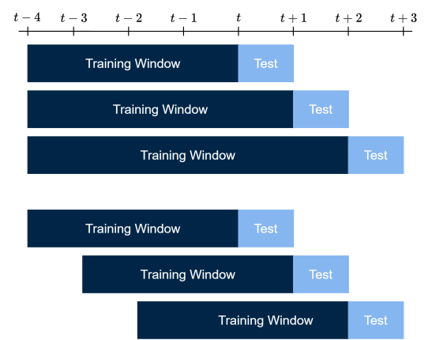

# Introduction {.divider}

## Why Python?

Python is the programming language used in this course.

- Large array of libraries for **data wrangling** and **machine learning**
- (Nearly) exclusive language of deep learning
- Aligns with your prerequisite courses
- Free and open-source
- Favored in both academia and industry

::: {.notes}
While R is used for machine learning, Python is used (nearly) exclusively for deep learning implementations. Today: pandas and NumPy as work-horses for data wrangling, scikit-learn for all non-deep-learning modelling, PyTorch for deep learning (brief now; neural networks in two weeks).
:::

## The four libraries

::: {.cards}
::: {.card-box}
[NumPy]{.t}
[Arrays and numerical tasks]{.d}
:::
::: {.card-box}
[pandas]{.t}
[Data frames and wrangling]{.d}
:::
::: {.card-box}
[scikit-learn]{.t}
[All non-deep-learning models]{.d}
:::
::: {.card-box}
[PyTorch]{.t}
[Deep learning]{.d}
:::
:::

## Today's lecture

::: {.overview}
::: {.ov-row}
::: {.ov-label}
NumPy
:::
::: {.ov-desc}
Arrays, operations, subsetting, NaNs, random draws, lagging
:::
:::
::: {.ov-row}
::: {.ov-label}
pandas
:::
::: {.ov-desc}
Data frames, wrangling, time-indexed data
:::
:::
::: {.ov-row}
::: {.ov-label}
Machine learning
:::
::: {.ov-desc}
Definitions and scope
:::
:::
::: {.ov-row}
::: {.ov-label}
The forecasting pipeline
:::
::: {.ov-desc}
Data wrangling, model selection, evaluation
:::
:::
::: {.ov-row}
::: {.ov-label}
scikit-learn
:::
::: {.ov-desc}
OLS, LASSO, ridge, random forests
:::
:::
:::

## Pratical Information
- Colab is used in course instruction and exercises
- Exam must be handed in [XXX]{style="color:#b3261e"} format
- Slides are .html-based to facilitate embedded code
  - Allows you to manipulate code directly in the slides
- .pdf versions are available on Brightspace
- "Up to you" slides provide small exercises


# NumPy --- Numerical Python {.divider}

## What is NumPy?

- Go-to library for numerical tasks --- mean, logs, etc.

Always import library with the standard alias:

```{pyodide}
import numpy as np
```

- Data is stored in **arrays**, say `arr`
- Arrays general term for scalars, vectors, matrices and tensors:

$$
\texttt{arr}\in\mathbb{R},\quad \texttt{arr}\in\mathbb{R}^n,\quad \texttt{arr}\in\mathbb{R}^{n\times m},\quad \texttt{arr}\in\mathbb{R}^{m_1\times \cdots \times m_n}
$$

## Defining arrays

```{pyodide}
arrS = np.array(4)                       # scalar
arrV = np.array([4, 7, 2])               # vector
arrM = np.array([[4, 7, 2],
                 [6, 3, 3]])             # matrix
arrT = np.array([[[4, 7], 
                  [2, 6]],  
                  [[3, 3], 
                  [1, 2]]])              # tensor
print(arrS.shape, arrV.shape, arrM.shape, arrT.shape)
```

## Visualising a 3D array

<div style="display: flex; justify-content: center; margin-top: 0.3em;">

</div>

## Functions on arrays

```{pyodide}
print(np.var(arrV))
print(np.log(arrM).round(2))
print(np.sum(arrT, axis=0))
```

::: {.notes}
axis = 0 means summing across indices: [1, 1] + [1, 1] for each matrix, [1, 2] + [1, 2] for each matrix, etc.
:::

## Subsetting

- Important to get right --- differs from pandas
- Python is **zero-indexed**
- `::2` $\to$ every other index

```{pyodide}
np.random.seed(160923)
arrM = np.random.randn(100, 100)
arrMEven = arrM[::2, :]
print(arrM.shape, arrMEven.shape)
```

## Subsetting a row

```{pyodide}
arrM11    = arrM[10, :]       # 11th row, drops the dimension
arrM11Row = arrM[10:11, :]    # keeps row-vector structure
print(arrM11.shape, arrM11Row.shape)
```

- Treatment of `arrM11` depends on context --- it is a 1D array
- `arrM11Row` is always a row vector, $\texttt{arr}\in\mathbb{R}^{1\times n}$

::: {.notes}
Given a matrix, A, when A %*% arrM11, then arrM11 is treated as a column vector, 
(100, 1), whilst arrM11 %*% is treated as a row vector, (1, 100).
:::

## Several indices

```{pyodide}
RowIdx = np.array([2, 4, 7])
ColIdx = np.array([9, 12, 56])
print(arrM[np.ix_(RowIdx, ColIdx)].shape)
```

::: {.keypoint}
`arrM[RowIdx, ColIdx]` is wrong --- it only selects three data points.
:::

## Intervals

```{pyodide}
arrMSub = arrM[0:20, 39:56]   # rows 1-20, columns 40-56
print(arrMSub.shape)
```

::: {.keypoint}
Zero-indexed, but the end of the interval is **excluded**
:::

## Up to you: subsetting

Extract from `arrM`, every 4th column of rows 20 to 60 in increments of three.

```{pyodide}
#| exercise: ex_subset
#| setup: true
import numpy as np
np.random.seed(160923)
arrM = np.random.randn(100, 100)
```

```{pyodide}
#| exercise: ex_subset
arrMSub = ...
print(arrMSub.shape)
```

```{pyodide}
#| exercise: ex_subset
#| solution: true
arrMSub = arrM[19:60:3, ::4]
print(arrMSub.shape)
```

## NaNs I 

Adding a number of NaNs to `arrM`,

```{pyodide}
np.random.seed(160923)
arrMNaN = arrM.copy()
arrMNaN[np.random.randint(0, 100, 10), np.random.randint(0, 100, 10)] = np.nan
print(np.isnan(arrMNaN).sum())
```

::: {.keypoint}
`.copy()` is required --- otherwise it is a *view* and the original receives NaNs too.
:::

## NaNs II

Determine whether NaNs are present and their count,
```{pyodide}
arrMNaN0 = np.isnan(arrMNaN).any()      # Any NaNs present?
arrMNaNCount = np.isnan(arrMNaN).sum()  # Count the number of NaNs present
print(f"NaNs present: {arrMNaN0}. Count: {arrMNaNCount}")
```

Replacing NaNs with values of your choice, e.g., 0 or the mean,
```{pyodide}
arrMNaN0    = np.where(np.isnan(arrMNaN), 0, arrMNaN) # Replace NaNs with 0
arrMNaNMean = np.where(np.isnan(arrMNaN), np.nanmean(arrMNaN), arrMNaN) # Replace NaNs with mean
```

## NaNs III - Drop Rows Containing NaNs
```{pyodide}
arrMNoNaN   = arrMNaN[~np.isnan(arrMNaN).any(axis=1)] # Drop rows containing NaNs
print(arrMNaN0.shape, arrMNoNaN.shape)
```

1. `np.isnan(arrMNaN)` identifies the NaNs
2. `.any(axis=1)` --- identifies any NaN in each row
3. `~` flips the selection to retain the clean rows

::: {.keypoint}
Manipulating NaNs is dangerous --- choose replacement values with care
:::

## Random numbers and concatenating

Simulate to show your methods work: $T$ values at a time, $d$ replications.

```{pyodide}
np.random.seed(160923)
arrUni   = np.random.uniform(low=0, high=1, size=(10, 5))
arrGauss = np.random.normal(loc=0, scale=1, size=(10, 5))
arrAll   = np.concatenate([arrUni, arrGauss], axis=1)
print(arrUni.shape, arrGauss.shape, arrAll.shape)
```

## Lagging

Prediction $Y_t \sim f(X_{t-1})$ --- to avoid look-ahead bias we must **lag** the data.

```{pyodide}
np.random.seed(160923)
arrV = np.random.choice(10, size=10, replace=False)
arrX = arrV[:-1]   # X_{t-1}: drop final observation
arrY = arrV[1:]    # Y_t: drop first observation
print(arrY, arrX)
```

## Lagging: shape for OLS

OLS functions generally expect matrix arrays: reshape `arrX` from (9,) to (9,1).

```{pyodide}
arrX = arrX.reshape(-1, 1)
print(arrX.shape)
```

::: {.notes}
-1 in rows is a placeholder to let Python figure out the number of rows, whilst 1 dictates one column. Makes for a column vector, exactly like in a design matrix.
:::

# Pandas --- Panel Data {.divider}

## What are pandas?

- Developed to match `R`'s (at the time) superior data handling
- Stores data in **data frames**; single variable data frames are called **series**
- Series are most commonly used for univariate targets, i.e., $Y$'s

```{pyodide}
import pandas as pd
```

## Series

```{pyodide}
dfS = pd.Series([4, 7, 2], index = ["A", "B", "C"])
dfS
```

The left-most column is the index; it can also be set afterwards with `dfS.index = [...]`.

## Data frames

```{pyodide}
df = pd.DataFrame({
    "Gaussian": np.random.randn(5),
    "Integer": np.random.randint(0, 10, 5)
})
df
```

## Reading in data

`pd.read_csv()` is an important function. We use `ToyData.csv`.

```{pyodide}
df = pd.read_csv("ToyData.csv")
print(df.shape)
df.head()
```

## Inspecting types

```{pyodide}
df["Date"] = pd.to_datetime(df["Date"], format="%d/%m/%Y")
print(df.dtypes)
```

::: {.keypoint}
Also useful: `df.describe()`, `df.isna().sum()`, `df.dropna()`.
:::

## Subsetting

```{pyodide}
dfSub = df[["Amount", "Quantity"]]   # by name
dfSub.head(3)
```

`iloc` (integer location) differs from NumPy --- and conditions work too:

```{pyodide}
df[df["Amount"] > 50].head(3)
```

## Imputing NAs

Fill instead of dropping rows:

```{pyodide}
df["Amount"] = df["Amount"].fillna(df["Amount"].mean())   # or 0, 99, ...
df["Amount"] = df["Amount"].ffill()                       # forward fill
```

::: {.notes}
Forward fill: imagine a stock price is missing for some days. Then we presume the past known price until a new price presents itself. [102, 103, NA, NA, 105] becomes [102, 103, 103, 103, 105].
:::

## Columns and sorts

```{pyodide}
df["TotPrice"] = df["Amount"] * df["Quantity"]   # add
df = df.drop(columns=["TotPrice"])               # drop
df = df.sort_values("Amount", ascending=False)
df.head(3)
```

## Writing to .csv

When done wrangling, write the data frame to file:

```python
df.to_csv("UpdToyData.csv", index = True)   # True because we set the index
```

::: {.keypoint}
In the browser this only writes to a temporary file system --- run it in your own Notebook to save.
:::

# Machine Learning {.divider}

## Layers of Intelligence
<div style="display: flex; justify-content: center;">
  
</div>

::: {.notes}
The IBM supercomputer, Deep Blue, defeated chess grandmaster Garry Kasparov -- in chess -- in 1997. No learning was applied, the rules of chess were hard-coded -- still AI.
:::

## Defining AI, Machine Learning, and Deep Learning
- Artificial intelligence is a set of learned rules
- Following Gu et al., 2020: The term **machine learning** encompasses:
  1. a diverse collection of high-dimensional models for statistical prediction, combined with;
  2. so-called "regularization" methods for model selection and mitigation of overfit, and;
  3. efficient algorithms for searching among a vast number of potential model specifications

- Following IBM, **deep learning** is a subset of machine learning driven by multilayered neural networks whose design is inspired by the structure of the human brain.


# The Forecasting Pipeline {.divider}

## The forecasting pipeline

::: {.overview}
::: {.ov-row-inline}
::: {.ov-label}
Inspecting
:::
::: {.ov-desc}
Explore distributions, check for NaNs and outliers
:::
:::
::: {.ov-row-inline}
::: {.ov-label}
Splitting
:::
::: {.ov-desc}
Reserve the test set before touching the data further
:::
:::
::: {.ov-row-inline}
::: {.ov-label}
Lagging
:::
::: {.ov-desc}
Construct predictors from past values only
:::
:::
::: {.ov-row-inline}
::: {.ov-label}
Standardizing
:::
::: {.ov-desc}
Fit the scaler on train, apply to both data sets
:::
:::
::: {.ov-row-inline}
::: {.ov-label}
Tuning
:::
::: {.ov-desc}
Cross-validate hyperparameters on the training set
:::
:::
::: {.ov-row-inline}
::: {.ov-label}
Fitting
:::
::: {.ov-desc}
Fit the model on the training and validation sets
:::
:::
::: {.ov-row-inline}
::: {.ov-label}
Evaluating
:::
::: {.ov-desc}
Compare models on the held-out test set
:::
:::
:::

## The Forecasting Task

::: {.keypoint}

We distinguish between classification and regression, categorical and numerical targets

:::

::: {.compare}
::: {.compare-col}
::: {.cmp-title}
Classification
:::
- Categorical target
- Forecasting output: a class, or class probabilities
- Errors: correct/incorrect classification
- Metrics: accuracy, precision/recall, F1, AUC
:::
::: {.compare-col .cmp-alt}
::: {.cmp-title}
Regression
:::
- Numerical target
- Forecasting output: a continuous value
- Errors have a magnitude
- Metrics: MSE, MAE, $R^2$
:::
:::

## Data inspection

Before modelling always inspect the raw data.

```python
df.head()          # first rows
df.describe()      # distributional summary
df.isna().sum()    # count missing values per column
df.dtypes          # check that data types are as expected
```

- Data pre-processing is essential in the forecasting pipeline 
- We cannot dedicate due time to all important steps in this lecture
- Instead, refer to Chapter III of [Applied Predictive Modeling](https://vuquangnguyen2016.wordpress.com/wp-content/uploads/2018/03/applied-predictive-modeling-max-kuhn-kjell-johnson_1518.pdf) (Kuhn & Johnson, 2013)
- Code translated from `R` to Python is available in the [Colab Notebook "Chapter III"](https://colab.research.google.com/drive/1JX1COhoV31ilURxSnsbkHhulN0A3FCxh#scrollTo=cxueYY40abwP)


## Standardization

$Z$-score standardization: Subtract the mean, divide by the standard deviation:

$$
z_t = \frac{x_t - \hat{\mu}}{\hat{\sigma}}
$$

::: {.compare}
::: {.compare-col}
<!-- ### Standardize -->
::: {.cmp-title}
Standardize
:::
- Shrinkage models (LASSO, ridge)
  - Penalty not scale-invariant
- Neural networks --- gradient descent is sensitive to scale
:::
::: {.compare-col .cmp-alt}
<!-- ### Standardization unnecessary -->
::: {.cmp-title}
Standardization unnecessary
:::
- Tree-based models (random forests, XGBoost)
  - Splits are scale-invariant
- OLS --- coefficients scale with data
:::
:::

::: {.keypoint}

Fit the scaler on **training data only**, then apply to the test set. Fitting on the full sample leaks future distributional information.

:::

## Standardization: code

```python
from sklearn.preprocessing import StandardScaler

scaler = StandardScaler()

X_train_sc = scaler.fit_transform(X_train)  # fit + transform on train
X_test_sc = scaler.transform(X_test)        # transform only on test
```

::: {.keypoint}

`fit_transform` on the test set leaks future distributional information into the model

:::

## Sample splitting

In **cross-sectional modelling**, data is usually split randomly

In **time series**, data must be split chronologically

```python
split = int(0.8 * T)
X_train, X_test = X[:split], X[split:]  # first 80 %
y_train, y_test = y[:split], y[split:]  # last 20 %
```

::: {.keypoint}

Shuffling breaks temporal order and causes look-ahead bias

:::

Alternative:
```python
from sklearn.model_selection import train_test_split

X_train, X_test, y_train, y_test = train_test_split(
    X, y, train_size=0.8, shuffle=False
)
```

## Expanding and rolling windows

For out-of-sample evaluation across many periods:

::: {.compare}
::: {.compare-col}
<!-- ### Expanding window -->
::: {.cmp-title}
Expanding window
:::
- Train on $t = 1, \ldots, \tau$; evaluate at $\tau + 1$
- Increment $\tau$, repeat
- Growing training set
- Standard in the forecasting literature
:::
::: {.compare-col .cmp-alt}
<!-- ### Rolling window -->
::: {.cmp-title}
Rolling window
:::
- Train on $t = \tau - W + 1, \ldots, \tau$; evaluate at $\tau + 1$
- Fixed window size $W$
- Discards old data
- Useful when structural breaks are suspected
:::
:::

## Difference Between Rolling and Expanding Windows

<div style="display: flex; justify-content: center; margin-top: 0.3em;">

</div>

## Lagging and off-by-one errors

We predict $y_t$ using information available at $t-1$.

```python
y_raw = ...        # the time series, length T
X = y_raw[:-1]     # y_{t-1}: predictor (length T-1)
y = y_raw[1:]  # y_t: target (length T-1)
```

::: {.keypoint}

Common mistake: `X = y_raw[1:]` and `y = y_raw[1:]` --- then $X = y\Rightarrow$ look-ahead bias.

You predict $y_t$ **with** $y_t$. Training error collapses; out-of-sample performance is worthless.

:::

## The bias-variance trade-off

The expected squared forecast error decomposes as

$$\mathrm{E}\!\left[(\hat{y} - y)^2\right] = \underbrace{\mathrm{Bias}^2}_{\text{underfitting}} + \underbrace{\mathrm{Variance}}_{\text{overfitting}} + \underbrace{\sigma^2}_{\text{irreducible}}$$

::: {.compare}
::: {.compare-col}
<!-- ### High bias -->
::: {.cmp-title}
High bias
:::
- Model too simple
- Misses systematic patterns
- Train error $\approx$ test error, both large
:::
::: {.compare-col .cmp-alt}
<!-- ### High variance -->
::: {.cmp-title}
High variance
:::
- Model too complex/flexible
- Model fits to noise rather than signal
- Train error $\ll$ test error
:::
:::

Models applying regularisation, e.g., LASSO, ridge, and random forests, trade off bias for variance

## Hyperparameter tuning

Hyperparameters (e.g. $\alpha$ in LASSO) must be selected to optimize out-of-sample performance

::: {.keypoint}
**Never** select hyperparameters by performance on the test set --- this generates forward-looking bias
:::

Standard approach: **time-series cross-validation** on the training set.

```python
from sklearn.model_selection import TimeSeriesSplit, GridSearchCV

tscv   = TimeSeriesSplit(n_splits=5)
params = {"alpha": [0.001, 0.01, 0.1, 1.0]}
search = GridSearchCV(Lasso(), params, cv=tscv,
                      scoring="neg_mean_squared_error")
search.fit(X_train, y_train)
print(search.best_params_)
```

# scikit-learn {.divider}

## What is scikit-learn?

Primary modelling library covering a large array of models:

- Linear regression (OLS)
- Shrinkage models (LASSO, ridge, elastic net)
- Tree-based models (CART, random forests, XGBoost)
- Support vector regression/machines

::: {.keypoint}
Advantage: unified and streamlined syntax --- `fit`, `predict`, `score`.
:::

## Importing

Generally import functions as needed, e.g., 

```{pyodide}
from sklearn.linear_model import LinearRegression, Lasso, Ridge, LassoCV, RidgeCV
from sklearn.model_selection import train_test_split
from sklearn.model_selection import TimeSeriesSplit
from sklearn.ensemble import RandomForestRegressor
from sklearn.preprocessing import StandardScaler
from sklearn.metrics import mean_squared_error
```

::: {.keypoint}
Importing from `sklearn` and not `scikit-learn`
:::

## Practical example predicting final grades
- Data from [UCI Machine Learning Repository](https://archive.ics.uci.edu/ml/datasets/Student+Performance)
- Data can be fetched directly to Python (and hence our slides), see Colab or link
- Slows slide deck down, so we read in a .csv file instead,
```{pyodide}
df = pd.read_csv("student_performance.csv")
```

::: {.notes}
Code for fetching data directly is provided below

```python
# Installing relevant library
pip install ucimlrepo

# Fetching dataset 
student_performance = fetch_ucirepo(id=320) 

# Extracting features and target
X = student_performance.data.features 
y = student_performance.data.targets 
```
:::

## Variables in dataset

```{python}
#| echo: false
#| output: asis
import pandas as pd
from IPython.display import HTML
df = pd.read_csv("student_performance_variables.csv")[["name", "role", "type"]]
display(HTML(f'<div style="height:560px;overflow-y:auto;width:100%;font-size:1.1em">{df.to_html(index=False)}</div>'))
```

## Data pre-processing
- We keep it simple, no categorical or binary variables
- Dropping variables of this type

```{pyodide}
df = df.drop(columns = ["school", "sex", "address", "famsize", "Pstatus", "Mjob", "Fjob", 
             "reason", "guardian", "schoolsup", "famsup", "paid", "activities", 
             "nursery", "higher", "internet", "romantic"])
```

Splitting data according to target (only the continuous target, `G3` is used) and covariates
```{pyodide}
X = df.drop(columns=["G1", "G2", "G3"])
y = df["G3"]
```

## Train/test split

```{pyodide}
X_train, X_test, y_train, y_test = train_test_split(
    X, y, test_size=0.2, shuffle=True
)
print(f"Train dimension X: {X_train.shape}, Test dimension X: {X_test.shape}")
print(f"Train dimension y: {y_train.shape}, Test dimension y: {y_test.shape}")
```

## Visualising target data
```{pyodide}
import matplotlib.pyplot as plt
fig, ax = plt.subplots(figsize=(8, 2.5))
ax.hist(y, bins=range(0, 22), color="#86b6ef", edgecolor="#002546", linewidth=0.5)
ax.set_xlabel("$G_3$"); ax.set_ylabel("Count"); ax.set_xlim(-0.5, 20.5)
plt.tight_layout(); plt.show()
```

## Ordinary Least Squares (OLS)
- **The** linear regression model
- Determine how the target variable $y$ depends on a set of exogeneous variable, $X$
- Compute the coefficients, $\beta$, by minimizing the sum of squared residuals,
$$\hat\beta_{\text{OLS}} = \underset{\beta}{\arg\min} \sum_{t = 1}^T(y_t - \hat{y}_t)^2$$
- The squared distance between the observed data points and the fitted "line"

::: {.keypoint}
Intuitive and interpretable; challenged by heteroskedasticity and serial correlation
:::

- Estimator, for your reference,

::: {style="margin-top: -1em"}
$$\hat{\beta} = (X^\top X)^{-1} X^\top y$$
:::

## Linear regression (OLS) 
```{pyodide}
ols = LinearRegression()
ols.fit(X_train, y_train)
y_pred_ols = ols.predict(X_test)
mse_ols    = mean_squared_error(y_test, y_pred_ols)
print(f"OLS MSE = {mse_ols:.4f}")
```

## OLS in scikit-learn II
Implementation on previous slide follows the standard scikit-learn blueprint,

::: {.overview}
::: {.ov-row}
::: {.ov-label}
Initialize model object
:::
::: {.ov-desc}
`ols = LinearRegression()` assigns a linear regression object to `ols`
:::
:::
::: {.ov-row}
::: {.ov-label}
Fitting/training model
:::
::: {.ov-desc}
`.fit(X_train, y_train)` accepts the training covariates and target and fits/trains the model on this data
:::
:::
::: {.ov-row}
::: {.ov-label}
Predicting
:::
::: {.ov-desc}
`.predict(X_test)` uses the out-of-sample covariates to generate predictions of the target 
:::
:::
::: {.ov-row}
::: {.ov-label}
Evaluating
:::
::: {.ov-desc}
`mean_squared_error(y_test, y_pred_ols)` compares the, $\hat{y}$, to the true values, $y$
:::
:::
:::

::: {.keypoint}
The mean squared error is a common metric for model evaluation, but others exist as well
:::

## Up to you: OLS

Compute the **in-sample** fitted values from `ols` and the training MSE. 
The relevant data and fitted model are stored in the memory already, so you can proceed from here.

```{pyodide}
#| exercise: ex_ols
#| setup: true
import numpy as np
import pandas as pd
from sklearn.linear_model import LinearRegression
from sklearn.metrics import mean_squared_error
from sklearn.preprocessing import StandardScaler
from sklearn.model_selection import train_test_split

df = pd.read_csv("energy_demand.csv")
y = df["demand"]
X = df.drop(columns=["date", "demand"]).shift(1).dropna()
y = y.iloc[1:].reset_index(drop=True)
X = X.reset_index(drop=True)
X_train, X_test, y_train, y_test = train_test_split(
    X, y, test_size=0.2, shuffle=False
)
scaler = StandardScaler()
X_train_sc = scaler.fit_transform(X_train)
X_test_sc  = scaler.transform(X_test)
ols = LinearRegression().fit(X_train_sc, y_train)
```

```{pyodide}
#| exercise: ex_ols
y_fitted  = ...
mse_train = ...
print(f"Train MSE = {mse_train:.4f}")
```

```{pyodide}
#| exercise: ex_ols
#| solution: true
y_fitted  = ols.predict(X_train_sc)
mse_train = mean_squared_error(y_train, y_fitted)
print(f"Train MSE = {mse_train:.4f}")
```

## Penalized regression models
- Three primary penalized regression models; i) LASSO, ii) ridge, and iii) elastic net
- Each adds a penalty term to the ordinary least squares (OLS) objective function of $\ell_1$, $\ell_2$, and both, respectively

$$\begin{aligned}
\text{LASSO:}&\quad \hat\beta_{\text{LASSO}} &= \underset{\beta}{\arg\min} \sum_{t=1}^T(y_t - \hat{y}_t)^2 + \alpha \sum_{j=1}^p |\beta_j|\\
\text{Ridge:}&\quad \hat\beta_{\text{Ridge}} &= \underset{\beta}{\arg\min} \sum_{t=1}^T(y_t - \hat{y}_t)^2 + \lambda \sum_{j=1}^p \beta_j^2
\end{aligned}$$

- The LASSO is a variable selection method, as, by virtue of the $\ell_1$ penalty, coefficients can be set to exactly zero

::: {.keypoint}
Penalized regression models trade off bias for variance relative to OLS
:::

::: {.notes}
- Three primary penalized regression models; i) LASSO, ii) ridge, and iii) elastic net
- Each adds a penalty term to the ordinary least squares (OLS) objective function of $\ell_1$, $\ell_2$, and both, respectively
- The Least Absolute Shrinkage and Selection Operator (LASSO) penalizes according to the absolute value of the coefficients, the $\ell_1$ penalty
- This makes the LASSO a variable selection method, as it can set coefficients exactly to zero
- Ridge penalizes according to the squared value of the coefficients, the $\ell_2$ penalty
- Elastic net combines the two penalties, $\ell_1$ and $\ell_2$, in a convex combination

- Under regularity conditions, OLS is unbiased, but it can have high variance, especially in high-dimensional settings (many predictors)
- Penalized regression handles high dimensionality well, but are fundamentally biased estimators
- We trade off bias for variance
:::

## Non-optimized LASSO and Ridge
```{pyodide}
scaler     = StandardScaler()
X_train_sc = scaler.fit_transform(X_train)
X_test_sc  = scaler.transform(X_test)

lasso = Lasso(alpha=0.05).fit(X_train_sc, y_train)
ridge = Ridge(alpha=1.0).fit(X_train_sc, y_train)

y_pred_lasso = lasso.predict(X_test_sc)
y_pred_ridge = ridge.predict(X_test_sc)
mse_lasso    = mean_squared_error(y_test, y_pred_lasso)
mse_ridge    = mean_squared_error(y_test, y_pred_ridge)
print(f"LASSO MSE = {mse_lasso:.4f}")
print(f"Ridge MSE = {mse_ridge:.4f}")
```

## Cross-Sectional Cross-Validation
<div style="display: flex; justify-content: center; margin-top: 0.3em;">

</div>

## Time Series Cross-Validation
<div style="display: flex; justify-content: center; margin-top: 0.3em;">

</div>

## Cross-validated LASSO and Ridge
```{pyodide}
lasso = LassoCV(cv=5).fit(X_train_sc, y_train)
ridge = RidgeCV(cv=5).fit(X_train_sc, y_train)

y_pred_lasso = lasso.predict(X_test_sc)
y_pred_ridge = ridge.predict(X_test_sc)
mse_lasso    = mean_squared_error(y_test, y_pred_lasso)
mse_ridge    = mean_squared_error(y_test, y_pred_ridge)
print(f"LASSO alpha = {lasso.alpha_:.4f},  MSE = {mse_lasso:.4f}")
print(f"Ridge alpha = {ridge.alpha_:.4f},  MSE = {mse_ridge:.4f}")
```

## Random Forests
```{pyodide}
rf = RandomForestRegressor(n_estimators=200, max_depth=4, random_state=42)
rf.fit(X_train, y_train)
y_pred_rf = rf.predict(X_test)
mse_rf    = mean_squared_error(y_test, y_pred_rf)
print(f"Random forest   MSE = {mse_rf:.4f}")
```

::: {.keypoint}
Note: Random forests is scale equivariant --- no standardization required
:::

## Comparing Results
```{pyodide}
results = {
    "OLS":           mse_ols,
    "LASSO":         mse_lasso,
    "Ridge":         mse_ridge,
    "Random forest": mse_rf,
}
for name, mse in results.items():
    print(f"{name:20s}  MSE = {mse:.4f}")
```

## Time series example
- Several things differ when we move from the cross-section to time series
- In train/test splitting we cannot shuffle the data randomly
- Nor can we do so in cross-validation

::: {.keypoint}
The temporal order of the data must be preserved
:::

- Lagging is required to avoid look-ahead bias

## Dataset --- Simulated
- Stationary AR(1) data emulating weather data
- Avoiding seasonality, ensuring each fold draws from the same distribution
- Demand is a non-linear function of yesterday's weather
- 11 features contain signal, 14 are pure noise

```{pyodide}
df = pd.read_csv("energy_demand.csv")
df.head()
```

## Data pre-processing
```{pyodide}
y = df["demand"]
X = df.drop(columns=["date", "demand"]).shift(1).dropna()
y = y.iloc[1:].reset_index(drop=True)
X = X.reset_index(drop=True)

X_train, X_test, y_train, y_test = train_test_split(
    X, y, test_size=0.2, shuffle=False
)
print(f"Train dimension X: {X_train.shape}, Test dimension X: {X_test.shape}")
print(f"Train dimension y: {y_train.shape}, Test dimension y: {y_test.shape}")

scaler     = StandardScaler()
X_train_sc = scaler.fit_transform(X_train)
X_test_sc  = scaler.transform(X_test)
```

## Visualising the target

```{pyodide}
import matplotlib.pyplot as plt
fig, ax = plt.subplots(figsize=(8, 2.5))
ax.plot(range(len(y)), y, lw=0.8, color="#86b6ef")
ax.axvline(len(y_train), color="#002546", lw=1, ls="--", label="Train / test split")
ax.set_xlabel("$t$"); ax.set_ylabel("$y_t$"); ax.legend(fontsize=9)
plt.tight_layout(); plt.show()
```

## The random walk benchmark

- The random walk is commonly used as benchmark in time series forecasting
- Predicts the next value as the previous value,
$$ \hat{y}_t = y_{t-1} $$

```{pyodide}
y_pred_rw = y_test.shift(1)
y_pred_rw.iloc[0] = y_train.iloc[-1]  
mse_rw = mean_squared_error(y_test, y_pred_rw)
print(f"Random walk   MSE = {mse_rw:.4f}")
```

::: {.notes}
The random walk is the standard benchmark in financial and macroeconomic forecasting. A model that cannot beat it provides no predictive value.
:::

## Random Walk and OLS

```{pyodide}
ols = LinearRegression()
ols.fit(X_train, y_train)
y_pred_ols = ols.predict(X_test)
mse_ols    = mean_squared_error(y_test, y_pred_ols)
print(f"OLS MSE = {mse_ols:.4f}")
```

## Non-optimized LASSO and Ridge
```{pyodide}
lasso = Lasso(alpha=0.05).fit(X_train, y_train)
ridge = Ridge(alpha=1.0).fit(X_train, y_train)

y_pred_lasso = lasso.predict(X_test)
y_pred_ridge = ridge.predict(X_test)
mse_lasso    = mean_squared_error(y_test, y_pred_lasso)
mse_ridge    = mean_squared_error(y_test, y_pred_ridge)
print(f"LASSO MSE = {mse_lasso:.4f}")
print(f"Ridge MSE = {mse_ridge:.4f}")
```

## Time-series cross-validated LASSO and Ridge
```{pyodide}
lasso = LassoCV(cv=TimeSeriesSplit()).fit(X_train, y_train)
ridge = RidgeCV(cv=TimeSeriesSplit()).fit(X_train, y_train)

y_pred_lasso = lasso.predict(X_test)
y_pred_ridge = ridge.predict(X_test)
mse_lasso    = mean_squared_error(y_test, y_pred_lasso)
mse_ridge    = mean_squared_error(y_test, y_pred_ridge)
print(f"LASSO alpha = {lasso.alpha_:.4f},  MSE = {mse_lasso:.4f}")
print(f"Ridge alpha = {ridge.alpha_:.4f},  MSE = {mse_ridge:.4f}")
```

## LASSO: variable selection
```{pyodide}
for name, coef in zip(X.columns, lasso.coef_):
    print(f"{name:20s}  {coef:+.4f}")
```

::: {.keypoint}
LASSO sets irrelevant coefficients exactly to zero
:::

## Random Forests
```{pyodide}
rf = RandomForestRegressor(n_estimators=200, max_depth=4, random_state=42)
rf.fit(X_train, y_train)
y_pred_rf = rf.predict(X_test)
mse_rf    = mean_squared_error(y_test, y_pred_rf)
print(f"Random forest   MSE = {mse_rf:.4f}")
```

## Comparing Results
```{pyodide}
results = {
    "RW":            mse_rw,
    "OLS":           mse_ols,
    "LASSO":         mse_lasso,
    "Ridge":         mse_ridge,
    "Random forest": mse_rf,
}
for name, mse in results.items():
    print(f"{name:20s}  MSE = {mse:.4f}")
```