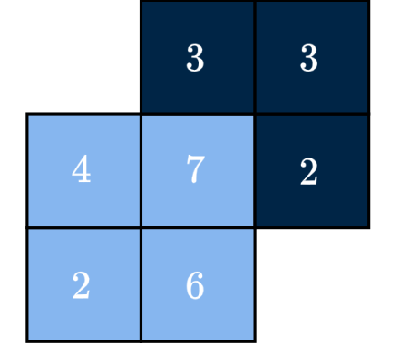
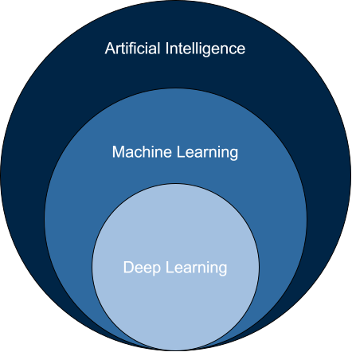
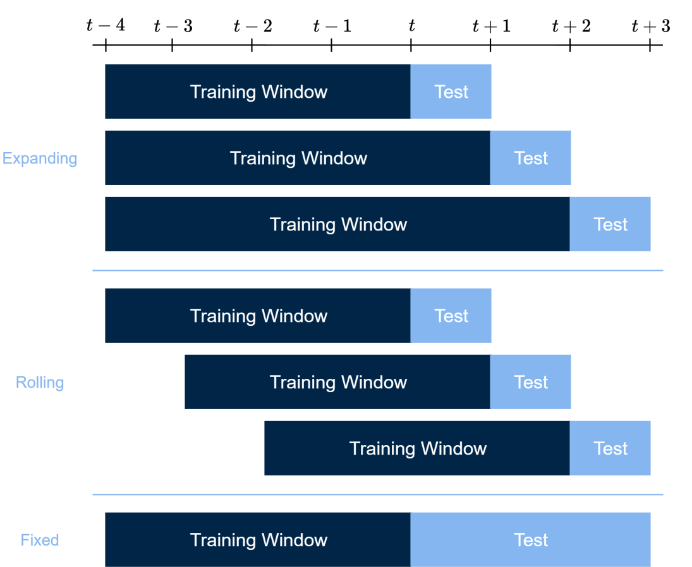
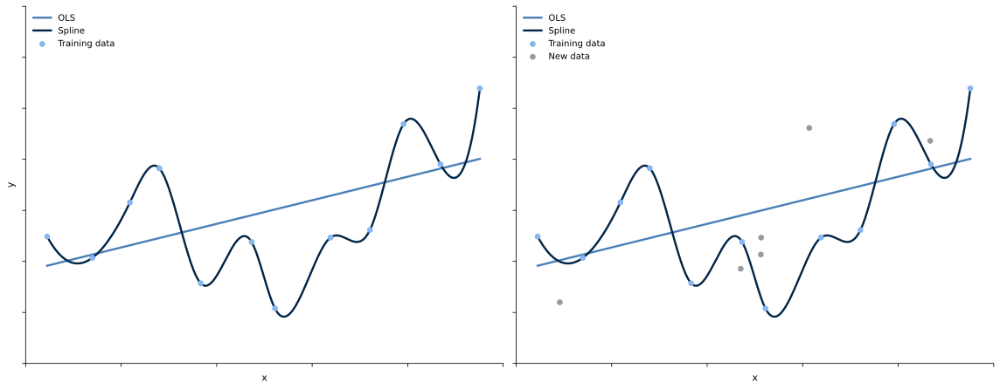
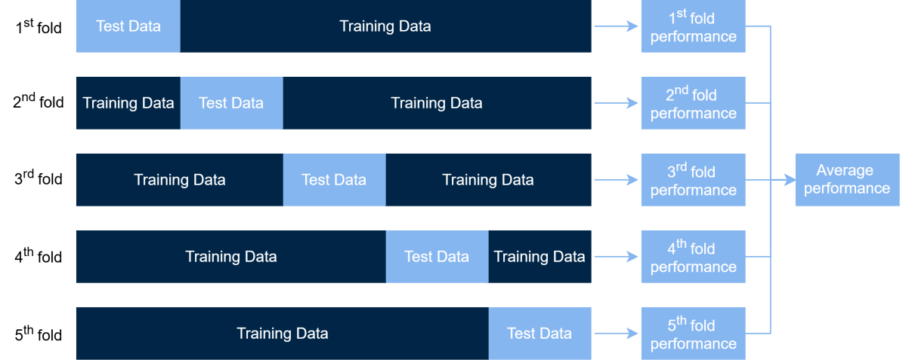
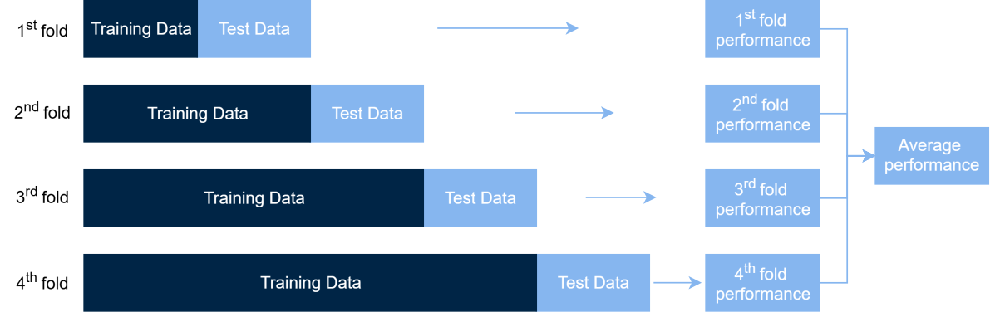

# Introduction {.divider}

## Today's lecture

::: {.overview}
::: {.ov-row}
::: {.ov-label}
NumPy
:::
::: {.ov-desc}
Arrays, operations, subsetting, NaNs, random draws, lagging
:::
:::
::: {.ov-row}
::: {.ov-label}
pandas
:::
::: {.ov-desc}
Data frames, wrangling, time-indexed data
:::
:::
::: {.ov-row}
::: {.ov-label}
Machine learning
:::
::: {.ov-desc}
Definitions and scope
:::
:::
::: {.ov-row}
::: {.ov-label}
The forecasting pipeline
:::
::: {.ov-desc}
Data wrangling, model selection, evaluation
:::
:::
::: {.ov-row}
::: {.ov-label}
scikit-learn
:::
::: {.ov-desc}
OLS, LASSO, ridge, random forests
:::
:::
:::

## Practical Information
- Colab is used in course instruction and exercises
- Exam must be handed in notebook (.ipynb) format
- Slides are .html-based to facilitate embedded code
  - Allows you to manipulate code directly in the slides
- .pdf versions are available on Brightspace
- "Up to you" slides provide small exercises

## Why Python?

Python is the programming language used in this course.

- Large array of libraries for **data wrangling** and **machine learning**
- (Nearly) exclusive language of deep learning
- Aligns with your prerequisite courses
- Favored in both academia and industry
- Free and open-source

::: {.notes}
While R is used for machine learning, Python is used (nearly) exclusively for deep learning implementations. Today: pandas and NumPy as work-horses for data wrangling, scikit-learn for all non-deep-learning modelling, PyTorch for deep learning (brief now; neural networks in two days).
:::

## The four libraries

::: {.cards}
::: {.card-box}
[NumPy]{.t}
[Arrays and numerical tasks]{.d}
:::
::: {.card-box}
[pandas]{.t}
[Data frames and wrangling]{.d}
:::
::: {.card-box}
[scikit-learn]{.t}
[All non-deep-learning models]{.d}
:::
::: {.card-box}
[PyTorch]{.t}
[Deep learning]{.d}
:::
:::

# NumPy -- Numerical Python {.divider}

## What is NumPy?

- Go-to library for numerical tasks -- mean, logs, etc.

Always import library with the standard alias,

```{pyodide}
import numpy as np
```

- Data is stored in **arrays**, say `arr`

Arrays general term for scalars, vectors, matrices and tensors:

$$
\texttt{arr}\in\mathbb{R},\quad \texttt{arr}\in\mathbb{R}^n,\quad \texttt{arr}\in\mathbb{R}^{n\times m},\quad \texttt{arr}\in\mathbb{R}^{m_1\times \cdots \times m_n}
$$

::: {.callout-tip}
If not quite confident in ***scalars, vectors, matrices, tensors***, refer to the [Maths Brush-Up](https://github.com/nvilladsen/fml-2026/blob/main/Maths_Brush_Up__FwML.pdf)
:::

## Defining arrays

```{pyodide}
arrS = np.array(4)                       # scalar
arrV = np.array([4, 7, 2])               # vector
arrM = np.array([[4, 7, 2],
                 [6, 3, 3]])             # matrix
arrT = np.array([[[4, 7], 
                  [2, 6]],  
                  [[3, 3], 
                  [1, 2]]])              # tensor
print(arrS.shape, arrV.shape, arrM.shape, arrT.shape)
```

::: {.notes}
Print of dimension arrT is number of matrices, number of rows, number of columns
:::

## Visualizing a 3D array
::: {.figblock}
::: {.fig-title}
:::



::: {.fig-src}
Associated NumPy code: `arrT = np.array([[[4, 7], [2, 6]], [[3, 3], [1, 2]]])`
:::
:::

## Functions on arrays

```{pyodide}
print(np.var(arrV))
print(np.log(arrM).round(2))
print(np.sum(arrT, axis=0))
```

::: {.notes}
axis=0 means summing across indices: [1, 1] + [1, 1] for each matrix, [1, 2] + [1, 2] for each matrix (positions), etc.
res[j,k] = arrT[0,j,k] + arrT[1,j,k] for each j, k.
axis=1 means summing across matrices: [1, 1] + [1, 2] for each matrix, [1, 2] + [1, 3] for each matrix (positions), etc.
res[i,k] = arrT[i,0,k] + arrT[i,1,k] for each i, k.
axis=2 means summing across the third dimension: [1, 1, 1] + [1, 1, 2] for each position, etc.
res[i,j] = arrT[i,j,0] + arrT[i,j,1] for each i, j.
So in this example, axis=0 is [[7, 10], [3, 8]], axis=1 is [[6, 9], [4, 8]], and axis=2 is [[11, 5], [4, 5]].
:::

## Subsetting I

- Important to get right -- differs from pandas
- Python is **zero-indexed**: `arr[row, col]`

```{pyodide}
print(arrM[1, 2])   # one element
print(arrM[0, :])   # first row
print(arrM[:, 0])   # first column
```

## Subsetting II

```{pyodide}
rng = np.random.default_rng(160923)
arrM = rng.standard_normal((100, 100))
arrMSub = arrM[0:20, 39:56]   # rows 1-20, columns 40-56
print(arrMSub.shape)
```

::: {.keypoint}
Zero-indexed, but the end of the interval is **excluded**
:::

## Subsetting III

```{pyodide}
RowIdx = np.array([2, 4, 7])
ColIdx = np.array([9, 12, 56])
print(arrM[RowIdx, ColIdx].shape)          # wrong
print(arrM[np.ix_(RowIdx, ColIdx)].shape)
```

::: {.keypoint}
`arrM[RowIdx, ColIdx]` is wrong -- it only selects three data points
:::

## Subsetting IV

`::2` $\to$ every second index

```{pyodide}
arrMEven = arrM[::2, :]
print(arrM.shape, arrMEven.shape)
```

## Up to you: subsetting

Extract from `arrM`, every 4th column of rows 20 to 60 in increments of 3.

```{pyodide}
#| exercise: ex_subset
#| setup: true
import numpy as np
rng = np.random.default_rng(160923)
arrM = rng.standard_normal((100, 100))
```

```{pyodide}
#| exercise: ex_subset
arrMSub = ...
print(arrMSub.shape)
```

```{pyodide}
#| exercise: ex_subset
#| solution: true
arrMSub = arrM[19:60:3, ::4]
print(arrMSub.shape)
```

## NaNs I 

Adding a number of NaNs to `arrM`,

```{pyodide}
rng = np.random.default_rng(160923)
arrMNaN = arrM.copy()
arrMNaN[rng.integers(0, 100, 10), rng.integers(0, 100, 10)] = np.nan
print(np.isnan(arrMNaN).sum())
```

::: {.notes}
print(np.isnan(arrMNaN)) returns a matrix the same shape as arrMNaN, with True where NaNs are present and False otherwise
.sum() counts the NaNs, .any() returns True if any True is present in np.isnan(arrMNaN), False otherwise
:::

::: {.keypoint}
`.copy()` is required -- otherwise the original receives NaNs too
:::

## NaNs II

Determine whether NaNs are present and their count,
```{pyodide}
arrMNaN0 = np.isnan(arrMNaN).any()      # Any NaNs present?
arrMNaNCount = np.isnan(arrMNaN).sum()  # Count the number of NaNs present
print(f"NaNs present: {arrMNaN0}. Count: {arrMNaNCount}")
```

Replacing NaNs with values of your choice, e.g., 0 or the mean (for time series, compute the mean on training data only),
```{pyodide}
arrMNaN0s = np.where(np.isnan(arrMNaN), 0, arrMNaN) # Replace NaNs with 0
arrMNaNMean = np.where(np.isnan(arrMNaN), np.nanmean(arrMNaN), arrMNaN) # Replace NaNs with mean
```

## NaNs III - Drop Rows Containing NaNs
```{pyodide}
arrMNoNaN   = arrMNaN[~np.isnan(arrMNaN).any(axis=1)] # Drop rows containing NaNs
print(arrMNaN.shape, arrMNoNaN.shape)
```

1. `np.isnan(arrMNaN)` identifies the NaNs
2. `.any(axis=1)` -- identifies any NaN in each row
3. `~` flips the selection to retain the clean rows

::: {.keypoint}
Manipulating NaNs is dangerous -- choose replacement values with care
:::

## Reshaping 1D arrays

A 1D array has shape `(n,)`, but many functions expect a 2D array. 

Reshape it into a column vector with `.reshape(-1, 1)`:

```{pyodide}
rng = np.random.default_rng(160923)
arrX = rng.standard_normal(100)
print(arrX.shape)

arrX = arrX.reshape(-1, 1)
print(arrX.shape)
```

::: {.keypoint}
`-1` is a placeholder to let Python determine the number of rows, while `1` dictates one column
:::

# Pandas -- Panel Data {.divider}

## What are pandas?

- Developed to match `R`'s (at the time) superior data handling
- Stores data in **data frames**. A single variable would be stored in a **series**
- Series are most commonly used for univariate targets, i.e., $y$s

Always import library with the standard alias,

```{pyodide}
import pandas as pd
```

## Preliminary: Dictionaries

- Store **key–value pairs**: values are looked up by their key
- Defined with curly braces, `{key: value}`

```{pyodide}
scores = {"OLS": 0.52, "LASSO": 0.48, "Ridge": 0.49}
print(scores["LASSO"])                # look up by key
scores["Random forest"] = 0.41        # add a new key
print(scores)
```

::: {.keypoint}
Keys are unique, usually strings; values can be anything. 
We will use dictionaries for data frames, hyperparameter grids and collecting results
:::

::: {.notes}
Contrast with NumPy arrays, which are indexed by position. A dictionary is indexed by name.
:::

## Series

Defining a pandas series,

```{pyodide}
dfS = pd.Series([4, 7, 2], index=["A", "B", "C"])
dfS
```

The left-most column is the index; it can also be set afterwards with `dfS.index=[...]`.

## Data frames

Defining a pandas data frame,

```{pyodide}
df = pd.DataFrame({
    "Gaussian": rng.standard_normal(5),
    "Integer": rng.integers(0, 10, 5)
})
df
```

## Reading in data

`pd.read_csv()` is an important function. Example with `ToyData.csv`.

```{pyodide}
df = pd.read_csv("ToyData.csv")
print(df.shape)
df.head()
```

::: {.notes}
.head() also works for pd.Series
:::

## Inspecting types

```{pyodide}
df["Date"] = pd.to_datetime(df["Date"])
print(df.dtypes)
```

::: {.keypoint}
Also useful: `df.describe()`, `df.isna().sum()`, `df.dropna()`
:::

## Subsetting I
Different than NumPy - use `.iloc` for index-based subsetting, `.loc` for label-based subsetting
```{pyodide}
df.iloc[:3, :2].head(3)   # by position, rows 0-2 and columns 0-1, as in NumPy
```

```{pyodide}
df.loc[:2, ["Description", "Amount"]]   # rows labelled 0-2, columns by location
```

## Subsetting II

Subsetting by name alone (cannot subset rows simultaneously),
```{pyodide}
df[["Amount", "Quantity"]].head(3)   # by name
```

Subsetting by condition,

```{pyodide}
df[df["Amount"] > 50].head(3)
```

## Writing to .csv

Data, results, and similar datasets can be written to file with `to_csv()`,

```python
df.to_csv("UpdToyData.csv", index=False)  
```

::: {.keypoint}
In the browser this only writes to a temporary file system -- run it in your own Notebook to save.
:::

# Machine Learning {.divider}

## Layers of Intelligence
::: {.figblock}
::: {.fig-title}
:::



::: {.fig-src}
Deep learning is a subset of machine learning, which in turn is a subset of artificial intelligence.
:::
:::

::: {.notes}
The IBM supercomputer, Deep Blue, defeated chess grandmaster Garry Kasparov -- in chess -- in 1997. No learning was applied, the rules of chess were hard-coded -- still AI.
:::

## Defining AI, Machine Learning, and Deep Learning
- Artificial intelligence is a programmed, possibly learned, set of rules
- Following Gu et al., 2020: The term **machine learning** encompasses:
  1. a diverse collection of high-dimensional models for statistical prediction, combined with
  2. so-called "regularization" methods for model selection and mitigation of overfit, and
  3. efficient algorithms for searching among a vast number of potential model specifications

- Following IBM, **deep learning** is a subset of machine learning driven by multilayered neural networks whose design is inspired by the structure of the human brain.


# The Forecasting Pipeline {.divider}

## The forecasting pipeline

::: {.overview}
::: {.ov-row-inline}
::: {.ov-label}
Pre-processing
:::
::: {.ov-desc}
Explore distributions, check for NaNs and outliers
:::
:::
::: {.ov-row-inline}
::: {.ov-label}
Lagging 
:::
::: {.ov-desc}
Construct predictors from past values only (time series forecasting only)
:::
:::
::: {.ov-row-inline}
::: {.ov-label}
Splitting
:::
::: {.ov-desc}
Reserve the test set before touching the data further
:::
:::
::: {.ov-row-inline}
::: {.ov-label}
Standardizing
:::
::: {.ov-desc}
Fit the scaler on train, apply to both data sets
:::
:::
::: {.ov-row-inline}
::: {.ov-label}
Tuning
:::
::: {.ov-desc}
Cross-validate hyperparameters on the training set
:::
:::
::: {.ov-row-inline}
::: {.ov-label}
Fitting
:::
::: {.ov-desc}
Fit the model on the training and validation sets
:::
:::
::: {.ov-row-inline}
::: {.ov-label}
Evaluating
:::
::: {.ov-desc}
Compare models on the held-out test set
:::
:::
:::

## The Forecasting Task

::: {.keypoint}

We distinguish between classification and regression, categorical and numerical targets

:::

::: {.compare}
::: {.compare-col}
::: {.cmp-title}
Classification
:::
- Categorical target
- Forecasting output: a class, or class probabilities
- Errors: correct/incorrect
- Metrics: accuracy, ...
:::
::: {.compare-col .cmp-alt}
::: {.cmp-title}
Regression
:::
- Numerical target
- Forecasting output: a continuous value
- Errors have a magnitude
- Metrics: MSE, MAE, $R^2$
:::
:::

## Data pre-processing

Before modelling always inspect the raw data.

```python
df.head()          # first rows
df.describe()      # distributional summary
df.isna().sum()    # count missing values per column
df.dtypes          # check that data types are as expected
```

- Data pre-processing is essential in the forecasting pipeline 
- We cannot dedicate due time to all the important steps in this lecture
- Instead, refer to Chapter III of [Applied Predictive Modeling](https://vuquangnguyen2016.wordpress.com/wp-content/uploads/2018/03/applied-predictive-modeling-max-kuhn-kjell-johnson_1518.pdf) (Kuhn & Johnson, 2013)
- Code translated from `R` to Python is available in the [Colab Notebook "Chapter III"](https://colab.research.google.com/drive/1JX1COhoV31ilURxSnsbkHhulN0A3FCxh#scrollTo=cxueYY40abwP)

## Lagging

Prediction $Y_t \sim f(X_{t-1})$ -- to avoid look-ahead bias we must **lag** the data.

```{pyodide}
rng = np.random.default_rng(160923)
arrV = rng.choice(10, size=10, replace=False)
arrX = arrV[:-1]   # X_{t-1}: drop final observation
arrY = arrV[1:]    # Y_t: drop first observation
print(arrY, arrX)
```

## Lagging in pandas

`shift(1)` moves every value one row down, so row $t$ holds the value of $t-1$. The first row has no predecessor and becomes `NaN`.

```{pyodide}
dfLag = pd.DataFrame({"x": [1, 2, 3, 4], "y": [1, 2, 3, 4]})
dfLag["x_lag"] = dfLag["x"].shift(1)   # x_lag in row t is x in row t-1
print(dfLag)                           # row 0: x_lag is NaN

dfLag = dfLag.dropna().reset_index(drop=True)   # drop the NaN row, renumber from 0
print(dfLag)                                    # 3 rows: (11, 2, 10), (12, 3, 11), (13, 4, 12)
```

::: {.keypoint}
`dropna()` removes the first row of `X`, so remove the first row of `y` too (`y.iloc[1:]`). Otherwise `X` and `y` are misaligned
:::

## Sample splitting

In cross-sectional modeling, data is usually split randomly

In **time series modeling**, data must be split chronologically, such as,

```python
from sklearn.model_selection import train_test_split

X_train, X_test, y_train, y_test = train_test_split(
    X, y, train_size=0.8, shuffle=False
)
```

::: {.notes}
sklearn is the scikit-learn library which we will get to in more detail in a few slides.
:::

## Standardization

$Z$-score standardization: Subtract the mean, divide by the standard deviation,

$$
z_t = \frac{x_t - \hat{\mu}}{\hat{\sigma}}
$$

::: {.compare}
::: {.compare-col}
<!-- ### Standardize -->
::: {.cmp-title}
Standardize
:::
- Shrinkage models (LASSO, ridge)
  - Penalty not scale-invariant
- Neural networks -- gradient descent is sensitive to scale
:::
::: {.compare-col .cmp-alt}
<!-- ### Standardization unnecessary -->
::: {.cmp-title}
Standardization unnecessary
:::
- Tree-based models (random forests)
  - Splits are scale-invariant
- OLS -- coefficients scale with data
:::
:::

::: {.keypoint}

Fit the scaler on **training data only**, then apply to the test set. 
Fitting on the full sample leaks future distributional information.

:::

## Standardization: code

```python
from sklearn.preprocessing import StandardScaler

scaler = StandardScaler()

X_train_sc = scaler.fit_transform(X_train)  # fit + transform on train
X_test_sc = scaler.transform(X_test)        # transform only on test
```

::: {.keypoint}

`fit_transform` on the test set would leak future distributional information into the model

:::


## Expanding and rolling windows

For out-of-sample evaluation across many periods:

::: {.compare}
::: {.compare-col}
<!-- ### Expanding window -->
::: {.cmp-title}
Expanding window
:::
- Train on $t = 1, \ldots, \tau$; evaluate at $\tau + 1$
- Increment $\tau$, repeat
- Growing training set
- Standard in the forecasting literature
:::
::: {.compare-col .cmp-alt}
<!-- ### Rolling window -->
::: {.cmp-title}
Rolling window
:::
- Train on $t = \tau - W + 1, \ldots, \tau$; evaluate at $\tau + 1$
- Fixed window size $W$
- Discards old data
- Useful when structural breaks are suspected
:::
:::

## Difference Between Rolling and Expanding Windows
::: {.figblock}
::: {.fig-title}
:::



::: {.fig-src}
From top to bottom: expanding window, rolling window, and fixed window forecasting structures.
:::
:::

## The bias-variance trade-off

The expected squared forecast error decomposes as

$$\mathrm{E}\!\left[(\hat{y} - y)^2\right] = \underbrace{\mathrm{Bias}^2}_{\text{underfitting}} + \underbrace{\mathrm{Variance}}_{\text{overfitting}} + \underbrace{\sigma^2}_{\text{irreducible}}$$

::: {.compare}
::: {.compare-col}
<!-- ### High bias -->
::: {.cmp-title}
High bias
:::
- Model too simple
- Misses systematic patterns
- Train error $\approx$ test error, both large
:::
::: {.compare-col .cmp-alt}
<!-- ### High variance -->
::: {.cmp-title}
High variance
:::
- Model too complex/flexible
- Model fits to noise rather than signal
- Train error $\ll$ test error
:::
:::

Models applying regularization, e.g., LASSO, ridge, and random forests, trade off bias for variance

## Bias-variance trade-off, an extreme example
::: {.figblock}
::: {.fig-title}
:::



::: {.fig-src}
MSE OLS (left-hand side): 0.262, MSE spline (left-hand side): 0.000, MSE OLS (right-hand side): 0.209, MSE spline (right-hand side): 0.394.
:::
:::

## Hyperparameter tuning

Hyperparameters (e.g. $\alpha$ in LASSO) must be selected to optimize out-of-sample performance

::: {.keypoint}
**Never** select hyperparameters by performance on the test set -- generates forward-looking bias
:::

Standard approach: **time-series cross-validation** on the training set. 

Stylized code:

```python
from sklearn.model_selection import TimeSeriesSplit, GridSearchCV

tscv   = TimeSeriesSplit(n_splits=5)
params = {"alpha": [0.001, 0.01, 0.1, 1.0]}
search = GridSearchCV(Lasso(), params, cv=tscv,
                      scoring="neg_mean_squared_error")
search.fit(X_train, y_train)
print(search.best_params_)
```

# scikit-learn {.divider}

::: {.notes}
From SciPy (Scientific Python) and toolkit (scikit) and then learn
:::

## What is scikit-learn?

Primary modeling library covering a large array of models:

- Linear regression (OLS)
- Shrinkage models (LASSO, ridge, elastic net)
- Tree-based models (CART, random forests, gradient boosting...)
- Support vector regression/machines

::: {.keypoint}
Advantage: unified and streamlined syntax -- `fit` $\to$ `predict` $\to$ `score` ($R^2$)
:::

## Importing

Generally import functions as needed, e.g., 

```{pyodide}
from sklearn.linear_model import LinearRegression, Lasso, Ridge, LassoCV, RidgeCV
from sklearn.model_selection import train_test_split
from sklearn.model_selection import TimeSeriesSplit
from sklearn.ensemble import RandomForestRegressor
from sklearn.preprocessing import StandardScaler
from sklearn.metrics import mean_squared_error
```

::: {.keypoint}
Importing from `sklearn` and not `scikit-learn`
:::

## Practical example: forecasting US inflation
Quarterly US macroeconomic data, 1959Q1--2009Q3, from `statsmodels`
- Target: inflation, `infl`
- Predictors: lagged inflation, unemployment and the T-bill rate

```{pyodide}
import statsmodels.api as sm
df = sm.datasets.macrodata.load_pandas().data
series = df[["infl", "unemp", "tbilrate"]].to_numpy()   # (T, 3)
infl = series[:, 0]
print(series.shape)
df[["infl", "unemp", "tbilrate"]].head(3)
```

## Data pre-processing
```{pyodide}
X = series[:-1]     # (infl, unemp, tbilrate) at t-1: drop final observation
y = infl[1:]        # infl at t: drop first observation
features = ["infl_lag", "unemp_lag", "tbilrate_lag"]

X_train, X_test, y_train, y_test = train_test_split(
    X, y, test_size=0.2, shuffle=False
)
print(f"Train dimension X: {X_train.shape}, Test dimension X: {X_test.shape}")
print(f"Train dimension y: {y_train.shape}, Test dimension y: {y_test.shape}")

scaler     = StandardScaler()
X_train_sc = scaler.fit_transform(X_train)
X_test_sc  = scaler.transform(X_test)
```

## Visualizing the target

```{pyodide}
import matplotlib.pyplot as plt
fig, ax = plt.subplots(figsize=(8, 2.5))
ax.plot(range(len(y)), y, lw=0.8, color="#86b6ef")
ax.axvline(len(y_train), color="#002546", lw=1, ls="--", label="Train / test split")
ax.set_xlabel("quarter $t$"); ax.set_ylabel("Inflation, %"); ax.legend(fontsize=9)
plt.tight_layout(); plt.show()
```

## The random walk benchmark

- The random walk is commonly used as benchmark in time series forecasting
- Predicts the next value as the previous value,
$$ \hat{y}_t = y_{t-1} $$

::: {.pull-up}
:::

```{pyodide}
y_pred_rw = np.concatenate([[y_train[-1]], y_test[:-1]])   # previous value
mse_rw = mean_squared_error(y_test, y_pred_rw)
print(f"Random walk   MSE = {mse_rw:.4f}")
```

::: {.notes}
The random walk is a very commonly used benchmark in financial and macroeconomic forecasting
:::

## Ordinary Least Squares (OLS)
- **The** linear regression model
- Determine how the target variable $y$ depends on a set of exogeneous variable, $X$
  - Compute the coefficients, $\beta$, by minimizing the sum of squared residuals,
$$\hat\beta_{\text{OLS}} = \underset{\beta}{\arg\min} \sum_{t = 1}^T(y_t - \hat{y}_t)^2$$

::: {.keypoint}
Intuitive and interpretable, yet possibly challenged by heteroskedasticity and serial correlation
:::

- Estimator,

::: {style="margin-top: -1em"}
$$\hat{\beta} = (X^\top X)^{-1} X^\top y$$
:::

## Linear regression (OLS) in code
```{pyodide}
ols = LinearRegression()
ols.fit(X_train, y_train)
y_pred_ols = ols.predict(X_test)
mse_ols    = mean_squared_error(y_test, y_pred_ols)
print(f"OLS MSE = {mse_ols:.4f}")
```

## OLS in scikit-learn
Implementation on previous slide follows the standard scikit-learn blueprint,

::: {.overview}
::: {.ov-row}
::: {.ov-label}
Initialize model object
:::
::: {.ov-desc}
`ols = LinearRegression()` assigns a linear regression object to `ols`
:::
:::
::: {.ov-row}
::: {.ov-label}
Fitting/training model
:::
::: {.ov-desc}
`.fit(X_train, y_train)` accepts the training covariates and target and fits/trains the model on this data
:::
:::
::: {.ov-row}
::: {.ov-label}
Predicting
:::
::: {.ov-desc}
`.predict(X_test)` uses the out-of-sample covariates to generate predictions of the target 
:::
:::
::: {.ov-row}
::: {.ov-label}
Evaluating
:::
::: {.ov-desc}
`mean_squared_error(y_test, y_pred_ols)` compares the $\hat{y}$ to the true values, $y$
:::
:::
:::

::: {.keypoint}
The mean squared error is a common metric for model evaluation, but others exist as well
:::

## Up to you: OLS

Compute the **in-sample** fitted values from `ols` and the training MSE. 
The relevant data and fitted model are stored in the memory already, so you can proceed from here.

```{pyodide}
#| exercise: ex_ols
#| setup: true
import numpy as np
import pandas as pd
from sklearn.linear_model import LinearRegression
from sklearn.metrics import mean_squared_error
from sklearn.preprocessing import StandardScaler
from sklearn.model_selection import train_test_split

import statsmodels.api as sm
df = sm.datasets.macrodata.load_pandas().data
series = df[["infl", "unemp", "tbilrate"]].to_numpy()
X, y = series[:-1], series[1:, 0]
X_train, X_test, y_train, y_test = train_test_split(
    X, y, test_size=0.2, shuffle=False
)
scaler = StandardScaler()
X_train_sc = scaler.fit_transform(X_train)
X_test_sc  = scaler.transform(X_test)
ols = LinearRegression().fit(X_train_sc, y_train)
```

```{pyodide}
#| exercise: ex_ols
y_fitted  = ...
mse_train = ...
print(f"Train MSE = {mse_train:.4f}")
```

```{pyodide}
#| exercise: ex_ols
#| solution: true
y_fitted  = ols.predict(X_train_sc)
mse_train = mean_squared_error(y_train, y_fitted)
print(f"Train MSE = {mse_train:.4f}")
```

## Penalized regression models
- Three primary penalized regression models; i) LASSO, ii) ridge, and iii) elastic net
- Each adds a penalty term to the ordinary least squares (OLS) objective function of $\ell_1$, $\ell_2$, and both, respectively. LASSO and ridge are defined as,

<!-- $$\begin{aligned}
\text{LASSO:}&\quad \hat\beta_{\text{LASSO}} &= \underset{\beta}{\arg\min} \sum_{t=1}^T(y_t - \hat{y}_t)^2 + \alpha \sum_{j=1}^p |\beta_j|\\
\text{Ridge:}&\quad \hat\beta_{\text{Ridge}} &= \underset{\beta}{\arg\min} \sum_{t=1}^T(y_t - \hat{y}_t)^2 + \lambda \sum_{j=1}^p \beta_j^2
\end{aligned}$$ -->

$$\begin{aligned}
\text{LASSO:}\quad \hat\beta_{\text{LASSO}} &= \underset{\beta}{\arg\min} \sum_{t=1}^T(y_t - \hat{y}_t)^2 + \alpha \sum_{j=1}^p |\beta_j|\\
\text{Ridge:}\quad \hat\beta_{\text{Ridge}} &= \underset{\beta}{\arg\min} \sum_{t=1}^T(y_t - \hat{y}_t)^2 + \lambda \sum_{j=1}^p \beta_j^2
\end{aligned}$$

- The LASSO is a variable selection method, as, by virtue of the $\ell_1$ penalty, coefficients can be set to exactly zero

::: {.keypoint}
Penalized regression models trade off bias for variance relative to OLS
:::

::: {.notes}
- Three primary penalized regression models; i) LASSO, ii) ridge, and iii) elastic net
- Each adds a penalty term to the ordinary least squares (OLS) objective function of $\ell_1$, $\ell_2$, and both, respectively
- The Least Absolute Shrinkage and Selection Operator (LASSO) penalizes according to the absolute value of the coefficients, the $\ell_1$ penalty
- This makes the LASSO a variable selection method, as it can set coefficients exactly to zero
- Ridge penalizes according to the squared value of the coefficients, the $\ell_2$ penalty
- Elastic net combines the two penalties, $\ell_1$ and $\ell_2$, in a convex combination

- Under regularity conditions, OLS is unbiased, but it can have high variance, especially in high-dimensional settings (many predictors)
- Penalized regression handles high dimensionality well, but are fundamentally biased estimators
- We trade off bias for variance
:::

## Non-optimized LASSO and Ridge
```{pyodide}
lasso = Lasso(alpha=0.05).fit(X_train_sc, y_train)
ridge = Ridge(alpha=1.0).fit(X_train_sc, y_train)

y_pred_lasso = lasso.predict(X_test_sc)
y_pred_ridge = ridge.predict(X_test_sc)

mse_lasso    = mean_squared_error(y_test, y_pred_lasso)
mse_ridge    = mean_squared_error(y_test, y_pred_ridge)
print(f"LASSO MSE = {mse_lasso:.4f}")
print(f"Ridge MSE = {mse_ridge:.4f}")
```

## Cross-Sectional Cross-Validation
::: {.figblock}
::: {.fig-title}
:::



::: {.fig-src}
Cross-sectional cross-validation depicted for a 5-fold split.
:::
:::

## Time Series Cross-Validation
::: {.figblock}
::: {.fig-title}
:::



::: {.fig-src}
Time series cross-validation depicted for a 4-fold split.
:::
:::

## Cross-validated LASSO and Ridge
```{pyodide}
lasso = LassoCV(cv=TimeSeriesSplit()).fit(X_train_sc, y_train)
ridge = RidgeCV(cv=TimeSeriesSplit()).fit(X_train_sc, y_train)

y_pred_lasso = lasso.predict(X_test_sc)
y_pred_ridge = ridge.predict(X_test_sc)

mse_lasso    = mean_squared_error(y_test, y_pred_lasso)
mse_ridge    = mean_squared_error(y_test, y_pred_ridge)
print(f"LASSO alpha = {lasso.alpha_:.4f},  MSE = {mse_lasso:.4f}")
print(f"Ridge alpha = {ridge.alpha_:.4f},  MSE = {mse_ridge:.4f}")
```

::: {.keypoint}
The scaler is fitted before CV, so the validation folds influence it slightly
:::

## LASSO: variable selection
```{pyodide}
pd.Series(lasso.coef_, index=features).round(3)
```

::: {.keypoint}
With only three predictors there is little to select -- LASSO mainly shrinks the coefficients
:::

## Random Forests
```{pyodide}
rf = RandomForestRegressor(n_estimators=200, max_depth=4, random_state=160923)
rf.fit(X_train, y_train)
y_pred_rf = rf.predict(X_test)
mse_rf    = mean_squared_error(y_test, y_pred_rf)
print(f"Random forest   MSE = {mse_rf:.4f}")
```

::: {.keypoint}
Note: Random forests is scale equivariant -- no standardization required
:::

## Comparing Results
```{pyodide}
results = {
    "RW":            mse_rw,
    "OLS":           mse_ols,
    "LASSO":         mse_lasso,
    "Ridge":         mse_ridge,
    "Random forest": mse_rf,
}
for name, mse in results.items():
    print(f"{name:20s}  MSE = {mse:.4f}")
```