# Introduction {.divider}

```{=html}
<style>
.reveal .slides .list-gap li {
  margin-top: 0 !important;
  margin-bottom: 0 !important;
  padding-bottom: var(--gap, 0.5em) !important;
}
.reveal .slides .list-gap li p { margin: 0 !important; }
.reveal .bp .flow-label { margin: 0.5em 0 0.2em; }
.reveal .bp .flow { margin: 0.4em 0; }
.reveal .bp .math.display { margin: 0.4em 0; }
.reveal .bp p { margin: 0.4em 0; }
.reveal .rank-note { font-size: 0.5em; color: #141413; }
</style>
```

```{=html}
<script>
(function () {
  function centre(section) {
    var s = Reveal.getScale();
    var sr = section.getBoundingClientRect();
    section.querySelectorAll('ol ul li > p > span.math.display').forEach(function (m) {
      var p = m.parentElement;
      p.style.marginLeft = '0px';
      p.style.width = 'auto';
      var pr = p.getBoundingClientRect();
      p.style.marginLeft = (-(pr.left - sr.left) / s) + 'px';
      p.style.width = (sr.width / s) + 'px';
    });
  }
  function run() {
    var c = Reveal.getCurrentSlide();
    if (c) centre(c);
  }
  window.addEventListener('load', function () {
    Reveal.on('ready', run);
    Reveal.on('slidechanged', run);
    run();
  });
})();
</script>
```

## Today

:::: {.overview}
::: {.ov-row-inline}
::: {.ov-label}
Brains and history
:::
::: {.ov-desc}
From biological neurons to the renaissance of neural networks
:::
:::
::: {.ov-row-inline}
::: {.ov-label}
Anatomy of a network
:::
::: {.ov-desc}
Layers, activations, and the forecast
:::
:::
::: {.ov-row-inline}
::: {.ov-label}
Training
:::
::: {.ov-desc}
Objective, optimization, backpropagation
:::
:::
::: {.ov-row-inline}
::: {.ov-label}
Regularization
:::
::: {.ov-desc}
Dropout, penalties, and early stopping
:::
:::
::: {.ov-row-inline}
::: {.ov-label}
Implementation
:::
::: {.ov-desc}
The PyTorch pipeline, from data to evaluation
:::
:::
::: {.ov-row-inline}
::: {.ov-label}
Beyond feed-forward neural networks
:::
::: {.ov-desc}
CNNs, LSTMs, and Transformers
:::
:::
::::

## Why PyTorch? 

**PyTorch** is the deep learning framework of this course

:::: {.statband}
::: {.stat}
[40.5% vs. 34.7%]{.stat-big}
[Job postings (PyTorch vs. TF)]{.stat-label}
:::
::: {.stat}
[248,163 vs. 17,342]{.stat-big}
[Hugging Face models (PyTorch vs. TF)]{.stat-label}
:::
::: {.stat}
[86.2M vs. 16.7M]{.stat-big}
[PyPI downloads (PyTorch vs. TF), (Aug 2026)]{.stat-label}
:::
::::

::: {.figblock}
::: {.fig-src}
Sources: Huntr (Jul 2026); Second Talent (2026)
:::
:::

- **Tutorials**

::: {.keypoint}
PyTorch is the framework of instruction, but you are free to use TensorFlow
:::

# Neural Networks are Inspired by Brains {.divider}

## A Neural Network of the Brain of a Mouse I

::: {.figblock .fb-brain .fb-w75}
::: {.fig-title}
Extract from 1 mm³ of Mouse Brain
:::


::: {.fig-src}
Source: MICrONS Explorer Render, Daniel Berger & MICrONS Explorer Consortium Team. Google Research and Harvard University.
:::
:::

## A Neural Network of the Brain of a Mouse II

::: {.figblock .fb-brain}
::: {.fig-title}
Extract from 1 mm³ of Mouse Brain — Closer Look
:::


::: {.fig-src}
Source: MICrONS Explorer Render, Daniel Berger & MICrONS Explorer Consortium Team. Google Research and Harvard University.

:::
:::

## A Neural Network of the Brain of a Mouse III

::: {.figblock .fb-brain}
::: {.fig-title}
Extract from 1 mm³ of Mouse Brain — Even Closer Look
:::


::: {.fig-src}
Source: MICrONS Explorer Render, Daniel Berger & MICrONS Explorer Consortium Team. Google Research and Harvard University. 

[Explore the network yourself.](https://www.microns-explorer.org/cortical-mm3){target="_blank"}
:::
:::

## A Neuron I

::: {.figblock}
::: {.fig-title}
A Biological Neuron
:::

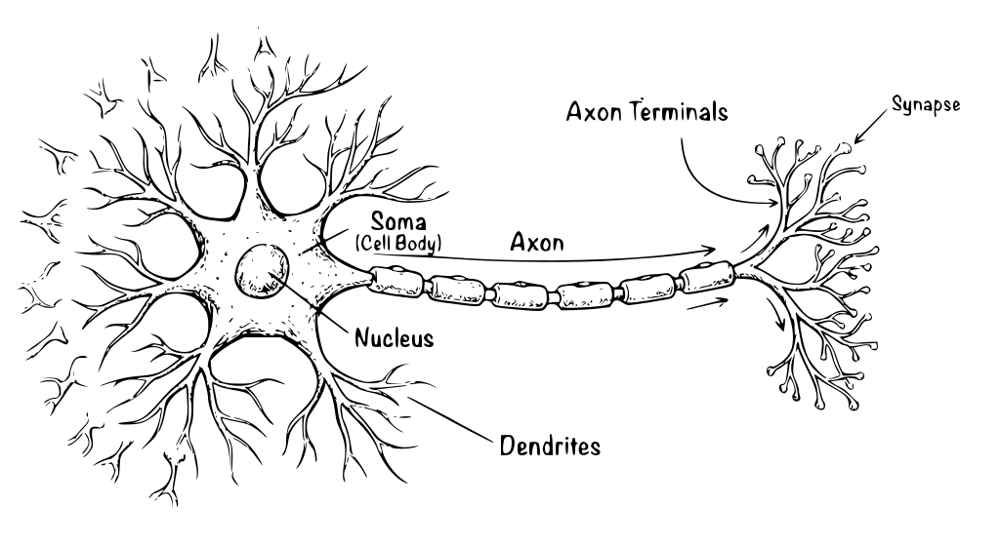

::: {.fig-src}
:::
:::

::: {.notes}
- Dendrites: receive signals (inputs)
- Soma: sums the inputs and decides whether to fire (weighted sum + activation)
- Nucleus: holds the DNA and keeps the cell running; not part of the signalling
- Axon: carries the signal away from the soma (output)
- Axon terminals: release the signal to the next neuron
- Synapse: the junction between neurons; its strength is what learning changes (weights)
:::

## A Neuron II

::: {.figblock}
::: {.fig-title}
Artificial Analogue to Neuron
:::

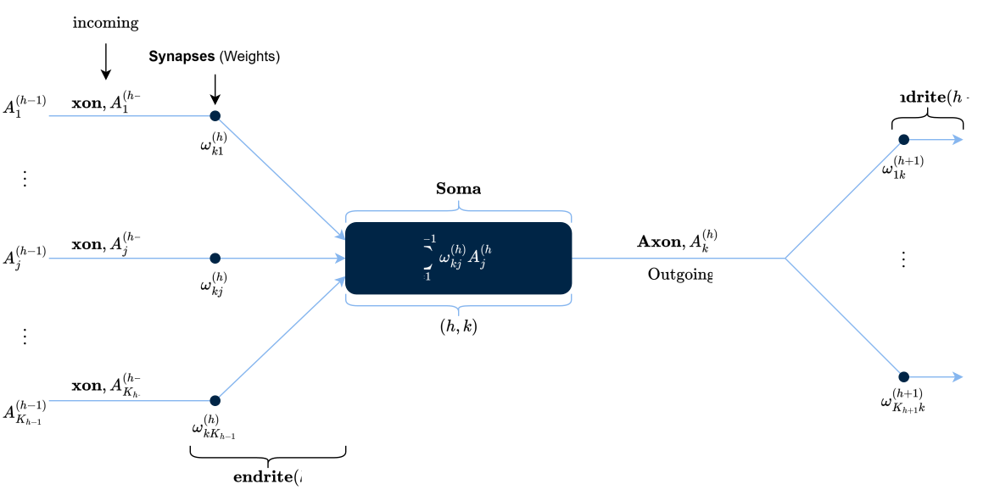

::: {.fig-src}
:::
:::

## The Neurological Network

::: {.figblock}
::: {.fig-title}
:::

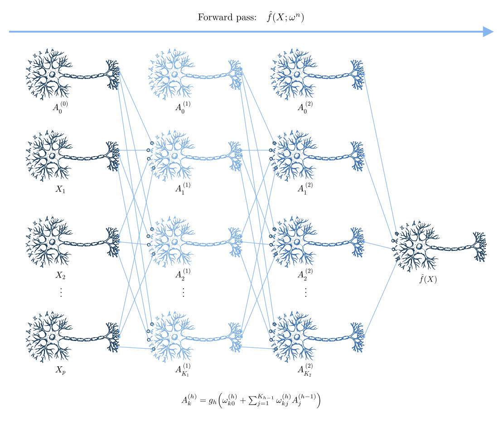

::: {.fig-src}
:::
:::

## The Artificial Network

::: {.figblock}
::: {.fig-title}
:::

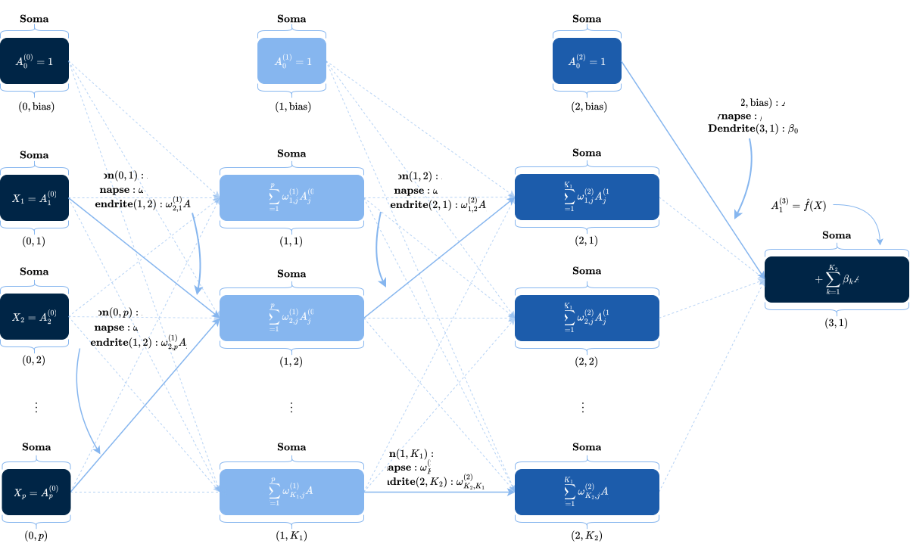

::: {.fig-src}
:::
:::

## Neural Networks are Supported by...

:::: {.cards .cards-sm}
::: {.card-box}
[Computational Power]{.t}
[Exponentially growing computing power, GPUs]{.d}
:::
::: {.card-box}
[Backpropagation]{.t}
[Efficient gradient computation for deep networks]{.d}
:::
::: {.card-box}
[Pre-trained Models]{.t}
[Including custom tuning]{.d}
:::
::: {.card-box}
[Frameworks]{.t}
[PyTorch, TensorFlow, and similar]{.d}
:::
::::

::: {.keypoint}
Next challenge: Physical limits of silicon-based chips reached. 

  Possible solution: quantum computing
:::

# Neural Networks {.divider}

## Forecasting US Inflation: Benchmarks vs. a Neural Network

US quarterly inflation, test sample (last 15% of quarters)

```{=html}
<table class="bars">
<thead><tr><th>Forecast</th><th colspan="2">Test MSE</th></tr></thead>
<tbody>
<tr><td>Random walk</td><td class="bt" style="--w:99.3%"></td><td class="bv">13.8971</td></tr>
<tr><td>OLS</td><td class="bt" style="--w:70.9%"></td><td class="bv">9.9284</td></tr>
<tr><td>LASSO</td><td class="bt" style="--w:67.9%"></td><td class="bv">9.5005</td></tr>
<tr><td>Ridge</td><td class="bt" style="--w:68.6%"></td><td class="bv">9.5995</td></tr>
<tr><td>Random forest</td><td class="bt" style="--w:71.1%"></td><td class="bv">9.9475</td></tr>
<tr><td>Feedforward neural network - basic</td><td class="bt" style="--w:77.6%"></td><td class="bv">10.8601</td></tr>
</tbody>
</table>
```

::: {.keypoint}
Today: how do we construct and train this network?
:::

## A Neural Network

::: {.figblock}
::: {.fig-title}
A Neural Network
:::

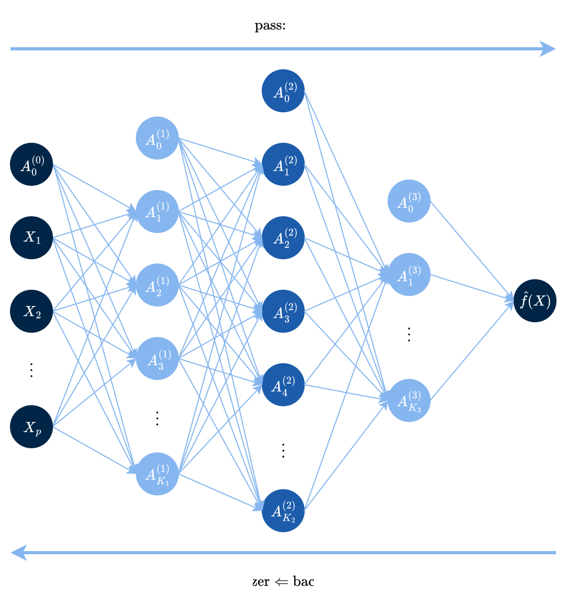

::: {.fig-src}
:::
:::

## The Layers of a Neural Network

Layers are indexed by $h$, $h = 0, \ldots, H+1$. There are $K_h$ **neurons** in each layer $h$, with **activations** $A_k^{(h)}$

:::: {.triad}
::: {.triad-card}
[One input layer]{.tc-tag}

[$h = 0$]{.tc-title}

The neurons are the $p$ input features, $\mathbf{X} = (X_1, X_2, \ldots, X_p)$

$A_j^{(0)} = X_j$, $\quad j = 1,\ldots,p$
:::
::: {.triad-card .tc-light}
[$H$ hidden layers]{.tc-tag}

[$h = 1, \ldots, H$]{.tc-title}

Essential computations here
:::
::: {.triad-card .tc-amber}
[One output layer]{.tc-tag}

[$h = H+1$]{.tc-title}

Produces the forecast
:::
::::

## The Hidden Layers

The essential computations occur in the **hidden** layers ($h = 1,...,H$), with activations $A_k^{(h)}$, weights $\omega_{kj}^{(h)}$, biases $\omega_{k0}^{(h)}$, and activation functions $g_h$,

$$A_k^{(h)} = g_h\left(\omega_{k0}^{(h)}+\sum_{j=1}^{K_{h-1}}\omega_{kj}^{(h)}A_j^{(h-1)}\right), \qquad k = 1,...,K_h$$

:::: {.triad .cols-2}
::: {.triad-card}
[Weighted sum]{.tc-tag}

Weights times the activations of the previous layer
:::
::: {.triad-card .tc-light}
[Activation function]{.tc-tag}

$g_h$ introduces non-linearity to layer $h$
:::
::::

## The First Hidden Layer

The first hidden layer is a special case, with $K_0 = p$ and $A_j^{(0)} = X_j$,

$$A_k^{(1)} = g_1\left(\omega_{k0}^{(1)}+\sum_{j=1}^{p}\omega_{kj}^{(1)}X_j\right), \qquad k = 1,...,K_1$$

## Forecasts
In the regression task, the **output** layer ($h = H+1$) produces forecasts, with weights $\beta_k$ and intercept $\beta_0$,
$$f(\mathbf{X}) = \beta_0 + \sum_{k = 1}^{K_H}\beta_k A_k^{(H)}$$

Evaluating in the activations of the last hidden layer, 

$$f(\mathbf{X}) = \beta_0 + \sum_{k = 1}^{K_H}\beta_k\, g_H\left(\omega_{k0}^{(H)}+\sum_{j=1}^{K_{H-1}}\omega_{kj}^{(H)}A_j^{(H-1)}\right)$$

## Similarity to Neurons Revisited

::: {.figblock}
::: {.fig-title}
Artificial Analogue to Neuron
:::


::: {.fig-src}
:::
:::

# Implementation {.divider}

## The Blueprint
:::: {.steplist}
::: {.step-row}
::: {.step-num}
1
:::
::: {.step-title}
Data
:::
::: {.step-desc}
Target variable and predictors
:::
:::
::: {.step-row}
::: {.step-num}
2
:::
::: {.step-title}
Split and scale
:::
::: {.step-desc}
Chronological training, validation and test split, standardization fitted on the training sample only
:::
:::
::: {.step-row}
::: {.step-num}
3
:::
::: {.step-title}
DataLoaders
:::
::: {.step-desc}
Tensors in mini-batches
:::
:::
::: {.step-row}
::: {.step-num}
4
:::
::: {.step-title}
Model
:::
::: {.step-desc}
An `nn.Module` defining the architecture
:::
:::
::: {.step-row}
::: {.step-num}
5
:::
::: {.step-title}
Ingredients
:::
::: {.step-desc}
Objective, optimizer, regularization, loss
:::
:::
::: {.step-row}
::: {.step-num}
6
:::
::: {.step-title}
Training loop
:::
::: {.step-desc}
Training and validation over epochs
:::
:::
::: {.step-row}
::: {.step-num}
7
:::
::: {.step-title}
Evaluation
:::
::: {.step-desc}
Out-of-sample accuracy measures on the test sample
:::
:::
::::

## Preliminaries
Importing libraries and selecting device 

```{pyodide}
import copy
import time
import numpy as np
import statsmodels.api as sm
from sklearn.preprocessing import StandardScaler
from sklearn.linear_model import LinearRegression
from sklearn.model_selection import train_test_split

# import torch
# import torch.nn as nn
# import torch.nn.functional as F
# from torch.utils.data import TensorDataset, DataLoader

# device = torch.device("cuda" if torch.cuda.is_available() else "cpu")
```

## Empirical Data
US quarterly macro data 1959Q1-2009Q3 (no missing values).

```{pyodide}
df = sm.datasets.macrodata.load_pandas().data.iloc[1:] # No inflation in the first quarter
features = df[["infl", "unemp", "tbilrate"]].to_numpy()   # (T, 3)
infl = features[:, 0]
```

Lagging features: inflation, unemployment and the T-bill rate at time $t$ are used to predict inflation at time $t+1$,

```{pyodide}
X = features[:-1]
target = infl[1:].reshape(-1, 1)
```

## Temporally Conscious Data Splitting

Chronological split (shuffle=False) to preserve temporal order (split: 70:15:15)

:::: {.splitbar}
::: {.sb-train style="flex: 70"}
Train (70%)
:::
::: {.sb-val style="flex: 15"}
Validation (15%)
:::
::: {.sb-test style="flex: 15"}
Test (15%)
:::
::::

```{pyodide}
X_train, X_tmp, y_train, y_tmp = train_test_split(X, target, train_size=0.7, shuffle=False)
X_val, X_test, y_val, y_test = train_test_split(X_tmp, y_tmp, train_size=0.5, shuffle=False)

print(f"Train: {X_train.shape}, Validation: {X_val.shape}, Test: {X_test.shape}")
```

## Standardization
Standardization, fitting on the training sample only,

```{pyodide}
X_scaler = StandardScaler()
y_scaler = StandardScaler()

X_train = X_scaler.fit_transform(X_train)
X_val = X_scaler.transform(X_val)
X_test = X_scaler.transform(X_test)

y_train = y_scaler.fit_transform(y_train)
y_val = y_scaler.transform(y_val)
y_test = y_scaler.transform(y_test)
```

## Tensors

:::: {.flow}
::: {.fn-navy}
NumPy array
:::
::: {.fn}
`torch.Tensor`
:::
::: {.fn}
`TensorDataset`
:::
::: {.fn}
`DataLoader`
:::
::::

The input data is converted to the format that PyTorch expects/receives,

```{pyodide}
#| autorun: false
#| runbutton: false
#| startover: false
X_train = torch.from_numpy(X_train).float().to(device)
X_val = torch.from_numpy(X_val).float().to(device)
X_test = torch.from_numpy(X_test).float().to(device)
y_train = torch.from_numpy(y_train).float().to(device)
y_val = torch.from_numpy(y_val).float().to(device)
y_test = torch.from_numpy(y_test).float().to(device)
```

## Constructing DataLoaders

This is incredibly efficient for large or specialized datasets,

```{pyodide}
#| autorun: false
#| runbutton: false
#| startover: false
dfTrain = TensorDataset(X_train, y_train)
dfVal = TensorDataset(X_val, y_val)
dfTest = TensorDataset(X_test, y_test)

lTrain = DataLoader(dfTrain, batch_size=32, shuffle=True)
lVal = DataLoader(dfVal, batch_size=32, shuffle=False)
lTest = DataLoader(dfTest, batch_size=32, shuffle=False)
```

::: {.notes}
A standard network has no memory between days, so shuffling can’t remove time information. It only gives better batches.
:::

## The Simple Neural Network I

```{pyodide}
#| autorun: false
#| runbutton: false
#| startover: false
class NN(nn.Module):
    def __init__(self, n_in, n_hidden1=16, n_hidden2=8):
        super(NN, self).__init__()
        self.fc1 = nn.Linear(n_in, n_hidden1)
        self.fc2 = nn.Linear(n_hidden1, n_hidden2)
        self.fc3 = nn.Linear(n_hidden2, 1)

    def forward(self, x):
        x = F.relu(self.fc1(x))
        x = F.relu(self.fc2(x))
        x = self.fc3(x)

        return x
```

Parameters are passed after `self` (here `n_in`, `n_hidden1` and `n_hidden2`)

::: {.notes}
A class is a blueprint for building an object that bundles its own parameters with the functions that use them. 
In PyTorch, the model is a class that inherits from nn.Module: __init__ creates the layers (the parameters), and forward describes how data flows through them. 
"self" just means ‘this model’, so self.layer1 is a layer that belongs to it. 
The class is called model (here NN), and calling model(x) runs the forward pass. (i.e. here model = NN(...) is an instance of it)
:::

## The Simple Neural Network II

PyTorch neural networks are defined as subclasses of `nn.Module`

:::: {.flow}
::: {.fn-navy}
Input
[`n_in` features]{.fn-sub}
:::
::: {.fn}
`fc1` + ReLU
[`n_hidden1` neurons]{.fn-sub}
:::
::: {.fn}
`fc2` + ReLU
[`n_hidden2` neurons]{.fn-sub}
:::
::: {.fn-amber}
`fc3`
[1 output]{.fn-sub}
:::
::::

- `n_in` is the number of input features, `n_hidden1` and `n_hidden2` are the numbers of neurons in the first and second hidden layer
- The network on the previous slide has two hidden layers

## Non-Linear Activation Functions

Introduce non-linearity, allowing the model to learn complex patterns

::: {.act-table}
| Function | Map | Definition |
|:----------------------------|:-------------------------:|:--------------------------:|
| **ReLU** (Rectified Linear Unit)<br>[most prevalent today]{.small} | $f: \mathbb{R} \to [0, \infty)$ | $f(x) = \max\{0, x\}$ |
| **tanh** (hyperbolic tangent) | $\text{tanh}: \mathbb{R} \to (-1, 1)$ | $\text{tanh}(x) = \dfrac{e^x - e^{-x}}{e^x + e^{-x}}$ |
| **sigmoid** | $\sigma: \mathbb{R} \to (0, 1)$ | $\sigma(x) = \dfrac{1}{1 + e^{-x}}$ |
:::

::: {.pull-up}
:::

[Sigmoid: The first activation function]{.flow-label .fl-lg}

:::: {.triad .cols-2 .strip}
::: {.triad-card}
$\sigma(x) \approx 0$: the neuron does not fire
:::
::: {.triad-card}
$\sigma(x) \approx 1$: the neuron fires $\Rightarrow$ the neuron contributes to the output of the network
:::
::::

## Activation Functions and Their Derivatives

::: {.figblock}
::: {.fig-title}
ReLU, tanh and Sigmoid with Their Derivatives
:::

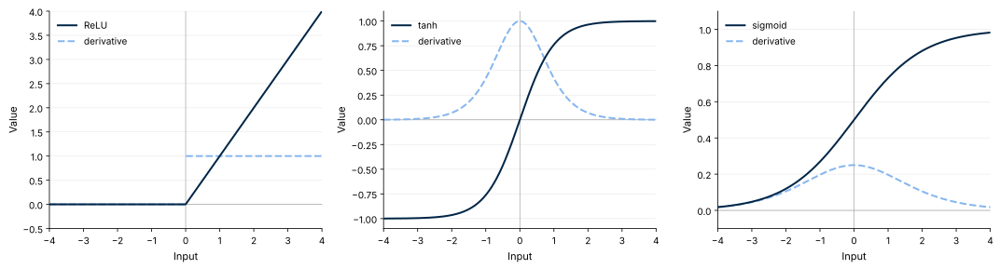

::: {.fig-src}
ReLU: $g'(x) = 0$ for $x < 0$, $g'(x) = 1$ for $x > 0$. tanh: $g'(x) = 1 - \tanh^2(x)$. sigmoid: $g'(x) = \sigma(x)(1 - \sigma(x))$.
:::
:::

::: {.keypoint}
The derivative $g'$ enters every backpropagation step (coming up).

Note: the sigmoid derivative is maximized at $x = 0 \to \sigma'(x) = 0.25$ -- risk of vanishing gradients
:::

## Specifying the Activation Function

Specifying the activation function in the forward pass,

```{pyodide}
#| autorun: false
#| runbutton: false
#| startover: false
x = F.relu(self.fc1(x))
```

Alternatives: `torch.tanh(self.fc1(x))`, `torch.sigmoid(self.fc1(x))`

## Up to you: Activation Functions

The vanishing gradient problem pertains to the maximum of the sigmoid derivative being 0.25. A product of many such derivatives will with high likelihood approach zero. 

Using the derivative functions of the ReLU and sigmoid activation functions, `d_sigmoid` and `d_relu`, compute the product of each evaluated at $x = 1$, ten times (the vector `np.full(10, 1.0)`).

```{pyodide}
#| exercise: ex_vg
#| setup: true
import numpy as np
def d_sigmoid(z):
    s = 1 / (1 + np.exp(-z))
    return s * (1 - s)
def d_relu(z):
    return (z > 0).astype(float)
```

```{pyodide}
#| exercise: ex_vg
#| autorun: false
x = np.full(10, 1.0)
prod_sig  = ...
prod_relu = ...
print(f"Sigmoid: {prod_sig:.1e} | ReLU: {prod_relu:.1e}")
```

```{pyodide}
#| exercise: ex_vg
#| solution: true
x = np.full(10, 1.0)
prod_sig  = np.prod(d_sigmoid(x))
prod_relu = np.prod(d_relu(x))
print(f"Sigmoid: {prod_sig:.1e} | ReLU: {prod_relu:.1e}")
```

## Training a Neural Network I 
::: {.figblock}
::: {.fig-title}
xkcd \#1838
:::

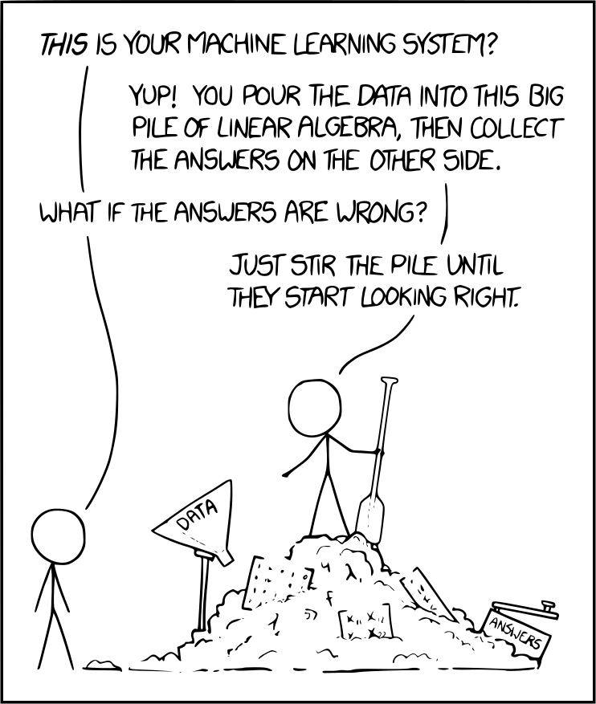

::: {.fig-src}
Source: Randall Munroe, [https://xkcd.com/1838/](https://xkcd.com/1838/), CC BY-NC 2.5.
:::
:::

## Training a Neural Network II
We give this example in the $h = 1$ case, 

$$f(\mathbf{X}) = \beta_0 + \sum_{k = 1}^{K_1} \beta_k A_k^{(1)} = \beta_0 + \sum_{k = 1}^{K_1}\beta_k g_1\left(\omega_{k0}^{(1)}+\sum_{j=1}^p\omega_{kj}^{(1)}X_j \right)$$

The parameters to be estimated are,

:::: {.triad .cols-2}
::: {.triad-card}
[Output layer]{.tc-tag}

$\boldsymbol{\beta} = \beta_0, \beta_1, \ldots, \beta_{K_1}$
:::
::: {.triad-card .tc-light}
[Hidden layer]{.tc-tag}

$\boldsymbol{\omega}^{(1)} = \omega_{kj}^{(1)}$ for $k = 1, \ldots, K_1$ and $j = 0, \ldots, p$
:::
::::

Stack the parameters into a vector: $\theta = (\boldsymbol{\beta}, \boldsymbol{\omega}^{(1)})$

## Objective Function

We assume a squared loss function to estimate parameters $\theta$.

For a single-hidden-layer network ($H=1$), the model forecast for observation $i$ is,

$$ f_\theta(x_i) = \beta_0 + \sum_{k = 1}^{K_1}\beta_k g_1\left(\omega_{k0}^{(1)}+\sum_{j=1}^p\omega_{kj}^{(1)}x_{ij} \right) $$

Vectorising the parameters into $\theta$, we minimize the objective function $R(\theta)$:

$$ \min_\theta \{R(\theta)\}, \quad R(\theta) = \frac12\sum_{i = 1}^n(y_i - f_\theta(x_i))^2 $$

::: {.notes}
The factor 1/2 cancels the 2 from differentiating the square. nn.MSELoss averages instead of summing and has no 1/2. This rescales the gradient by a constant, which the step size absorbs.
:::

## Numerical Optimization I {.compact}

:::: {.flow}
::: {.fn-navy}
Non-convex and high-dimensional problem
[no closed form, no analytical solution]{.fn-sub}
:::
::: {.fn}
Numerical optimization
[gradient descent is a common algorithm]{.fn-sub}
:::
::: {.fn-amber}
Too heavy computationally
[stochastic gradient descent (SGD) is used instead]{.fn-sub}
:::
::::

SGD uses only a small batch of data to compute the gradient

## Numerical Optimization II --- Gradient Descent
- Given a differentiable function $f: \mathbb{R}^p\to \mathbb{R}$ to be minimized with respect to the vector $\mathbf{\theta}\in\mathbb{R}^p$ and step size $s$,

1. Initialize with some starting value $\mathbf{\theta}^\ast_{(0)}$
2. Then, for each iteration, $i$,

   - Compute the gradient at $\mathbf{\theta}_{(i)}^\ast$, i.e.,

     $$ \nabla f(\mathbf{\theta}_{(i)}^\ast) = \frac{\partial f(\mathbf{\theta})}{\partial \mathbf{\theta}}\Bigg\vert_{\mathbf{\theta} = \mathbf{\theta}_{(i)}^\ast}$$

   - Set $\mathbf{\theta}_{(i+1)}^\ast = \mathbf{\theta}_{(i)}^\ast - s\nabla f(\mathbf{\theta}_{(i)}^\ast)$

3. Repeat until convergence. A convergence criterion could be a sufficiently small gradient, $\lVert \nabla f(\theta_{(i)}^\ast)\rVert <\varepsilon$ with a maximal number of iterations at which the algorithm terminates -- and reports non-convergence. 

## Numerical Optimization III --- Stochastic Gradient Descent

- Given $f(\mathbf{\theta}) = \frac{1}{n}\sum_{j=1}^{n} f_j(\mathbf{\theta})$ to be minimized with respect to $\mathbf{\theta}\in\mathbb{R}^p$ and step sizes $s_i$,

1. Initialize with some starting value $\mathbf{\theta}^\ast_{(0)}$
2. Then, for each iteration, $i$,

   - Draw an index $j_i$ uniformly at random from $\{1,\dots,n\}$ and compute the gradient of that single term at $\mathbf{\theta}_{(i)}^\ast$, i.e.,

     $$ \nabla f_{j_i}(\mathbf{\theta}_{(i)}^\ast) = \frac{\partial f_{j_i}(\mathbf{\theta})}{\partial \mathbf{\theta}}\Bigg\vert_{\mathbf{\theta} = \mathbf{\theta}_{(i)}^\ast}$$

   - Set $\mathbf{\theta}_{(i+1)}^\ast = \mathbf{\theta}_{(i)}^\ast - s_i\nabla f_{j_i}(\mathbf{\theta}_{(i)}^\ast)$


3. Repeat until convergence

::: {.notes}
- The choice of step sizes $s_i$ is crucial for the convergence of the algorithm.
- Common choices include a decreasing step size, or an adaptive step size, both according to some schedule. A constant stepsize is also possible, but may lead to oscillations around the minimum. Here a decay is often added later. Another option is halving the step decay after a certain number of epochs. The reason is that each step of SGD uses the gradient of a single randomly chosen term, a noisy approximation of the true gradient. With a constant step size, the iterations never settle down and keep bouncing around the minimum due to this noise. Shrinking the step size over time dampens this noise, allowing for convergence. 

$f_j(\theta)$ is the loss of one observation, and so $f(\theta)$ is the average loss of all observations. Due to $j_i$ being uniform, the single-term gradient is correct on average, an unbiased estimate, at a fraction of the cost.
:::

## Numerical Optimization IV

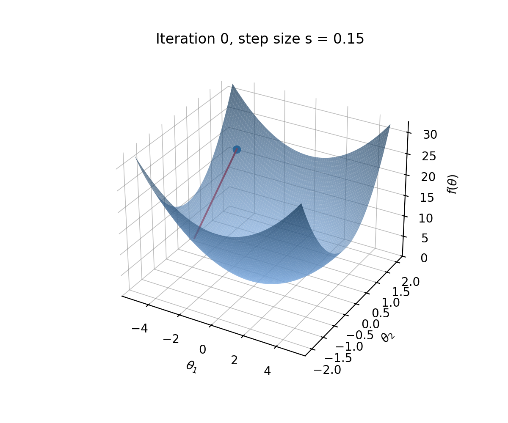{fig-align="center" height="480"}


## Backpropagation I

:::: {.triad .cols-2}
::: {.triad-card .tc-brick}
[The problem]{.tc-tag}

- The numerical optimization, even in the SGD case, has incredibly high computational overhead
- Weights require the chain rule to compute derivatives
:::
::: {.triad-card}
[The solution]{.tc-tag}

- Backpropagation is a recursive application of the chain rule to compute the gradient of the loss
- Therefore, backpropagation eases the computational burden of training
:::
::::

Each SGD step uses a mini-batch $B$ of observations (batch_size=32), so backpropagation computes the gradient of the batch-averaged loss rather than of a single $R_i$.

## Backpropagation II
Recall the objective,

$$ R(\theta) = \sum_{i = 1}^n R_i(\theta) = \frac12\sum_{i = 1}^n(y_i - f_\theta(x_i))^2$$

A sum, which means the gradient is a sum over the $n$ observations, so we need only consider one of these,

$$R_i(\theta) = \frac12\left(y_i - \beta_0- \sum_{k = 1}^{K_1}\beta_k g_1\left(\omega_{k0}+\sum_{j = 1}^p\omega_{kj}x_{ij}\right)\right)^2$$

::: {.notes}
The derivative of a sum is the sum of the derivatives.
:::

## Backpropagation III {.bp}

Let $z_{ik} = \omega_{k0} + \sum_{j = 1}^p\omega_{kj}x_{ij}\Rightarrow f_\theta(x_i) = \beta_0 + \sum_{k = 1}^{K_1}\beta_k g_1(z_{ik})$. Update $\beta_k$ in one training step,

::: {.flow-label}
Forward pass: compute the forecast and the loss
:::

:::: {.flow}
::: {.fn}
$\beta_k$
:::
::: {.fn}
$f_\theta(x_i)$
:::
::: {.fn-navy}
$R_i(\theta)$
:::
::::

::: {.flow-label}
Backward pass: multiply the derivatives (chain rule)
:::

:::: {.flow .back}
::: {.fn}
$\dfrac{\partial f_\theta(x_i)}{\partial \beta_k} = g_1(z_{ik})$
:::
::: {.fn}
$\dfrac{\partial R_i(\theta)}{\partial f_\theta(x_i)} = -(y_i - f_\theta(x_i))$
:::
::::

Computing the derivative w.r.t. $\beta_k$,

::: {.pull-up}
:::

$$
\begin{aligned}
\frac{\partial R_i(\theta)}{\partial \beta_k} &= \frac{\partial R_i(\theta)}{\partial f_\theta(x_i)} \cdot \frac{\partial f_\theta(x_i)}{\partial \beta_k} \\ &= -(y_i - f_\theta(x_i)) \cdot g_1(z_{ik})
\end{aligned}
$$

## Backpropagation IV {.bp}

Let $z_{ik} = \omega_{k0} + \sum_{j = 1}^p\omega_{kj}x_{ij}$. Update $\omega_{kj}$ in one training step,

::: {.flow-label}
Forward pass: compute the forecast and the loss
:::

:::: {.flow}
::: {.fn}
$\omega_{kj}$
:::
::: {.fn}
$z_{ik}$
:::
::: {.fn}
$g_1(z_{ik})$
:::
::: {.fn}
$f_\theta(x_i)$
:::
::: {.fn-navy}
$R_i(\theta)$
:::
::::

::: {.flow-label}
Backward pass: multiply the derivatives (chain rule)
:::

:::: {.flow .back}
::: {.fn}
$\dfrac{\partial z_{ik}}{\partial \omega_{kj}} = x_{ij}$
:::
::: {.fn}
$\dfrac{\partial g_1(z_{ik})}{\partial z_{ik}} = g'_1(z_{ik})$
:::
::: {.fn}
$\dfrac{\partial f_\theta(x_i)}{\partial g_1(z_{ik})} = \beta_k$
:::
::: {.fn}
$\dfrac{\partial R_i(\theta)}{\partial f_\theta(x_i)} = -(y_i - f_\theta(x_i))$
:::
::::

Computing the derivative w.r.t. $\omega_{kj}$,

::: {.pull-up}
:::

$$
\begin{aligned}
\frac{\partial R_i(\theta)}{\partial \omega_{kj}} &= \frac{\partial R_i(\theta)}{\partial f_\theta(x_i)} \cdot \frac{\partial f_\theta(x_i)}{\partial g_1(z_{ik})} \cdot \frac{\partial g_1(z_{ik})}{\partial z_{ik}} \cdot \frac{\partial z_{ik}}{\partial \omega_{kj}} \\ &= -(y_i - f_\theta(x_i)) \cdot \beta_k \cdot g'_1(z_{ik}) \cdot x_{ij}
\end{aligned}
$$

## Backpropagation V: Update Rules

The two derivatives form the basis for the update rules, with step size $s$ and one observation $i$ per step

:::: {.triad .cols-2 .big}
::: {.triad-card}
[Output weight]{.tc-tag}

$$
\begin{aligned}
\beta_k^{(t + 1)} &= \beta_k^{(t)} - s\,\frac{\partial R_i}{\partial \beta_k} \\
&= \beta_k^{(t)} + s\,(y_i - f_\theta(x_i))\,g_1(z_{ik})
\end{aligned}
$$
:::
::: {.triad-card}
[Hidden weight]{.tc-tag}

$$
\begin{aligned}
\omega_{kj}^{(t + 1)} &= \omega_{kj}^{(t)} - s\,\frac{\partial R_i}{\partial \omega_{kj}} \\
&= \omega_{kj}^{(t)} + s\,(y_i - f_\theta(x_i))\,\beta_k\,g'(z_{ik})\,x_{ij}
\end{aligned}
$$
:::
::::

- Both updates contain the forecast error $(y_i - f_\theta(x_i))$
- This error term is attributed to the parameters via the terms $g(z_{ik})$ and $\beta_k g'(z_{ik}) x_{ij}$

## Optimization Algorithms
::: {.keypoint}
Stochastic Gradient Descent is rarely used in practice today
:::

:::: {.triad}
::: {.triad-card .tc-light}
[Building block]{.tc-tag}

[RMSProp]{.tc-title}

Uses smaller steps for parameters with large recent gradients
:::
::: {.triad-card .tc-light}
[Building block]{.tc-tag}

[Momentum]{.tc-title}

Averages past gradients to smooth noise and speed up
:::
::: {.triad-card .tc-navy}
[Commonly preferred]{.tc-tag}

[ADAM]{.tc-title}

A combination of RMSProp and momentum (Kingma & Ba, 2014)
:::
::::

## Specifying the Optimizer

```{pyodide}
#| autorun: false
#| runbutton: false
#| startover: false
optimizer = torch.optim.Adam(model.parameters(), lr=0.001)
```

Common alternatives: `torch.optim.SGD`, `torch.optim.RMSprop`, `torch.optim.AdamW`

- `lr=0.001` is default for the `torch.optim.Adam` function.
- `model` is a name we specify for the neural network object, e.g., `model = NN(n_in=3)`

## Guards Against Overfitting

<!-- ## Guarding Against Overfitting -->
    
::: {.overview}
::: {.ov-row}
::: {.ov-label}
Dropout
:::
::: {.ov-desc}
Randomly sets neurons to zero in each training step
:::
:::
::: {.ov-row}
::: {.ov-label}
$\ell_1$ regularization
:::
::: {.ov-desc}
Penalizes the absolute value of the weights, favouring sparse networks
:::
:::
::: {.ov-row}
::: {.ov-label}
$\ell_2$ regularization (weight decay)
:::
::: {.ov-desc}
Shrinks the weights towards zero
:::
:::
::: {.ov-row}
::: {.ov-label}
Early stopping
:::
::: {.ov-desc}
Stops training when the validation loss no longer improves
:::
:::
:::

## Dropout

:::: {.columns}
::: {.column width="48%" .fs-sm}
- Dropout (Srivastava et al., 2014): `nn.Dropout(p)` is applied in every training step
- Each neuron in the layer is set to zero with probability $p$, e.g., $p = 0.5$
- Neurons are made more independent, so the network behaves like an average of many thinned networks (think bagged trees)
- Dropout is not applied in evaluation
:::
::: {.column width="52%"}

::: {.figblock}
::: {.fig-title}
Neural Network with Dropout = 0.5
:::

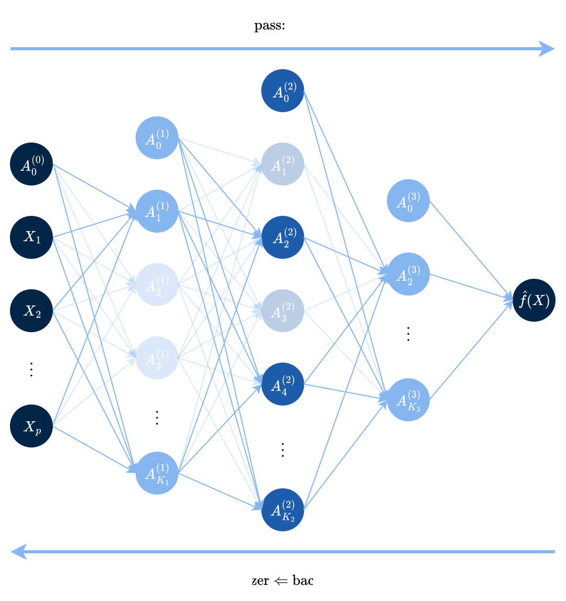

::: {.fig-src}
:::
:::
:::
::::

::: {.notes}
The dropped out units vary every mini-batch
:::

## Dropout in PyTorch {.th-slide}

Applying dropout to layer `fc1` with specified probability `p=0.5`

```{pyodide}
#| autorun: false
#| runbutton: false
#| startover: false
# in __init__
self.dropout = nn.Dropout(p=0.5)

# in forward
x = self.dropout(F.relu(self.fc1(x)))
```

```{=html}
<div class="th"><span class="th-arrow">↑</span><span class="th-line"></span><span class="th-ref" style="bottom:19.11%"><b>Basic NN</b></span><span class="th-dot" style="bottom:5.23%"></span><span class="th-val" style="bottom:5.23%">10.235</span></div>
```

## $\ell_1$ and $\ell_2$ Regularization

:::: {.compare}
::: {.compare-col}
[$\ell_1$: absolute value]{.cmp-title}

Penalizes the absolute value of the weights, favouring sparse networks, with penalty added to the loss,

$$\mathcal{L}(\omega) + \lambda\sum_{h,k,j}\left|\omega_{kj}^{(h)}\right|$$
:::
::: {.compare-col .cmp-alt}
[$\ell_2$: weight decay]{.cmp-title}

Weight decay ($\ell_2$) adds a penalty to the loss, shrinking the weights towards zero,

$$\mathcal{L}(\omega) + \frac{\lambda}{2}\sum_{h,k,j}\left(\omega_{kj}^{(h)}\right)^2$$
:::
::::

## $\ell_1$ Regularization in PyTorch {.th-slide}

```{pyodide}
#| autorun: false
#| runbutton: false
#| startover: false
l1_lambda = 0.0001

for inputs, targets in lTrain:
    ...
    loss = criterion(outputs, targets)
    loss = loss + l1_lambda * sum(param.abs().sum() for param in model.parameters())
```

```{=html}
<div class="th"><span class="th-arrow">↑</span><span class="th-line"></span><span class="th-ref" style="bottom:19.11%"><b>Basic NN</b></span><span class="th-dot" style="bottom:3.43%"></span><span class="th-val" style="bottom:3.43%">10.154</span></div>
```

## $\ell_2$ Regularization in PyTorch {.th-slide}

Weight decay is passed as an argument to the optimizer, e.g., `weight_decay=1e-4` in `Adam`,

```{pyodide}
#| autorun: false
#| runbutton: false
#| startover: false
optimizer = torch.optim.Adam(model.parameters(), lr=0.001, weight_decay=1e-4)
```

```{=html}
<div class="th"><span class="th-arrow">↑</span><span class="th-line"></span><span class="th-ref" style="bottom:19.11%"><b>Basic NN</b></span><span class="th-dot" style="bottom:3.33%"></span><span class="th-val" style="bottom:3.33%">10.150</span></div>
```

## Up to you: Penalties

Compute $\sum |\omega|$ (the $\ell_1$ term) and $\sum \omega^2$ (the $\ell_2$ term) for the weights $\omega = (0.5, -1, 2)$.

```{pyodide}
#| exercise: ex_pen
#| setup: true
import numpy as np
```

```{pyodide}
#| exercise: ex_pen
#| autorun: false
w = np.array([0.5, -1.0, 2.0])
l1 = ...
l2 = ...
print(f"L1 = {l1:.2f}, L2 = {l2:.2f}")
```

```{pyodide}
#| exercise: ex_pen
#| solution: true
w = np.array([0.5, -1.0, 2.0])
l1 = np.sum(np.abs(w))
l2 = np.sum(w ** 2)
print(f"L1 = {l1:.2f}, L2 = {l2:.2f}")
```

## Epochs

::: {.keypoint}
An epoch is a complete pass through the entire training dataset
:::

The training process is iterative and involves multiple **epochs**. The number of epochs can be 1) prespecified, 2) tuned, or 3) determined by early stopping

## Early Stopping I 

::: {.figblock}
::: {.fig-title}
Early Stopping
:::

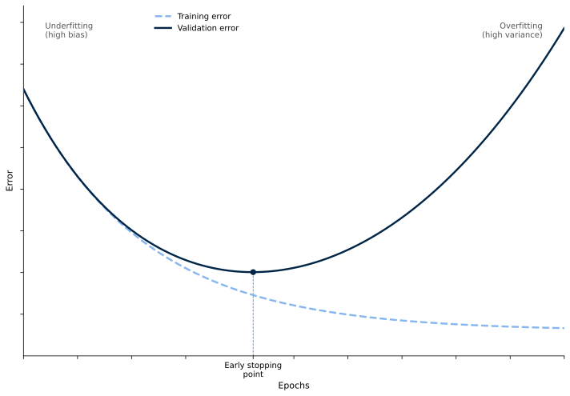

::: {.fig-src}
:::
:::

## Early Stopping II {.th-slide}

:::: {.flow}
::: {.fn-navy}
When the training accuracy keeps increasing, we continue training
:::
::: {.fn}
The validation accuracy, our ability to generalize, starts to decrease after a certain point
:::
::: {.fn-amber}
No improvement for #`patience` epochs: stop and restore the best model state
:::
::::

Early stopping adds a few lines to the training loop. Refer to Lecture 4 Exercises

```{=html}
<div class="th"><span class="th-arrow">↑</span><span class="th-line"></span><span class="th-ref" style="bottom:19.11%"><b>Basic NN</b></span><span class="th-dot" style="bottom:14.64%"></span><span class="th-val" style="bottom:14.64%">10.659</span></div>
```

## Loss Functions

We still consider only the regression task. Typical loss functions include,

:::: {.triad}
::: {.triad-card}
[`nn.MSELoss`]{.tc-title}

Squared error
:::
::: {.triad-card .tc-light}
[`nn.L1Loss`]{.tc-title}

Absolute error
:::
::: {.triad-card .tc-amber}
[`nn.HuberLoss`]{.tc-title}

Squared for small errors, absolute for large (Huber, 1964) -- remember for later
:::
::::

Example for the mean squared error,

```{pyodide}
#| autorun: false
#| runbutton: false
#| startover: false
criterion = nn.MSELoss()

for inputs, targets in lTrain:
    ...
    loss = criterion(outputs, targets)
```

We can write our own loss functions, but this is up to you if you wish to do so.

# Training in PyTorch {.divider}

## Initializing Training
- The model is initialized and moved to the appropriate device (CPU or GPU)
- The loss function and optimizer are specified
- The number of epochs is set to 20

```{pyodide}
#| autorun: false
#| runbutton: false
#| startover: false
model = NN(n_in=X_train.shape[1]).to(device)

criterion = nn.MSELoss()
optimizer = torch.optim.Adam(model.parameters(), lr=0.001)
n_epochs = 20
```

## One Training Step

::: {.overview}
::: {.ov-row}
::: {.ov-label}
1\. `optimizer.zero_grad()`
:::
::: {.ov-desc}
Reset the gradients
:::
:::
::: {.ov-row}
::: {.ov-label}
2\. `model(inputs)`
:::
::: {.ov-desc}
Forward pass: compute the forecasts
:::
:::
::: {.ov-row}
::: {.ov-label}
3\. `criterion(outputs, targets)`
:::
::: {.ov-desc}
Compute the loss
:::
:::
::: {.ov-row}
::: {.ov-label}
4\. `loss.backward()`
:::
::: {.ov-desc}
Backpropagation: compute the gradients
:::
:::
::: {.ov-row}
::: {.ov-label}
5\. `optimizer.step()`
:::
::: {.ov-desc}
Update the parameters
:::
:::
:::

## Main Training and Validation Loop I 
```{pyodide}
#| autorun: false
#| runbutton: false
#| startover: false
for epoch in range(n_epochs):
    model.train()
    for inputs, targets in lTrain:
        inputs, targets = inputs.to(device), targets.to(device)

        optimizer.zero_grad()
        outputs = model(inputs)
        loss = criterion(outputs, targets)
        loss.backward()

        optimizer.step()
  ...
# Continued on next slide
```

## Main Training and Validation Loop II
```{pyodide}
#| autorun: false
#| runbutton: false
#| startover: false
for epoch in range(n_epochs):
  ...
# Continued from previous slide
    model.eval()
    val_loss = 0.0
    with torch.no_grad():
        for inputs, targets in lVal:
            inputs, targets = inputs.to(device), targets.to(device)

            outputs = model(inputs)
            loss = criterion(outputs, targets)
            val_loss += loss.item() * inputs.size(0)

    val_loss /= len(lVal.dataset)
    print(f"Epoch {epoch + 1}: validation loss {val_loss:.4f}")
```

::: {.notes}
Normalizing the loss by the size of the batch, the number of observations in the batch. 

val_loss = (L_1*n_1 + L_2*n_2 + ... + L_B*n_B) / (n_1 + n_2 + ... + n_B)

or in sum form:

val_loss = sum_{i=1}^{B} (L_i * n_i) / sum_{i=1}^{B} n_i

L_i = mean loss of batch i
n_i = number of samples in batch i
B   = number of batches
:::

::: {.notes}
Validation for early stopping, hyperparameter tuning, and monitoring of convergence.
:::

## One Validation Step

::: {.overview}
::: {.ov-row}
::: {.ov-label}
1\. `model.eval()`
:::
::: {.ov-desc}
Switches to evaluation mode (leaving out dropout, batch normalization, etc.)
:::
:::
::: {.ov-row}
::: {.ov-label}
2\. `torch.no_grad()`
:::
::: {.ov-desc}
Disables gradient computations
:::
:::
::: {.ov-row}
::: {.ov-label}
3\. `model(inputs)`, `criterion(outputs, targets)`
:::
::: {.ov-desc}
Computes forecasts and loss
:::
:::
::: {.ov-row}
::: {.ov-label}
4\. `val_loss += loss.item() * inputs.size(0)`
:::
::: {.ov-desc}
Adds the batch's summed loss to `val_loss`
:::
:::
::: {.ov-row}
::: {.ov-label}
5\. `val_loss /= len(lVal.dataset)`
:::
::: {.ov-desc}
Divides `val_loss` by the number of validation observations to get the validation MSE
:::
:::
:::

## One Evaluation Pass

::: {.overview}
::: {.ov-row}
::: {.ov-label}
1\. `model.eval()` and `torch.no_grad()`
:::
::: {.ov-desc}
Switches to evaluation mode (leaving out dropout, batch normalization, etc.) and disables gradient computation
:::
:::
::: {.ov-row}
::: {.ov-label}
2\. `model(inputs)` over `lTest`
:::
::: {.ov-desc}
Computes the forecasts for the test sample
:::
:::
::: {.ov-row}
::: {.ov-label}
3\. `y_scaler.inverse_transform`
:::
::: {.ov-desc}
Transforms the forecasts and the ground truth back to the original scale
:::
:::
::: {.ov-row}
::: {.ov-label}
4\. Test MSE
:::
::: {.ov-desc}
Computes the mean squared error
:::
:::
::: {.ov-row}
::: {.ov-label}
5\. OOS $R^2$ vs. training mean
:::
::: {.ov-desc}
Computes the out-of-sample $R^2$ relative to the training-mean forecast
:::
:::
:::

## Model Evaluation
```{pyodide}
#| autorun: false
#| runbutton: false
#| startover: false
model.eval()
lPred = []

with torch.no_grad():
    for inputs, _ in lTest:
        lPred.append(model(inputs.to(device)).cpu().numpy())

forecasts = np.concatenate(lPred)
forecasts_unstd = y_scaler.inverse_transform(forecasts)
y_unstd = y_scaler.inverse_transform(y_test.cpu())

mse = np.mean((y_unstd - forecasts_unstd) ** 2)
# Benchmark: training-sample mean forecast
y_bench = y_scaler.inverse_transform(y_train.cpu()).mean()
r2_oos = 1 - np.sum((y_unstd - forecasts_unstd) ** 2) / np.sum((y_unstd - y_bench) ** 2)
print(f"Test MSE: {mse:.4f} | Test OOS R2 (vs. train mean): {r2_oos:.3f}")
```

## An Extended Pipeline (My Preferred Approach)

:::: {.triad}
::: {.triad-card}
[Reproducible]{.tc-title}

I set the seed for reproducibility
:::
::: {.triad-card .tc-light}
[Tracked]{.tc-title}

I store the training and validation losses, time the run, and keep running loss book-keeping for each epoch to keep track of the training process
:::
::: {.triad-card .tc-amber}
[Monitored]{.tc-title}

I print these losses at the end of each epoch to monitor convergence
:::
::::

## Limitations of Neural Networks

::: {.overview}
::: {.ov-row}
::: {.ov-label}
Jagged Intelligence
:::
::: {.ov-desc}
Models have incredible power, yet struggle with tasks like telling time ([Stanford 2026 AI Index Report](https://hai.stanford.edu/ai-index/2026-ai-index-report))
:::
:::
::: {.ov-row}
::: {.ov-label}
Black Box
:::
::: {.ov-desc}
Models are not interpretable with potentially harmful consequences
:::
:::
::: {.ov-row}
::: {.ov-label}
Data Hungry
:::
::: {.ov-desc}
Models require large amounts of data to train effectively, which may not be available in all domains
:::
:::
::: {.ov-row}
::: {.ov-label}
Computational overhead
:::
::: {.ov-desc}
Frequently requires GPUs, high memory, and long compute times
:::
:::
:::

# Beyond Feed-Forward Neural Networks {.divider}

## Broader Applications of Deep Learning

:::: {.triad}
::: {.triad-card}
[Computer vision]{.tc-tag}

[Convolutional Neural Networks]{.tc-title}
:::
::: {.triad-card .tc-light}
[Time series modelling]{.tc-tag}

[Recurrent Neural Networks, LSTMs, Transformers]{.tc-title}
:::
::: {.triad-card .tc-amber}
[Natural language processing]{.tc-tag}

[Transformers (!) $\to$ Large Language Models]{.tc-title}
:::
::::

::: {.keypoint}
Example: Computer vision for health care
:::

## Convolutional Neural Networks (CNNs)

- Developed for computer vision tasks (LeCun et al., 1998)
- The classic deep learning architecture for image recognition and classification
- Pipeline consists of convolutional and pooling operations

:::: {.flow}
::: {.fn-navy}
Image
:::
::: {.fn}
Convolution
:::
::: {.fn}
Activation
:::
::: {.fn}
Pooling
:::
::: {.fn-amber}
Prediction
:::
::::

## A Convolutional Neural Network Visualized

::: {.figblock}
::: {.fig-title}
:::

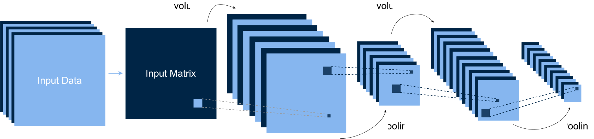

::: {.fig-src}
:::
:::

## The Convolutional Operation

::: {.figblock}
::: {.fig-title}
:::

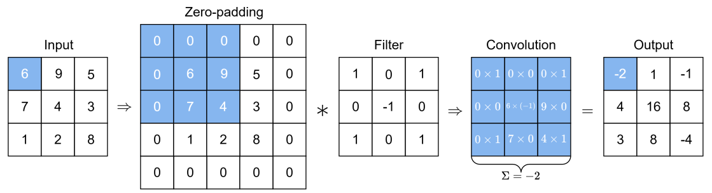

::: {.fig-src}
:::
:::

## Applying Activations and Pooling

::: {.figblock}
::: {.fig-title}
:::

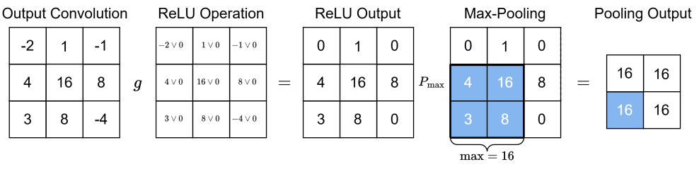

::: {.fig-src}
:::
:::

## A Stylized Example: Handwritten Digits {.compact}

Classic image dataset: 1,797 grayscale images of $8 \times 8$ pixels, showing the digits 0 to 9,

::: {.pull-up}
:::

```{pyodide}
from sklearn.datasets import load_digits
digits = load_digits()

print(f"Label examples: {digits.target[0:20]}")
print(digits.images[0].astype(int))
```

The CNN input has shape `(batch, channels, height, width)`. A grayscale image has `channels` = 1

## A Minimal CNN

:::: {.flow}
::: {.fn-navy}
Input
[`(batch, 1, 8, 8)`]{.fn-sub}
:::
::: {.fn}
`Conv2d` + ReLU
[`(batch, 4, 8, 8)`]{.fn-sub}
:::
::: {.fn}
`MaxPool2d(2)`
[`(batch, 4, 4, 4)`]{.fn-sub}
:::
::: {.fn}
`flatten(1)`
[`(batch, 64)`]{.fn-sub}
:::
::: {.fn-amber}
`Linear`
[`(batch, 10)`]{.fn-sub}
:::
::::

```{pyodide}
#| autorun: false
#| runbutton: false
#| startover: false
class SimpleCNN(nn.Module):
    def __init__(self):
        super(SimpleCNN, self).__init__()
        self.conv = nn.Conv2d(1, 4, kernel_size=3, padding=1)  # 4 filters of size 3x3
        self.pool = nn.MaxPool2d(2)
        self.fc = nn.Linear(4 * 4 * 4, 10)                     # one score per digit

    def forward(self, x):                                      # x: (batch, 1, 8, 8)
        x = self.pool(F.relu(self.conv(x)))
        return self.fc(x.flatten(1))
```

## Training the CNN

The task is classification into 10 classes, so the loss is chosen to be the **cross-entropy**,

```{pyodide}
#| autorun: false
#| runbutton: false
#| startover: false
model = SimpleCNN().to(device)
criterion = nn.CrossEntropyLoss()
optimizer = torch.optim.Adam(model.parameters(), lr=0.001)

# training loop: identical to the feedforward network

# evaluation: the predicted class is the one with the highest score
pred = model(X_test).argmax(dim=1)
accuracy = (pred == y_test).float().mean()
```

::: {.keypoint}
Only the input shape, the layers and the loss change. The training loop stays the same
:::

::: {.notes}
Cross-entropy measures how much probability the model assigned to the correct class: it is the negative log of that probability, so it is near 0 when the model is confident and right, and grows large when the model gives the true class a low probability. Averaged over all observations, it penalizes confident wrong answers heavily.
:::

## Forecasting from Images of Price Charts I 

A more relevant application: Jiang, Kelly and Xiu (2023) turn the recent price history of stocks into images, then use a 2D CNN to forecast the direction of future returns

:::: {.triad}
::: {.triad-card}
[Input]{.tc-tag}

A black-and-white image of the open-high-low-close bars, a moving average and volume bars of the last 5, 20 or 60 days.

All stocks on NYSE, AMEX, and NASDAQ
:::
::: {.triad-card .tc-light}
[Model]{.tc-tag}

The same ingredients as our example, only deeper: convolution, batch normalization, leaky ReLU and max-pooling, stacked in blocks.

A fully connected layer with dropout and sigmoid activation produces the forecast
:::
::: {.triad-card .tc-amber}
[Forecast]{.tc-tag}

The probability that the subsequent return is positive
:::
::::

## Forecasting from Images of Price Charts II

::: {.figblock}
::: {.fig-title}
60 day OHLC image
:::

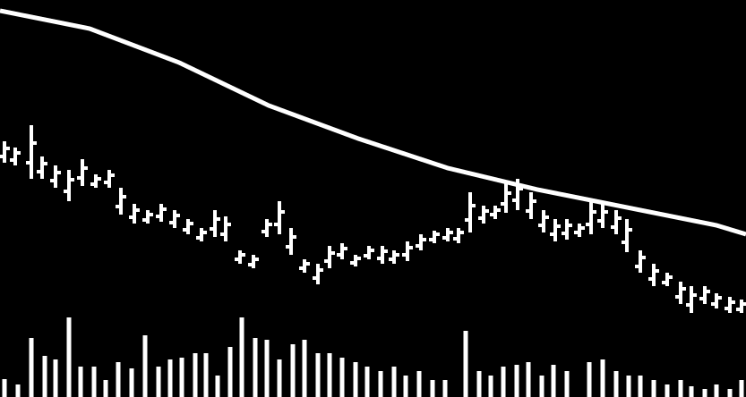

::: {.fig-src}
From Jiang, Kelly and Xiu (2023), "(Re-)Imag(in)ing Price Trends". *Generated OHLC images with volume bar and moving average line. 

This figure displays market data image for 60 days of data.*
:::
:::

## Recurrent Neural Networks (RNNs) and LSTMs
:::: {.compare .cols-3}

::: {.compare-col}
[Feedforward neural networks (FNNs)]{.cmp-title}

- Input: variables from $t-1$ (time series forecasting)
- Forecast: target in $t$
- No notion of order or history

:::
::: {.compare-col .cmp-mid}
[Recurrent neural networks (RNNs)]{.cmp-title}

- Designed for sequential data, where the output at time $t$ depends on previous inputs and outputs
- Sequential data common in time series and natural language processing

:::
::: {.compare-col .cmp-alt}
[Long short-term memory networks (LSTMs)]{.cmp-title}

- A type of RNN that can learn long-term dependencies
- Before 2017 (the transformer revolution, in a few slides), Google Translate used LSTMs
- Twin network: The GRU (Gated Recurrent Unit)
:::

::::

## Recurrent Neural Networks Visualized

::: {.figblock}
::: {.fig-title}
:::

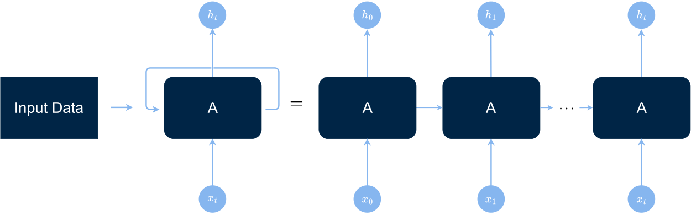

::: {.fig-src}
:::
:::

::: {.notes}
The input data arrow indicates the input data sequence, which is indicated below the elements, it is not a secondary source of input. $h_t$ indicates the outputs. The forecasts will be made from $h_t$ passed to something akin to $\hat{y} = W_y h_t + b_y$.
:::

## Forecasting Inflation from a Window of Quarters

We continue our inflation forecasting example, now in a recurrent setting, supporting time series consciousness

:::: {.compare}
::: {.compare-col}
[Feedforward network (so far)]{.cmp-title}

- Input: the three variables of one quarter
- Forecast: inflation in the next quarter
:::
::: {.compare-col .cmp-alt}
[Recurrent network]{.cmp-title}

- Input: the last 8 quarters of inflation, unemployment and the T-bill rate
- Forecast: inflation in the next quarter
:::
::::

## Windows of Quarters, Example

::: {.figblock}
::: {.fig-title}
:::

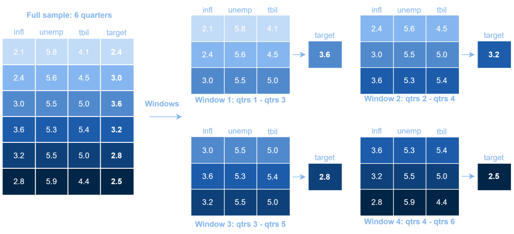

::: {.fig-src}
:::
:::

Windows have shape `(samples, quarters, variables)` = (4, 3, 3) 

Target has shape `(samples, 1)` = (4, 1)

## Setting up Windows I

`windows` has shape `(samples, quarters, variables)`, 

```{pyodide}
#| autorun: false
#| edit: true
#| eval: true
#| runbutton: false
#| startover: false
qrts = 8                                    # quarters in a window
windows = np.lib.stride_tricks.sliding_window_view(X, qrts, axis=0)
windows = windows.transpose(0, 2, 1)        # (samples, quarters, variables)
y_win = target[qrts - 1:]                   # target of the window ending in t

n_train = len(y_train) - qrts + 1   # first qrts-1 quarters have no full window
n_val = len(y_val)                  # validation and test keep their size

Xseq_train, Xseq_tmp, yseq_train, yseq_tmp = train_test_split(
    windows, y_win, train_size=n_train, shuffle=False)
Xseq_val, Xseq_test, yseq_val, yseq_test = train_test_split(
    Xseq_tmp, yseq_tmp, train_size=n_val, shuffle=False)

# cont'd on next slide
```

::: {.notes}
`np.lib.stride_tricks.sliding_window_view()` is a NumPy function that creates a sliding window view of an array. `qrts` is the window length, `axis=0` means the window slides along the rows, here: through time.
:::

## Setting up Windows II

```{pyodide}
#| autorun: false
#| edit: true
#| eval: true
#| runbutton: false
#| startover: false
# cont'd from previous slide

X_scaler = StandardScaler()
y_scaler = StandardScaler()

# The scaler expects 2D input, so reshape to (rows, 3) and back
Xseq_train = X_scaler.fit_transform(Xseq_train.reshape(-1, 3)).reshape(Xseq_train.shape)
Xseq_val = X_scaler.transform(Xseq_val.reshape(-1, 3)).reshape(Xseq_val.shape)
Xseq_test = X_scaler.transform(Xseq_test.reshape(-1, 3)).reshape(Xseq_test.shape)

yseq_train = y_scaler.fit_transform(yseq_train)
yseq_val = y_scaler.transform(yseq_val)
yseq_test = y_scaler.transform(yseq_test)
```

::: {.notes}
train original:         (133, 8, 3)
train after reshape:    (1064, 3)
train after scaler:     (1064, 3)
train back to original: (133, 8, 3)
val original:           (30, 8, 3)
val after reshape:      (240, 3)
val after scaler:       (240, 3)
val back to original:   (30, 8, 3)
test original:          (31, 8, 3)
test after reshape:     (248, 3)
test after scaler:      (248, 3)
test back to original:  (31, 8, 3)
:::

## The Recurrent Idea

A recurrent network reads the window one quarter at a time, and keeps a memory of what it has seen: the **hidden state**,

::: {.flow}
::: {.fn-navy}
Quarter 1
[initializes memory]{.fn-sub}
:::
::: {.fn}
Quarters 2 through 7
[memory updated]{.fn-sub}
:::
::: {.fn-amber}
Quarter 8
[forecast from the memory]{.fn-sub}
:::
:::

- The same weights are used for every quarter
- The forecast is made from the memory after the last quarter
- The memory is the distinguishing characteristic of recurrent networks, LSTMs in particular

## LSTM Unit Visualized

::: {.figblock}
::: {.fig-title}
:::

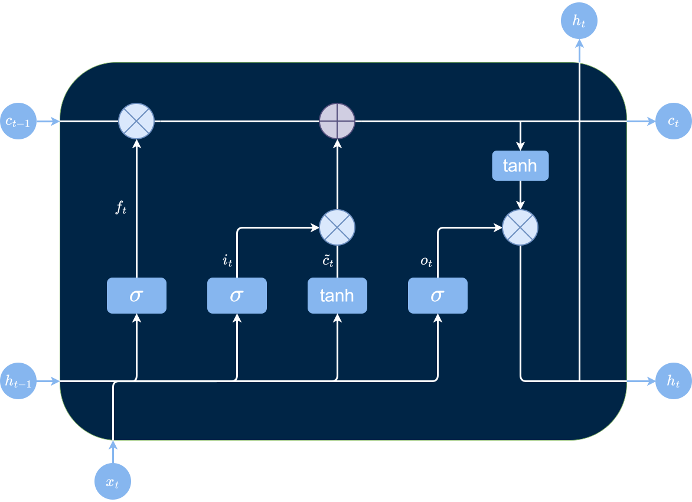

::: {.fig-src}
:::
:::

## The LSTM Cell 
The LSTM adds a cell state, a long-term memory, next to the hidden state. Gates between 0 (closed) and 1 (open) control it,

::: {.triad}
::: {.triad-card}
[Forget gate]{.tc-tag}

How much of the old memory is kept. Is last year's inflation spike still relevant?
:::
::: {.triad-card .tc-light}
[Input gate]{.tc-tag}

How much of the new information is written to the memory. Is this quarter's jump in unemployment worth remembering?
:::
::: {.triad-card .tc-amber}
[Output gate]{.tc-tag}

How much of the memory is shown to the forecast. Which parts matter for next quarter?
:::
:::

A plain RNN rewrites its entire memory every quarter, so early quarters fade. The LSTM gates edit the cell state instead, so information persists $\to$ long-memory modeling feasible

## A Recurrent Network in PyTorch {.th-slide .th-wide}
`qrts` indicates the number of quarters (in this case) in a window
```{pyodide}
#| autorun: false
#| edit: true
#| eval: true
#| runbutton: false
#| startover: false
class RecurrentNet(nn.Module):
    def __init__(self, n_features, hidden=16, cell="LSTM"):
        super(RecurrentNet, self).__init__()
        rnn = {"RNN": nn.RNN, "GRU": nn.GRU, "LSTM": nn.LSTM}[cell]
        self.rnn = rnn(n_features, hidden, batch_first=True)
        self.fc = nn.Linear(hidden, 1)

    def forward(self, x):                      # x: (batch, qrts, n_features) 
        output, _ = self.rnn(x)                # (batch, qrts, hidden)
        x = self.fc(output[:, -1, :])          # the last quarter's hidden state

        return x
```

::: {.notes}
`[cell]` is a dictionary look-up matching the passed string to the corresponding PyTorch  model. The `batch_first=True` argument makes the input shape `(batch, qrts, n_features)` instead of `(qrts, batch, n_features)`.
:::

::: {.notes}
The `self.rnn` returns the output and the hidden state, but we do not need the first thing here, hence the placeholder. The output is returned as (batch, qrts, hidden), and output[:, -1, :] extracts the final qrts, the last position, such that our output is (batch, hidden). This is passed to the linear layer. 
:::

```{=html}
<div class="th"><span class="th-arrow">↑</span><span class="th-line"></span><span class="th-ref" style="bottom:19.11%"><b>Basic NN</b></span><span class="th-dot" style="bottom:26.10%"></span><span class="th-val" style="bottom:26.10%">RNN 11.174</span><span class="th-dot" style="bottom:15.93%"></span><span class="th-val" style="bottom:15.93%">LSTM 10.717</span></div>
```

## The Transformer Revolution

**Transformers** (Vaswani et al., 2017) are the foundation of Large Language Models (LLMs)

:::: {.triad .cols-2}
::: {.triad-card .tc-light}
[Attention]{.tc-tag}

A mechanism that allows the model to focus on relevant parts of the input sequence when making predictions
:::
::: {.triad-card}
[Self-attention]{.tc-tag}

Transformers use self-attention mechanisms to process sequential data in parallel, allowing for better scalability and performance
:::
::::

::: {.callout-tip}
The best intuitive introduction by far, in my opinion, is Section "The Transformer Architecture", Chapter 15 of [Deep Learning with Python](https://deeplearningwithpython.io/chapters/chapter15_language-models-and-the-transformer/#the-transformer-architecture) (Chollet, 3rd edition, 2025). 

Skip the code (which is geared towards TensorFlow) and focus on the intuition
:::

## Attention: The Idea

We stay with our inflation forecasting example. 

An LSTM squeezes the window into one memory. Attention lets the forecast look at **every quarter directly** and decide how much each one matters. 

::: {.triad}
::: {.triad-card}
[Query: $\mathbf{Q}$]{.tc-tag}

What information is this quarter looking for?
:::
::: {.triad-card .tc-light}
[Key: $\mathbf{K}$]{.tc-tag}

What information does each quarter offer?
:::
::: {.triad-card .tc-amber}
[Value: $\mathbf{V}$]{.tc-tag}

Information passed on
:::
:::

::: {.spacer}
:::

Maths to decorate the slide,

::: {.pull-up}
:::

$$\text{Attention}(\mathbf{Q}, \mathbf{K}, \mathbf{V}) = \text{softmax}\left(\frac{\mathbf{Q}\mathbf{K}^\intercal}{\sqrt{d}}\right)\mathbf{V}$$

## Attention as a Lookup

Intuitively, attention works like a lookup/search engine:

::: {.vocab-wrap}
| Search engine | | Attention |
|:-------------------------------|:-:|:-----------------------------------|
| Search term | $\Leftrightarrow$ | **Query**, $\mathbf{Q}$ |
| Tags on the stored items | $\Leftrightarrow$ | **Key**, $\mathbf{K}$ |
| The stored items | $\Leftrightarrow$ | **Value**, $\mathbf{V}$ |
| Items returned, best match first | $\Leftrightarrow$ | Weighted average of the values |
:::

- Here, stored items are the quarters of the window, and the search is run once every quarter
- The better the match, the larger the weight
- Weights are learned via backpropagation

## A Self-Attention Network I

**Self-attention:** query, key and value all come from the same window. The forecast is made from the output of the last quarter,

```{pyodide}
#| autorun: false
#| runbutton: false
#| startover: false
class AttentionNet(nn.Module):
    def __init__(self, n_features, qrts, d=16):
        super(AttentionNet, self).__init__()
        self.embed = nn.Linear(n_features, d)           # quarter -> vector
        self.pos = nn.Parameter(torch.zeros(1, qrts, d))   # learned positions
        self.attn = nn.MultiheadAttention(d, num_heads=1, batch_first=True) # contains W_Q, W_K and W_V
        self.fc = nn.Linear(d, 1)

# cont'd on next slide
```

## A Self-Attention Network II {.th-slide}

```{pyodide}
#| autorun: false
#| runbutton: false
#| startover: false
# cont'd from previous slide
    def forward(self, x):                      # x: (batch, qrts, n_features)
        x = self.embed(x) + self.pos           # (batch, qrts, d)
        context, weights = self.attn(x, x, x)  # query = key = value = x
        x = self.fc(context[:, -1, :])         # the last quarter's context

        return x
```

`d` sets the size of the query, key and value vectors. A larger `d` stores more information per vector, but adds more parameters to learn

```{=html}
<div class="th"><span class="th-arrow">↑</span><span class="th-line"></span><span class="th-ref" style="bottom:19.11%"><b>Basic NN</b></span><span class="th-dot" style="bottom:63.40%"></span><span class="th-val" style="bottom:63.40%">12.853</span></div>
```

## From Attention to a Transformer

Attention only recombines the quarters. We still need non-linear activations.

A Transformer block (Vaswani et al., 2017) adds them, and blocks are stacked,

:::: {.flow}
::: {.fn-navy}
Self-attention
[information is mixed across quarters]{.fn-sub}
:::
::: {.fn}
Add and normalize
[residual connection and layer norm]{.fn-sub}
:::
::: {.fn}
Feedforward network
[two dense layers with ReLU, applied to each quarter]{.fn-sub}
:::
::: {.fn-amber}
Add and normalize
[residual connection and layer norm]{.fn-sub}
:::
::::

::: {.spacer}
:::

[Three more ingredients]{.flow-label .fl-lg}

:::: {.triad .strip}
::: {.triad-card}
[Multi-head]{.tc-tag}

Several attention heads in parallel, so different patterns can be uncovered
:::
::: {.triad-card}
[Positions]{.tc-tag}

Attention is blind to order, so a position vector is added to each quarter (`self.pos` in the code)
:::
::: {.triad-card}
[Causal mask]{.tc-tag}

A quarter may only attend to itself and earlier quarters $\to$ no look-ahead bias
:::
::::

## LLMs and Generative AI

An LLM is a very large transformer with causal attention, trained to predict the next token. GPTs like e.g., ChatGPT abbreviates "Generative Pre-trained **Transformer**"

:::: {.triad .gpt}
::: {.triad-card}
[G]{.tc-letter}
[Generative (AI)]{.tc-title}
Produces new text one word at a time: predict, append, repeat (next slide)
:::
::: {.triad-card}
[P]{.tc-letter}
[Pre-trained]{.tc-title}
Trained on large corpora of text data to learn the statistical properties of language, by predicting the next word
:::
::: {.triad-card}
[T]{.tc-letter}
[Transformers]{.tc-title}
Stacked attention blocks with a causal mask, as on the previous slides
:::
::::

## LLMs are Forecasting Models

::: {.pull-up}
:::

When we chat with generative AI, the model **forecasts** the next word given all previous words, and we sample from this probability distribution,

::: {.figblock}
::: {.fig-title}
Prompt: "The central bank decided to raise the ..."
:::

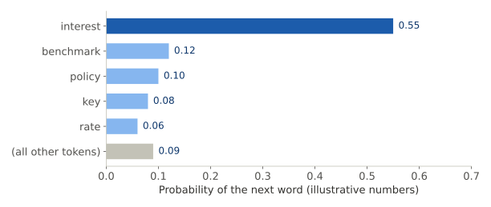

::: {.fig-src}
:::
:::

::: {.pull-up}
:::

The sampled word is appended and the model forecasts again: a recursive multi-step forecast

::: {.keypoint}
The replies we receive are nothing but (incredibly good) predictions
:::

## Recent Deep Learning Breakthroughs

:::: {.triad}
::: {.triad-card}
[Hardware]{.tc-tag}

The Chinese LLM LongCat-2.0 Model is trained without NVIDIA GPUs [(Reuters, 2026)]{.faint}

<!-- Training the Chinese LLM LongCat-2.0 Model without NVIDIA GPUs [(Reuters, 2026)]{.faint} -->
:::
::: {.triad-card .tc-light}
[Computer vision meets music]{.tc-tag}

MuSViT reads sheet music like computer vision models read images [(Penarrubia et al., 2026)]{.faint}
:::
::: {.triad-card .tc-amber}
[Mathematics]{.tc-tag}

OpenAI and Anthropic (etc.) make progress in the field of mathematics
:::
::::

## All Models Compared

```{=html}
<div class="rank">
<div class="rank-row best"><span class="rank-name">L2</span><span class="rank-track"><span class="rank-ref" style="left:19.11%"></span><span class="rank-seg gain" style="left:3.3%;width:15.8%"></span><span class="rank-dot" style="left:3.3%"></span></span><span class="rank-val">10.150</span></div>
<div class="rank-row"><span class="rank-name">L1</span><span class="rank-track"><span class="rank-ref" style="left:19.11%"></span><span class="rank-seg gain" style="left:3.4%;width:15.7%"></span><span class="rank-dot" style="left:3.4%"></span></span><span class="rank-val">10.154</span></div>
<div class="rank-row"><span class="rank-name">Dropout</span><span class="rank-track"><span class="rank-ref" style="left:19.11%"></span><span class="rank-seg gain" style="left:5.2%;width:13.9%"></span><span class="rank-dot" style="left:5.2%"></span></span><span class="rank-val">10.235</span></div>
<div class="rank-row"><span class="rank-name">Early stopping</span><span class="rank-track"><span class="rank-ref" style="left:19.11%"></span><span class="rank-seg gain" style="left:14.6%;width:4.5%"></span><span class="rank-dot" style="left:14.6%"></span></span><span class="rank-val">10.659</span></div>
<div class="rank-row"><span class="rank-name">LSTM</span><span class="rank-track"><span class="rank-ref" style="left:19.11%"></span><span class="rank-seg gain" style="left:15.9%;width:3.2%"></span><span class="rank-dot" style="left:15.9%"></span></span><span class="rank-val">10.717</span></div>
<div class="rank-row base"><span class="rank-name">Basic NN (20 epochs)</span><span class="rank-track"><span class="rank-ref" style="left:19.11%"></span><span class="rank-dot" style="left:19.1%"></span></span><span class="rank-val">10.860</span></div>
<div class="rank-row"><span class="rank-name">RNN</span><span class="rank-track"><span class="rank-ref" style="left:19.11%"></span><span class="rank-seg loss" style="left:19.1%;width:7.0%"></span><span class="rank-dot" style="left:26.1%"></span></span><span class="rank-val">11.174</span></div>
<div class="rank-row bench"><span class="rank-name">OLS</span><span class="rank-track"><span class="rank-ref" style="left:19.11%"></span><span class="rank-seg loss" style="left:19.1%;width:34.3%"></span><span class="rank-dot" style="left:53.4%"></span></span><span class="rank-val">12.403</span></div>
<div class="rank-row"><span class="rank-name">Self-attention</span><span class="rank-track"><span class="rank-ref" style="left:19.11%"></span><span class="rank-seg loss" style="left:19.1%;width:44.3%"></span><span class="rank-dot" style="left:63.4%"></span></span><span class="rank-val">12.853</span></div>
<div class="rank-row bench"><span class="rank-name">Training mean</span><span class="rank-track"><span class="rank-ref" style="left:19.11%"></span><span class="rank-seg loss" style="left:19.1%;width:72.7%"></span><span class="rank-dot" style="left:91.8%"></span></span><span class="rank-val">14.132</span></div>
<div class="rank-axis"><span></span><span class="rank-ticks"><span style="left:0%">10</span><span style="left:22.2%">11</span><span style="left:44.4%">12</span><span style="left:66.7%">13</span><span style="left:88.9%">14</span></span><span></span></div>
</div>
```

[Dashed line: basic NN.]{.rank-note}

## References

::: {style="font-size: 0.5em; line-height: 1.3;"}
Chollet, F. (2025). *Deep Learning with Python* (3rd ed.). Manning.

Huber, P. J. (1964). Robust estimation of a location parameter. *Annals of Mathematical Statistics*, 35(1), 73--101.

Huntr. (2026, 28 July). *Machine learning skills: What 10,704 job posts require (2026)*. https://huntr.co/resume-skills/machine-learning

Jiang, J., Kelly, B., & Xiu, D. (2023). (Re-)Imag(in)ing price trends. *Journal of Finance*, 78(6), 3193--3249.

Kingma, D. P., & Ba, J. (2014). Adam: A method for stochastic optimization. *arXiv:1412.6980*.

LeCun, Y., Bottou, L., Bengio, Y., & Haffner, P. (1998). Gradient-based learning applied to document recognition. *Proceedings of the IEEE*, 86(11), 2278--2324.

Penarrubia, C., et al. (2026). MuSViT: A foundation vision model for sheet music representation. *ECCV*. https://grfia.dlsi.ua.es/musvit/

Reuters. (2026, 30 June). Meituan releases LongCat-2.0, trained without NVIDIA chips.

Second Talent. (2026, 21 September). *PyTorch vs. TensorFlow: Usage, popularity and performance*. https://www.secondtalent.com/resources/pytorch-vs-tensorflow-usage-popularity-and-performance/

Srivastava, N., Hinton, G., Krizhevsky, A., Sutskever, I., & Salakhutdinov, R. (2014). Dropout: A simple way to prevent neural networks from overfitting. *Journal of Machine Learning Research*, 15(56), 1929--1958.

Vaswani, A., Shazeer, N., Parmar, N., Uszkoreit, J., Jones, L., Gomez, A. N., Kaiser, Ł., & Polosukhin, I. (2017). Attention is all you need. *NeurIPS*, 30.
:::