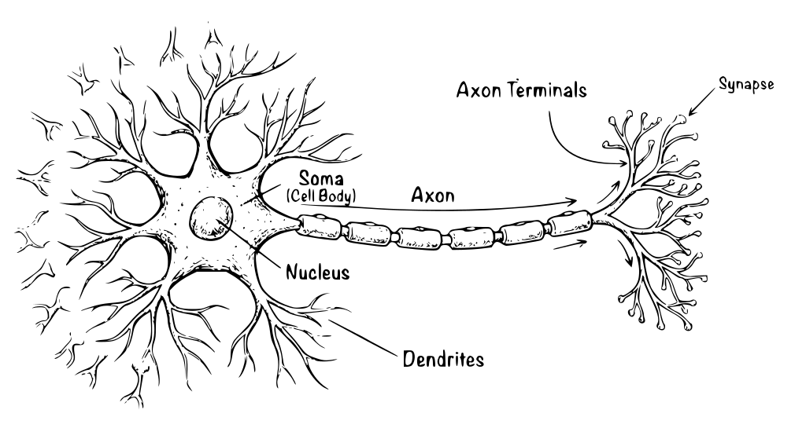
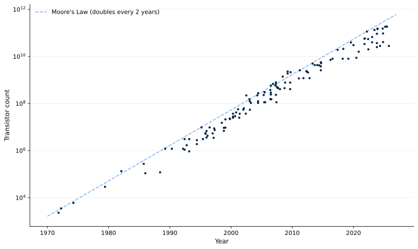
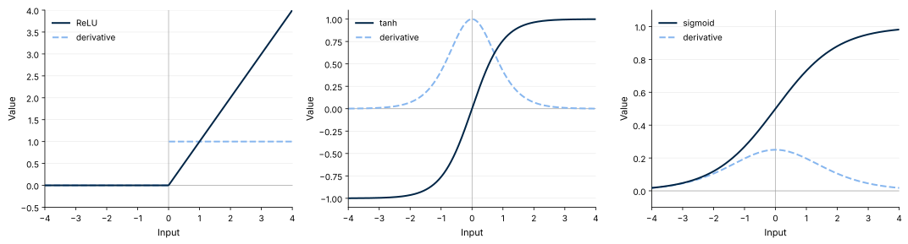
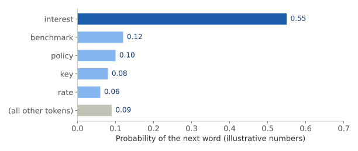

# Introduction {.divider}

```{=html}
<style>
.reveal .slides .list-gap li {
  margin-top: 0 !important;
  margin-bottom: 0 !important;
  padding-bottom: var(--gap, 0.5em) !important;
}
.reveal .slides .list-gap li p { margin: 0 !important; }
</style>
```

```{=html}
<script>
(function () {
  function centre(section) {
    var s = Reveal.getScale();
    var sr = section.getBoundingClientRect();
    section.querySelectorAll('ol ul li > p > span.math.display').forEach(function (m) {
      var p = m.parentElement;
      p.style.marginLeft = '0px';
      p.style.width = 'auto';
      var pr = p.getBoundingClientRect();
      p.style.marginLeft = (-(pr.left - sr.left) / s) + 'px';
      p.style.width = (sr.width / s) + 'px';
    });
  }
  function run() {
    var c = Reveal.getCurrentSlide();
    if (c) centre(c);
  }
  window.addEventListener('load', function () {
    Reveal.on('ready', run);
    Reveal.on('slidechanged', run);
    run();
  });
})();
</script>
```

## Today

:::: {.overview}
::: {.ov-row-inline}
::: {.ov-label}
Brains and history
:::
::: {.ov-desc}
From McCulloch and Pitts to the renaissance of neural networks
:::
:::
::: {.ov-row-inline}
::: {.ov-label}
Anatomy of a network
:::
::: {.ov-desc}
Layers, activations, and the forecast
:::
:::
::: {.ov-row-inline}
::: {.ov-label}
Training
:::
::: {.ov-desc}
Objective, optimization, backpropagation, initialization
:::
:::
::: {.ov-row-inline}
::: {.ov-label}
Regularization
:::
::: {.ov-desc}
Dropout, penalties, and early stopping
:::
:::
::: {.ov-row-inline}
::: {.ov-label}
Implementation
:::
::: {.ov-desc}
The PyTorch pipeline
:::
:::
::: {.ov-row-inline}
::: {.ov-label}
Beyond feed-forward neural networks
:::
::: {.ov-desc}
CNNs, LSTMs, and Transformers
:::
:::
::::

## Why PyTorch? 

**PyTorch** is the deep learning framework of this course

:::: {.statband}
::: {.stat}
[85%]{.stat-big}
[of deep learning research papers use PyTorch]{.stat-label}
:::
::: {.stat}
[228,000 vs. 15,000]{.stat-big}
[pre-trained models on HuggingFace (PyTorch vs. TensorFlow)]{.stat-label}
:::
::: {.stat}
[55%]{.stat-big}
[of new production deployments as of 2025 (not limited to research)]{.stat-label}
:::
::::

- **Tutorials**

::: {.keypoint}
PyTorch is the framework of instruction, but you are free to use TensorFlow
:::

# Neural Networks are Inspired by Brains {.divider}

## A Neural Network of the Brain of a Mouse I

<div class="figblock fb-brain fb-w75">
<p class="fig-title">Extract from 1mm² of Mouse Brain</p>

<p class="fig-src">Source: MICrONS Explorer Render, Daniel Berger & MICrONS Explorer Consortium Team. Google Research and Harvard University.</p>
</div>

## A Neural Network of the Brain of a Mouse II

<div class="figblock fb-brain">
<p class="fig-title">Extract from 1mm² of Mouse Brain — Closer Look</p>

<p class="fig-src">Source: MICrONS Explorer Render, Daniel Berger & MICrONS Explorer Consortium Team. Google Research and Harvard University.</p>
</div>

## A Neural Network of the Brain of a Mouse III

<div class="figblock fb-brain">
<p class="fig-title">Extract from 1mm² of Mouse Brain — Even Closer Look</p>

<p class="fig-src">Source: MICrONS Explorer Render, Daniel Berger & MICrONS Explorer Consortium Team. Google Research and Harvard University.</p>
</div>

## McCulloch & Pitts (1943)

:::: {.columns}
::: {.column width="46%"}
- Bedrock of contemporary deep learning
- Conceived analogue between brain and computer/artificial neural network
:::
::: {.column width="54%"}
::: {.vocab-wrap}
| Biology | | Computation |
|:--------------------------|:-:|:-----------------------|
| Biological neural network | $\Leftrightarrow$ | Artificial neural network |
| Thinking | $\Leftrightarrow$ | Computing |
| Neurons | $\Leftrightarrow$ | Mathematical objects |
:::

::: {.faint .small}
**"...each having a soma and an axon."** 
:::
:::
::::

From introduction of seminal 1943 paper:

::: {.quote-sm style="font-size: 1.2em;"}
> "The nervous system is a net of neurons, each having a soma and an axon. Their adjunctions, or synapses, are always between the axon of one neuron and the soma of another. At any instant a neuron has some threshold, which excitation must exceed to initiate an impulse."
:::

## Rosenblatt (1958)

Operationalised McCulloch & Pitts' networks

::: {.vocab-wrap}
| Biology | | Artificial network |
|:-------------------------------------------------|:-:|:-----------------------------------------|
| Synapses (connections between biological neurons) | $\Leftrightarrow$ | Trainable weights |
| Human learning | $\Leftrightarrow$ | Changing/updating weights and biases |
:::

## A Neuron I

<div class="figblock fb-w85">
<p class="fig-title">A Biological Neuron</p>

</div>

## A Neuron II

<div class="figblock">
<p class="fig-title">Artificial Analogue to Neuron</p>

</div>

# When Neural Networks Almost Died {.divider}

## The Crisis of Neural Networks

:::: {.cards .cards-sm}
::: {.card-box}
[Scale]{.t}
[Deep learning models are most favorable at scale]{.d}
:::
::: {.card-box}
[Hardware]{.t}
[Lack of necessary computing power and suitable hardware (GPUs)]{.d}
:::
::: {.card-box}
[Training]{.t}
[Overfitting, fragility, and vanishing gradients]{.d}
:::
::: {.card-box}
[Theory]{.t}
[Lack of theoretical support]{.d}
:::
::::

## The Renaissance of Neural Networks

Computation

:::: {.triad}
::: {.triad-card}
[Computational power]{.tc-title}

Moore's Law, GPUs
:::
::: {.triad-card}
[Algorithms]{.tc-title}

E.g., ReLU, dropout, Adam
:::
::: {.triad-card}
[Backpropagation]{.tc-title}

Efficient gradient computation for deep networks
:::
::::

Modeling

:::: {.triad}
::: {.triad-card}
[Pre-trained models]{.tc-title}

Including custom tuning
:::
::: {.triad-card}
[Frameworks]{.tc-title}

PyTorch, TensorFlow, and similar
:::
::: {.triad-card}
[Big data]{.tc-title}

Large datasets
:::
::::

::: {.keypoint}
Next challenge: Physical limits of silicon-based chips reached. 

  Possible solution: quantum computing
:::


## Moore's Law

<div class="figblock">
<p class="fig-title">Moore's Law</p>

<p class="fig-src">Source: M. Horowitz, F. Labonte, O. Shacham, K. Olukotun, L. Hammond, and C. Batten; Karl Rupp, &amp; Danial Chitnis, Creative Commons Attribution 4.0 International license.</p>
</div>

# Neural Networks {.divider}

## A Neural Network

<div class="figblock">
<p class="fig-title"></p>

</div>

## The Layers of a Neural Network

Layers are indexed by $h$, $h = 0, \ldots, H+1$. There are $K_h$ **neurons** in each layer $h$, with **activations** $A_k^{(h)}$.

:::: {.triad}
::: {.triad-card}
[One input layer]{.tc-tag}

[$h = 0$]{.tc-title}

The neurons are the $p$ input features, $\mathbf{X} = (X_1, X_2, \ldots, X_p)$

$A_j^{(0)} = X_j$, $\quad j = 1,\ldots,p$
:::
::: {.triad-card .tc-light}
[$H$ hidden layers]{.tc-tag}

[$h = 1, \ldots, H$]{.tc-title}

Essential computations here
:::
::: {.triad-card .tc-amber}
[One output layer]{.tc-tag}

[$h = H+1$]{.tc-title}

Produces the forecast
:::
::::

## The Hidden Layers

The essential computations occur in the **hidden** layers ($h = 1,...,H$), with activations $A_k^{(h)}$, weights $\omega_{kj}^{(h)}$, biases $\omega_{k0}^{(h)}$, and activation functions $g_h$,

$$A_k^{(h)} = g_h\left(\omega_{k0}^{(h)}+\sum_{j=1}^{K_{h-1}}\omega_{kj}^{(h)}A_j^{(h-1)}\right), \qquad k = 1,...,K_h$$

:::: {.triad .cols-2}
::: {.triad-card}
[Weighted sum]{.tc-tag}

Weights times the activations of the previous layer
:::
::: {.triad-card .tc-light}
[Activation function]{.tc-tag}

$g_h$ introduces non-linearity to layer $h$
:::
::::

## The First Hidden Layer

The first hidden layer is a special case, with $K_0 = p$ and $A_j^{(0)} = X_j$,

$$A_k^{(1)} = g_1\left(\omega_{k0}^{(1)}+\sum_{j=1}^{p}\omega_{kj}^{(1)}X_j\right), \qquad k = 1,...,K_1$$

## Forecasts
In the regression task, the **output** layer ($h = H+1$) produces forecasts, with weights $\beta_k$ and intercept $\beta_0$,
$$f(\mathbf{X}) = \beta_0 + \sum_{k = 1}^{K_H}\beta_k A_k^{(H)}$$

Evaluating in the activations of the last hidden layer, 

$$f(\mathbf{X}) = \beta_0 + \sum_{k = 1}^{K_H}\beta_k\, g_H\left(\omega_{k0}^{(H)}+\sum_{j=1}^{K_{H-1}}\omega_{kj}^{(H)}A_j^{(H-1)}\right)$$

## Similarity to Neurons Revisited
<div class="figblock">
<p class="fig-title">Artificial Analogue to Neuron</p>

</div>

## Non-Linear Activation Functions

Essential component of neural networks: Introduces non-linearity to the model, allowing it to learn complex patterns

::: {.act-table}
| Function | Map | Definition |
|:----------------------------|:-------------------------:|:--------------------------:|
| **ReLU** (Rectified Linear Unit)<br>[most dominant today]{.small} | $f: \mathbb{R} \to [0, \infty)$ | $f(x) = \max\{0, x\}$ |
| **tanh** (hyperbolic tangent) | $\text{tanh}: \mathbb{R} \to [-1, 1]$ | $\text{tanh}(x) = \dfrac{e^x - e^{-x}}{e^x + e^{-x}}$ |
| **sigmoid** | $\sigma: \mathbb{R} \to [0, 1]$ | $\sigma(x) = \dfrac{1}{1 + e^{-x}}$ |
:::

[Sigmoid was the first activation function]{.flow-label .fl-lg}

:::: {.triad .cols-2 .strip}
::: {.triad-card}
$\sigma(x) = 0$: the neuron does not fire
:::
::: {.triad-card}
$\sigma(x) = 1$: the neuron fires $\Rightarrow$ the neuron contributes to the output of the network
:::
::::
## Activation Functions and Their Derivatives

<div class="figblock fb-s400">

<p class="fig-src">ReLU: $g'(x) = 0$ for $x < 0$, $g'(x) = 1$ for $x > 0$. tanh: $g'(x) = 1 - \tanh^2(x)$. sigmoid: $g'(x) = \sigma(x)(1 - \sigma(x))$.</p>
</div>

::: {.keypoint}
The derivative $g'$ enters every backpropagation step.

Note: the sigmoid derivative is maximized at $x = 0 \to \sigma'(x) = 0.25$ - risk of vanishing gradients
:::

## Specifying the Activation Function

Specifying the activation function in the forward pass,

```{pyodide}
#| autorun: false
#| runbutton: false
#| startover: false
import torch
import torch.nn.functional as F

x = F.relu(self.fc1(x))
# alternatives: torch.tanh(self.fc1(x)), torch.sigmoid(self.fc1(x))
```

Alternatives: `torch.tanh(self.fc1(x))`, `torch.sigmoid(self.fc1(x))`

## The Blueprint
:::: {.steplist}
::: {.step-row}
::: {.step-num}
1
:::
::: {.step-title}
Data
:::
::: {.step-desc}
Target variable and predictors
:::
:::
::: {.step-row}
::: {.step-num}
2
:::
::: {.step-title}
Split and scale
:::
::: {.step-desc}
Chronological training, validation and test split, standardization fitted on the training sample only
:::
:::
::: {.step-row}
::: {.step-num}
3
:::
::: {.step-title}
DataLoaders
:::
::: {.step-desc}
Tensors in mini-batches
:::
:::
::: {.step-row}
::: {.step-num}
4
:::
::: {.step-title}
Model
:::
::: {.step-desc}
An `nn.Module` defining the architecture
:::
:::
::: {.step-row}
::: {.step-num}
5
:::
::: {.step-title}
Ingredients
:::
::: {.step-desc}
Objective, optimizer, initialization, regularization, early stopping, loss
:::
:::
::: {.step-row}
::: {.step-num}
6
:::
::: {.step-title}
Training loop
:::
::: {.step-desc}
Training and validation over epochs
:::
:::
::: {.step-row}
::: {.step-num}
7
:::
::: {.step-title}
Evaluation
:::
::: {.step-desc}
Out-of-sample accuracy measures on the test sample
:::
:::
::::

## Preliminaries
We consider a general blueprint for forecasting with neural networks and a specific example of forecasting US quarterly inflation with a feedforward neural network

```{pyodide}
#| autorun: false
#| runbutton: false
#| startover: false
import copy
import time
import numpy as np
import pandas as pd
from sklearn.preprocessing import StandardScaler
from sklearn.model_selection import train_test_split

import torch
import torch.nn as nn
import torch.nn.functional as F
from torch.utils.data import TensorDataset, DataLoader

device = torch.device("cuda" if torch.cuda.is_available() else "cpu")
```

## Empirical Data
US quarterly macro data 1959Q1-2009Q3 (no missing values)

```{pyodide}
#| autorun: false
#| runbutton: false
#| startover: false
df = pd.read_csv("macrodata.csv").iloc[1:]
series = df[["infl", "unemp", "tbilrate"]].to_numpy()   # (T, 3)
infl = series[:, 0]
```

Lagged features: inflation, unemployment and the T-bill rate at time $t$ are used to predict inflation at time $t+1$

```{pyodide}
#| autorun: false
#| runbutton: false
#| startover: false
X = series[:-1]
target = infl[1:].reshape(-1, 1)
```

## Temporally Conscious Data Splitting

Chronological split (shuffle=False) to preserve temporal order (split: 70:15:15)

:::: {.splitbar}
::: {.sb-train style="flex: 70"}
Train (70%)
:::
::: {.sb-val style="flex: 15"}
Validation (15%)
:::
::: {.sb-test style="flex: 15"}
Test (15%)
:::
::::

```{pyodide}
#| autorun: false
#| runbutton: false
#| startover: false
X_train, X_tmp, y_train, y_tmp = train_test_split(X, target, train_size=0.7, shuffle=False)
X_val, X_test, y_val, y_test = train_test_split(X_tmp, y_tmp, train_size=0.5, shuffle=False)
```

## Standardization

```{pyodide}
#| autorun: false
#| runbutton: false
#| startover: false
# Standardization, fitting on the training sample only
X_scaler = StandardScaler()
y_scaler = StandardScaler()

X_train = X_scaler.fit_transform(X_train)
X_val = X_scaler.transform(X_val)
X_test = X_scaler.transform(X_test)

y_train = y_scaler.fit_transform(y_train)
y_val = y_scaler.transform(y_val)
y_test = y_scaler.transform(y_test)
```

## Tensors

:::: {.flow}
::: {.fn-navy}
NumPy array
:::
::: {.fn}
`torch.Tensor`
:::
::: {.fn}
`TensorDataset`
:::
::: {.fn}
`DataLoader`
:::
::::

The input data is converted to the format that PyTorch expects

```{pyodide}
#| autorun: false
#| runbutton: false
#| startover: false
X_train = torch.from_numpy(X_train).float().to(device)
X_val = torch.from_numpy(X_val).float().to(device)
X_test = torch.from_numpy(X_test).float().to(device)
y_train = torch.from_numpy(y_train).float().to(device)
y_val = torch.from_numpy(y_val).float().to(device)
y_test = torch.from_numpy(y_test).float().to(device)
```

## Constructing DataLoaders

This is incredibly efficient for large or specialized datasets

```{pyodide}
#| autorun: false
#| runbutton: false
#| startover: false
dfTrain = TensorDataset(X_train, y_train)
dfVal = TensorDataset(X_val, y_val)
dfTest = TensorDataset(X_test, y_test)

lTrain = DataLoader(dfTrain, batch_size=32, shuffle=True)
lVal = DataLoader(dfVal, batch_size=32, shuffle=False)
lTest = DataLoader(dfTest, batch_size=32, shuffle=False)
```

## The Simple Neural Network I

PyTorch neural networks are defined as subclasses of `nn.Module`

:::: {.flow}
::: {.fn-navy}
Input
[`n_in` features]{.fn-sub}
:::
::: {.fn}
`fc1` + ReLU
[`n_hidden1` neurons]{.fn-sub}
:::
::: {.fn}
`fc2` + ReLU
[`n_hidden2` neurons]{.fn-sub}
:::
::: {.fn-amber}
`fc3`
[1 output]{.fn-sub}
:::
::::

- Parameters are passed after `self` (here `n_in`, `n_hidden1` and `n_hidden2`)
- `n_in` is the number of input features, `n_hidden1` and `n_hidden2` are the numbers of neurons in the first and second hidden layer
- The network on the next slide has two hidden layers


## The Simple Neural Network II
```{pyodide}
#| autorun: false
#| runbutton: false
#| startover: false
class NN(nn.Module):
    def __init__(self, n_in, n_hidden1=16, n_hidden2=8):
        super(NN, self).__init__()
        self.fc1 = nn.Linear(n_in, n_hidden1)
        self.fc2 = nn.Linear(n_hidden1, n_hidden2)
        self.fc3 = nn.Linear(n_hidden2, 1)

    def forward(self, x):
        x = F.relu(self.fc1(x))
        x = F.relu(self.fc2(x))
        x = self.fc3(x)

        return x
```


## Training a Neural Network I 

<div class="figblock">
<p class="fig-title">xkcd \#1838</p>

</div>

## Training a Neural Network II
- We give this example in the $h = 1$ case, 

$$f(\mathbf{X}) = \beta_0 + \sum_{k = 1}^{K_1} \beta_k A_k^{(1)} = \beta_0 + \sum_{k = 1}^{K_1}\beta_k g_1\left(\omega_{k0}^{(1)}+\sum_{j=1}^p\omega_{kj}^{(1)}X_j \right)$$

The parameters to be estimated are

:::: {.triad .cols-2}
::: {.triad-card}
[Output layer]{.tc-tag}

$\boldsymbol{\beta} = \beta_0, \beta_1, \ldots, \beta_{K_1}$
:::
::: {.triad-card .tc-light}
[Hidden layer]{.tc-tag}

$\boldsymbol{\omega}^{(1)} = \omega_{kj}^{(1)}$ for $k = 1, \ldots, K_1$ and $j = 1, \ldots, p$
:::
::::

Stack the parameters into a vector: $\theta = (\boldsymbol{\beta}, \boldsymbol{\omega}^{(1)})$

## Objective Function

We assume a squared loss function to estimate parameters $\theta$

For a single-hidden-layer network ($H=1$), the model forecast for observation $i$ is,

$$ f_\theta(x_i) = \beta_0 + \sum_{k = 1}^{K_1}\beta_k g\left(\omega_{k0}^{(1)}+\sum_{j=1}^p\omega_{kj}^{(1)}x_{ij} \right) $$

Vectorising the parameters into $\theta$, we minimize the objective function $R(\theta)$:

$$ \min_\theta \{R(\theta)\}, \quad R(\theta) = \frac12\sum_{i = 1}^n(y_i - f_\theta(x_i))^2 $$

## Numerical Optimization I

:::: {.flow}
::: {.fn-navy}
Non-convex and high-dimensional problem
[no closed form, no analytical solution]{.fn-sub}
:::
::: {.fn}
Numerical optimization
[gradient descent is a common algorithm]{.fn-sub}
:::
::: {.fn-amber}
Too heavy computationally
[stochastic gradient descent (SGD) is used instead]{.fn-sub}
:::
::::

SGD uses only a small batch of data to compute the gradient and update the parameters at each iteration

## Numerical Optimization II --- Gradient Descent
- Given a differentiable function $f: \mathbb{R}^p\to \mathbb{R}$ to be minimized with respect to the vector $\mathbf{\theta}\in\mathbb{R}^p$ and step size $s$,

1. Initialize with some starting value $\mathbf{\theta}^\ast_{(0)}$
2. Then, for each $i$,

   - Compute the gradient at $\mathbf{\theta}_{(i)}^\ast$, i.e.,

     $$ \nabla f(\mathbf{\theta}_{(i)}^\ast) = \frac{\partial f(\mathbf{\theta})}{\partial \mathbf{\theta}}\Bigg\vert_{\mathbf{\theta} = \mathbf{\theta}_{(i)}^\ast}$$

   - Set $\mathbf{\theta}_{(i+1)}^\ast = \mathbf{\theta}_{(i)}^\ast - s\nabla f(\mathbf{\theta}_{(i)}^\ast)$

3. Repeat until convergence

## Numerical Optimization III --- Stochastic Gradient Descent

- Given $f(\mathbf{\theta}) = \frac{1}{n}\sum_{j=1}^{n} f_j(\mathbf{\theta})$ to be minimized with respect to $\mathbf{\theta}\in\mathbb{R}^p$ and step sizes $s_i$,

1. Initialize with some starting value $\mathbf{\theta}^\ast_{(0)}$
2. Then, for each $i$,

   - Draw an index $j_i$ uniformly at random from $\{1,\dots,n\}$ and compute the gradient of that single term at $\mathbf{\theta}_{(i)}^\ast$, i.e.,

     $$ \nabla f_{j_i}(\mathbf{\theta}_{(i)}^\ast) = \frac{\partial f_{j_i}(\mathbf{\theta})}{\partial \mathbf{\theta}}\Bigg\vert_{\mathbf{\theta} = \mathbf{\theta}_{(i)}^\ast}$$

   - Set $\mathbf{\theta}_{(i+1)}^\ast = \mathbf{\theta}_{(i)}^\ast - s_i\nabla f_{j_i}(\mathbf{\theta}_{(i)}^\ast)$

3. Repeat until convergence

## Numerical Optimization IV

{fig-align="center" width="60%"}


## Backpropagation I

:::: {.triad .cols-2}
::: {.triad-card .tc-brick}
[The problem]{.tc-tag}

- The numerical optimization, even in the SGD case, has incredibly high computational overhead
- Weights require the chain rule to compute derivatives
:::
::: {.triad-card}
[The solution]{.tc-tag}
- Backpropagation is a recursive application of the chain rule to compute the gradient of the loss
- Therefore, backpropagation eases the burden of computational costs

:::
::::


## Backpropagation II
Recall the objective,

$$ R(\theta) = \sum_{i = 1}^n R_i(\theta) = \frac12\sum_{i = 1}^n(y_i - f_\theta(x_i))^2$$

A sum, which means the gradient is a sum over the $n$ observations, so we need only consider one of these,

$$R_i(\theta) = \frac12\left(y_i - \beta_0- \sum_{k = 1}^{K_1}\beta_k g_1\left(\omega_{k0}+\sum_{j = 1}^p\omega_{kj}x_{ij}\right)\right)^2$$


## Backpropagation III {.bp}

Define $z_{ik} = \omega_{k0} + \sum_{j = 1}^p\omega_{kj}x_{ij}$

The output weight $\beta_k$ enters the forecast directly: $f_\theta(x_i) = \beta_0 + \sum_{k = 1}^{K_1}\beta_k g(z_{ik})$

::: {.flow-label}
Forward pass: compute the forecast and the loss
:::

:::: {.flow}
::: {.fn}
$\beta_k$
:::
::: {.fn}
$f_\theta(x_i)$
:::
::: {.fn-navy}
$R_i(\theta)$
:::
::::

::: {.flow-label}
Backward pass: multiply the derivatives (chain rule)
:::

:::: {.flow .back}
::: {.fn}
$\dfrac{\partial f_\theta(x_i)}{\partial \beta_k} = g(z_{ik})$
:::
::: {.fn}
$\dfrac{\partial R_i(\theta)}{\partial f_\theta(x_i)} = -(y_i - f_\theta(x_i))$
:::
::::

Computing the derivative w.r.t. $\beta_k$,

$$
\begin{aligned}
\frac{\partial R_i(\theta)}{\partial \beta_k} &= \frac{\partial R_i(\theta)}{\partial f_\theta(x_i)} \cdot \frac{\partial f_\theta(x_i)}{\partial \beta_k} \\ &= -(y_i - f_\theta(x_i)) \cdot g(z_{ik})
\end{aligned}
$$

## Backpropagation IV {.bp}

Define $z_{ik} = \omega_{k0} + \sum_{j = 1}^p\omega_{kj}x_{ij}$

::: {.flow-label}
Forward pass: compute the forecast and the loss
:::

:::: {.flow}
::: {.fn}
$x_{ij}$
:::
::: {.fn}
$z_{ik}$
:::
::: {.fn}
$g(z_{ik})$
:::
::: {.fn}
$f_\theta(x_i)$
:::
::: {.fn-navy}
$R_i(\theta)$
:::
::::

::: {.flow-label}
Backward pass: multiply the derivatives (chain rule)
:::

:::: {.flow .back}
::: {.fn}
$\dfrac{\partial z_{ik}}{\partial \omega_{kj}} = x_{ij}$
:::
::: {.fn}
$\dfrac{\partial g_1(z_{ik})}{\partial z_{ik}} = g'(z_{ik})$
:::
::: {.fn}
$\dfrac{\partial f_\theta(x_i)}{\partial g(z_{ik})} = \beta_k$
:::
::: {.fn}
$\dfrac{\partial R_i(\theta)}{\partial f_\theta(x_i)} = -(y_i - f_\theta(x_i))$
:::
::::

Computing the derivative w.r.t. $\omega_{kj}$,

$$
\begin{aligned}
\frac{\partial R_i(\theta)}{\partial \omega_{kj}} &= \frac{\partial R_i(\theta)}{\partial f_\theta(x_i)} \cdot \frac{\partial f_\theta(x_i)}{\partial g(z_{ik})} \cdot \frac{\partial g_1(z_{ik})}{\partial z_{ik}} \cdot \frac{\partial z_{ik}}{\partial \omega_{kj}} \\ &= -(y_i - f_\theta(x_i)) \cdot \beta_k \cdot g'(z_{ik}) \cdot x_{ij}
\end{aligned}
$$

## Backpropagation V: Update Rules

The two derivatives form the basis for the update rules, with step size $s$ and one observation $i$ per step

:::: {.triad .cols-2 .big}
::: {.triad-card}
[Output weight]{.tc-tag}

$$
\begin{aligned}
\beta_k^{(t + 1)} &= \beta_k^{(t)} - s\,\frac{\partial R_i}{\partial \beta_k} \\
&= \beta_k^{(t)} + s\,(y_i - f_\theta(x_i))\,g(z_{ik})
\end{aligned}
$$
:::
::: {.triad-card}
[Hidden weight]{.tc-tag}

$$
\begin{aligned}
\omega_{kj}^{(t + 1)} &= \omega_{kj}^{(t)} - s\,\frac{\partial R_i}{\partial \omega_{kj}} \\
&= \omega_{kj}^{(t)} + s\,(y_i - f_\theta(x_i))\,\beta_k\,g'(z_{ik})\,x_{ij}
\end{aligned}
$$
:::
::::

- Both updates contain the forecast error $(y_i - f_\theta(x_i))$
- This error term is attributed to the parameters via the terms $g(z_{ik})$ and $\beta_k g'(z_{ik}) x_{ij}$


## Optimization Algorithms
::: {.keypoint}
Stochastic Gradient Descent is rarely used in practice today
:::

:::: {.triad}
::: {.triad-card .tc-light}
[Building block]{.tc-tag}

[RMSProp]{.tc-title}

Uses smaller steps for parameters with large recent gradients
:::
::: {.triad-card .tc-light}
[Building block]{.tc-tag}

[Momentum]{.tc-title}

Averages past gradients to smooth noise and speed up
:::
::: {.triad-card .tc-navy}
[Commonly preferred]{.tc-tag}

[ADAM]{.tc-title}

A combination of RMSProp and momentum (Kingma & Ba, 2014)
:::
::::

## Specifying the Optimizer

```{pyodide}
#| autorun: false
#| runbutton: false
#| startover: false
import torch

optimizer = torch.optim.Adam(model.parameters(), lr = 0.001)
```

Common alternatives: `torch.optim.SGD`, `torch.optim.RMSprop`, `torch.optim.AdamW`

## Initialization of Parameters I

- The network parameters are initialized at random --- `nn.Linear` uniformly
- If identical weights, the neurons within a layer would have identical values (thus gradients)
- Random initialization $\Rightarrow$ differing forecasts --- we might want to ensemble

Common choices of initialization, `torch.nn.init`:

:::: {.compare}
::: {.compare-col}
[Xavier (Glorot & Bengio, 2010)]{.cmp-title}

- For `torch.tanh` and `torch.sigmoid` activations
- `.xavier_uniform_`, `.xavier_normal_`
- $\operatorname{Var}(\omega_{kj}^{(h)}) = 2/(K_{h-1}+K_h)$
:::
::: {.compare-col .cmp-alt}
[He (He et al., 2015)]{.cmp-title}

- For `F.relu`
- `.kaiming_uniform_`, `.kaiming_normal_`
- $\operatorname{Var}(\omega_{kj}^{(h)}) = 2/K_{h-1}$
:::
::::

## Initialization of Parameters II

Specifying He initialization for all linear layers,

```{pyodide}
#| autorun: false
#| runbutton: false
#| startover: false
import torch.nn as nn

def init_weights(m):
    if isinstance(m, nn.Linear):
        nn.init.kaiming_normal_(m.weight, nonlinearity = "relu")
        nn.init.zeros_(m.bias)

model.apply(init_weights)
```

## Guards Against Overfitting

<!-- ## Guarding Against Overfitting -->

::: {.overview}
::: {.ov-row}
::: {.ov-label}
Dropout
:::
::: {.ov-desc}
Randomly sets neurons to zero in each training step
:::
:::
::: {.ov-row}
::: {.ov-label}
$\mathcal{L}_1$ regularization
:::
::: {.ov-desc}
Penalizes the absolute value of the weights, favouring sparse networks
:::
:::
::: {.ov-row}
::: {.ov-label}
$\mathcal{L}_2$ regularization (weight decay)
:::
::: {.ov-desc}
Shrinks the weights towards zero
:::
:::
::: {.ov-row}
::: {.ov-label}
Early stopping
:::
::: {.ov-desc}
Stops training when the validation loss no longer improves
:::
:::
:::

## Dropout

:::: {.columns}
::: {.column width="48%" .fs-sm}
- Dropout (Srivastava et al., 2014): `nn.Dropout(p)` is applied in every training step
- Each neuron in the layer is set to zero with probability $p$, e.g., $p = 0.5$
- Neurons are made more independent, so the network behaves like an average of many thinned networks (think bagged trees)
- Dropout is not applied in evaluation
:::
::: {.column width="52%"}
<div class="figblock fb-s360">
<p class="fig-title">Neural Network with Dropout = 0.5</p>

</div>
:::
::::

## Dropout in PyTorch

Applying dropout to layer `fc1` with specified probability `p=0.5`

```{pyodide}
#| autorun: false
#| runbutton: false
#| startover: false
# in __init__
self.dropout = nn.Dropout(p = 0.5)

# in forward
x = self.dropout(F.relu(self.fc1(x)))
```

## $\mathcal{L}_1$ and $\mathcal{L}_2$ Regularization

:::: {.compare}
::: {.compare-col}
[$\mathcal{L}_1$: absolute value]{.cmp-title}

Penalizes the absolute value of the weights, favouring sparse networks, with penalty added to the loss,

$$\mathcal{L}(\omega) + \lambda\sum_{h,k,j}\left|\omega_{kj}^{(h)}\right|$$
:::
::: {.compare-col .cmp-alt}
[$\mathcal{L}_2$: weight decay]{.cmp-title}

Weight decay ($\mathcal{L}_2$) adds a penalty to the loss, shrinking the weights towards zero,

$$\mathcal{L}(\omega) + \frac{\lambda}{2}\sum_{h,k,j}\left(\omega_{kj}^{(h)}\right)^2$$
:::
::::

## $\mathcal{L}_1$ Regularization in PyTorch

```{pyodide}
#| autorun: false
#| runbutton: false
#| startover: false
l1_lambda = 0.0001

loss = criterion(outputs, targets)
loss = loss + l1_lambda * sum(param.abs().sum() for param in model.parameters())
```

## $\mathcal{L}_2$ Regularization in PyTorch

Weight decay is passed as an argument to the optimizer, e.g., `weight_decay = 0.01` in `Adam`,

```{pyodide}
#| autorun: false
#| runbutton: false
#| startover: false
optimizer = torch.optim.Adam(model.parameters(), lr = 0.001, weight_decay = 0.01)
```


## Epochs

::: {.keypoint}
An epoch is a complete pass through the entire training dataset
:::

The training process is iterative and involves multiple **epochs**. The number of epochs can be,
1. prespecified,
2. tuned, or
3. determined by early stopping

## Early Stopping I 

<div class="figblock">
<p class="fig-title">Early Stopping</p>

</div>


## Early Stopping II

We will discuss the bias-variance trade-off in more detail next week

:::: {.flow}
::: {.fn-navy}
When the training accuracy keeps increasing, we continue training
:::
::: {.fn}
The validation accuracy, our ability to generalize, starts to decrease after a certain point
:::
::: {.fn-amber}
No improvement for #`patience` epochs: stop and restore the best model state
:::
::::

To implement early stopping, the training loop (see later slides) must be slightly modified

## Loss Functions

We still consider only the regression task. Typical loss functions include,

:::: {.triad}
::: {.triad-card}
[`nn.MSELoss`]{.tc-title}

Squared error
:::
::: {.triad-card .tc-light}
[`nn.L1Loss`]{.tc-title}

Absolute error
:::
::: {.triad-card .tc-amber}
[`nn.HuberLoss`]{.tc-title}

Squared for small errors, absolute for large (Huber, 1964). We will see this next week!
:::
::::

 Example for the mean squared error,

```{pyodide}
#| autorun: false
#| runbutton: false
#| startover: false
import torch.nn as nn

criterion = nn.MSELoss()

loss = criterion(outputs, targets) # Application
```

We can write our own loss functions, but this is up to you if you wish to do so.


## Initializing Training
- The model is initialized and moved to the appropriate device (CPU or GPU)
- The loss function and optimizer are specified
- The number of epochs is set to 20

```{pyodide}
#| autorun: false
#| runbutton: false
#| startover: false
model = NN(n_in=X_train.shape[1]).to(device)

criterion = nn.MSELoss()
optimizer = torch.optim.Adam(model.parameters(), lr=0.001)
n_epochs = 20
```

## One Training Step

::: {.overview}
::: {.ov-row}
::: {.ov-label}
1\. `optimizer.zero_grad()`
:::
::: {.ov-desc}
Reset the gradients
:::
:::
::: {.ov-row}
::: {.ov-label}
2\. `model(inputs)`
:::
::: {.ov-desc}
Forward pass: compute the forecasts
:::
:::
::: {.ov-row}
::: {.ov-label}
3\. `criterion(outputs, targets)`
:::
::: {.ov-desc}
Compute the loss
:::
:::
::: {.ov-row}
::: {.ov-label}
4\. `loss.backward()`
:::
::: {.ov-desc}
Backpropagation: compute the gradients
:::
:::
::: {.ov-row}
::: {.ov-label}
5\. `optimizer.step()`
:::
::: {.ov-desc}
Update the parameters
:::
:::
:::

## Main Training and Validation Loop I 
```{pyodide}
#| autorun: false
#| runbutton: false
#| startover: false
for epoch in range(n_epochs):
    model.train()
    running_loss = 0.0
    for inputs, targets in lTrain:
        inputs, targets = inputs.to(device), targets.to(device)

        optimizer.zero_grad()
        outputs = model(inputs)
        loss = criterion(outputs, targets)
        loss.backward()

        optimizer.step()
        running_loss += loss.item() * inputs.size(0)
  ...
# Continued on next slide
```

## Main Training and Validation Loop II
```{pyodide}
#| autorun: false
#| runbutton: false
#| startover: false
for epoch in range(n_epochs):
  ...
# Continued from previous slide
    model.eval()
    val_loss = 0.0
    with torch.no_grad():
        for inputs, targets in lVal:
            inputs, targets = inputs.to(device), targets.to(device)

            outputs = model(inputs)
            loss = criterion(outputs, targets)
            val_loss += loss.item() * inputs.size(0)
```

## Model Evaluation
```{pyodide}
#| autorun: false
#| runbutton: false
#| startover: false
model.eval()
lPred = []

with torch.no_grad():
    for inputs, _ in lTest:
        lPred.append(model(inputs.to(device)).cpu().numpy())

forecasts = np.concatenate(lPred)
forecasts_unstd = y_scaler.inverse_transform(forecasts)
y_unstd = y_scaler.inverse_transform(y_test.cpu())

mse = np.mean((y_unstd - forecasts_unstd) ** 2)
# Benchmark: training-sample mean forecast
y_bench = y_scaler.inverse_transform(y_train.cpu()).mean()
r2_oos = 1 - np.sum((y_unstd - forecasts_unstd) ** 2) / np.sum((y_unstd - y_bench) ** 2)
print(f"Test RMSE: {np.sqrt(mse):.2f} | Test OOS R2 (vs. train mean): {r2_oos:.3f}")
```

## An Extended Pipeline (My Preferred Approach)

:::: {.triad}
::: {.triad-card}
[Reproducible]{.tc-title}

I set the seed for reproducibility
:::
::: {.triad-card .tc-light}
[Tracked]{.tc-title}

I store the training and validation losses, time the run, and keep running loss book-keeping for each epoch to keep track of the training process
:::
::: {.triad-card .tc-amber}
[Monitored]{.tc-title}

I print these losses at the end of each epoch to monitor convergence
:::
::::

<!-- BLOCK D: Rolling and expanding windows -->
## Fixed, Expanding, and Rolling Windows

::: {.figblock .fb-s330}
::: {.fig-title}
Three Ways to Estimate Before Forecasting
:::

:::

::: {.keypoint}
So far, the model is estimated once (fixed). Expanding and rolling windows re-estimate at every forecast origin, as a forecaster could have done in real time
:::

## Trade-Offs

::: {.triad}
::: {.triad-card}
[Fixed]{.tc-tag}

Cheapest: one estimation. The model can become stale
:::
::: {.triad-card .tc-light}
[Expanding]{.tc-tag}

Uses all data available at the origin, and is precise if the relationship is stable
:::
::: {.triad-card .tc-amber}
[Rolling]{.tc-tag}

Adapts to changes, but uses fewer observations, and the window length $W$ is a choice
:::
:::

## Pseudo Out-of-Sample Forecasting

At each origin $t$, estimate on rows `lo` to `t-1`, and forecast row `t`

```{pyodide}
def pseudo_oos(forecaster, X, y, start, window=None):
    forecasts = []
    for t in range(start, len(y)):
        lo = 0 if window is None else t - window     # expanding or rolling
        forecasts.append(forecaster(X[lo:t], y[lo:t], X[t:t + 1]))

    return np.vstack(forecasts)

def ols_forecaster(X_tr, y_tr, X_new):
    return LinearRegression().fit(X_tr, y_tr).predict(X_new)
```


## Limitations of Neural Networks

::: {.overview}
::: {.ov-row}
::: {.ov-label}
Jagged Intelligence
:::
::: {.ov-desc}
Models have incredible power, yet struggle with tasks like telling time ([Stanford 2026 AI Index Report](https://hai.stanford.edu/ai-index/2026-ai-index-report))
:::
:::
::: {.ov-row}
::: {.ov-label}
Black Box
:::
::: {.ov-desc}
Models are not interpretable with potentially harmful consequences
:::
:::
::: {.ov-row}
::: {.ov-label}
Data Hungry
:::
::: {.ov-desc}
Models require large amounts of data to train effectively, which may not be available in all domains
:::
:::
::: {.ov-row}
::: {.ov-label}
Computational overhead
:::
::: {.ov-desc}
Frequently requires GPUs, high memory, and long compute times
:::
:::
:::

# Broader Perspectives of Neural Networks {.divider}

## Broader Applications of Deep Learning

:::: {.triad}
::: {.triad-card}
[Computer vision]{.tc-tag}

[Convolutional Neural Networks]{.tc-title}
:::
::: {.triad-card .tc-light}
[Time series modelling]{.tc-tag}

[Recurrent Neural Networks, LSTMs, Transformers]{.tc-title}
:::
::: {.triad-card .tc-amber}
[Natural language processing]{.tc-tag}

[Transformers (!) $\to$ Large Language Models]{.tc-title}
:::
::::

::: {.keypoint}
Example: Computer vision for health care
:::

## Convolutional Neural Networks (CNNs)

- Developed for computer vision tasks (LeCun et al., 1998)
- Dominant in the field of deep learning for image recognition and classification
- Pipeline consists of convolutional and pooling operations

:::: {.flow}
::: {.fn-navy}
Image
:::
::: {.fn}
Convolution
:::
::: {.fn}
Activation
:::
::: {.fn}
Pooling
:::
::: {.fn-amber}
Prediction
:::
::::

## A Convolutional Neural Network Visualized

<div class="figblock">
<p class="fig-title"></p>

</div>

## The Convolutional Operation

<div class="figblock">
<p class="fig-title"></p>

</div>

## Applying Activations and Pooling

<div class="figblock">
<p class="fig-title"></p>

</div>

## Forecasting from Images of Price Charts

Jiang, Kelly and Xiu (2023) turn the recent price history of stocks into images, then use a 2D CNN to forecast the direction of future returns

::: {.triad}
::: {.triad-card}
[Input]{.tc-tag}

A black-and-white image of the open-high-low-close bars, a moving average and volume bars of the last 5, 20 or 60 days. 

Each day is 3 pixels wide
:::
::: {.triad-card .tc-light}
[Model]{.tc-tag}

A 2D CNN architecture with convolution, batch normalization, leaky ReLU and max-pooling. 

A fully connected layer with dropout and sigmoid activation produces the forecast
:::
::: {.triad-card .tc-amber}
[Forecast]{.tc-tag}

The probability that the subsequent return is positive
:::
:::

::: {.keypoint}
All stocks on NYSE, AMEX and NASDAQ
:::

## A Stylized Version: Shapes

The input has shape `(batch, channels, height, width)`. A 20-day chart is 60 pixels wide, and we let $H$ denote its height

::: {.overview}
::: {.ov-row}
::: {.ov-label}
Input: Dimension `(batch, 1, H, 60)`
:::
::: {.ov-desc}
`channels` = 1 $\to$ black and white image
:::
:::
::: {.ov-row}
::: {.ov-label}
Block 1: `Conv2d(1, 64, 3)`
:::
::: {.ov-desc}
Components: Convolution, batch normalization, leaky ReLU, and max-pooling. `MaxPool2d(2)`: height and width are halved
:::
:::
::: {.ov-row}
::: {.ov-label}
Blocks 2 and 3: `Conv2d(64, 128, 3)` and `Conv2d(128, 256, 3)`
:::
::: {.ov-desc}
Components: Convolution, batch normalization, leaky ReLU, and max-pooling. 64 to 128 and 128 to 256 channels, each halving height and width
:::
:::
::: {.ov-row}
::: {.ov-label}
`flatten(1)` and dropout
:::
::: {.ov-desc}
`(batch, 256 * H/8 * 60/8)`, rounded down at each pooling. Division by 8 because `MaxPool2d(2)` is applied three times
:::
:::
::: {.ov-row}
::: {.ov-label}
`torch.sigmoid(Linear(n_flat, 1))`
:::
::: {.ov-desc}
`(batch, 1)`: one number, the probability of an up move
:::
:::
:::

## A Building Block (Helper)

```{pyodide}
#| autorun: false
#| edit: true
#| eval: true
#| runbutton: false
#| startover: false
def block(c_in, c_out):
    return nn.Sequential(
        nn.Conv2d(c_in, c_out, kernel_size=3, padding=1),
        nn.BatchNorm2d(c_out),
        nn.LeakyReLU(),
        nn.MaxPool2d(2),
    )
```

Criterion is the binary cross-entropy loss, the loss function for a binary (yes/no) outcome, 

```{pyodide}
#| autorun: false
#| edit: true
#| eval: true
#| runbutton: false
#| startover: false
criterion = nn.BCELoss() 
```

## The Network

```{pyodide}
#| autorun: false
#| edit: true
#| eval: true
#| runbutton: false
#| startover: false
class ChartCNN(nn.Module):
    def __init__(self, n_flat):                # n_flat: 256 * 8 * 7 if H = 64
        super(ChartCNN, self).__init__()
        self.features = nn.Sequential(block(1, 64), block(64, 128),
                                      block(128, 256))
        self.fc = nn.Sequential(nn.Dropout(0.5), nn.Linear(n_flat, 1))

    def forward(self, x):                      # x: (batch, 1, H, 60)
        return torch.sigmoid(self.fc(self.features(x).flatten(1)))
```
256 is `c_out` from block 3, and $H/8 = 8$ and $60/8 = 7$ if the input height is $H = 64$.

## Recurrent Neural Networks (RNNs) and LSTMs
:::: {.compare .cols-3}

::: {.compare-col}
[Feedforward neural networks (FNNs)]{.cmp-title}

- Input: variables from $t-1$ (time series forecasting)
- Forecast: target in $t$
- No notion of order or history

:::
::: {.compare-col .cmp-mid}
[Recurrent neural networks (RNNs)]{.cmp-title}

- Designed for sequential data, where the output at time $t$ depends on previous inputs and outputs
- Sequential data common in time series and natural language processing

:::
::: {.compare-col .cmp-alt}
[Long short-term memory networks (LSTMs)]{.cmp-title}

- A type of RNN that can learn long-term dependencies
- Before 2017 (the transformer revolution, in a few slides), Google Translate used LSTMs
- Twin network: The GRU (Gated Recurrent Unit)
:::

::::

## Forecasting Inflation from a Window of Quarters

:::: {.compare}
::: {.compare-col}
[Feedforward network (so far)]{.cmp-title}

- Input: the three variables of one quarter
- Forecast: inflation in the next quarter
:::
::: {.compare-col .cmp-alt}
[Recurrent network]{.cmp-title}

- Input: the last 8 quarters of inflation, unemployment and the T-bill rate, in order
- Forecast: inflation in the next quarter
- The path matters, e.g., whether inflation is rising or falling
:::
::::

## Recurrent Neural Networks Visualized

<div class="figblock">
<p class="fig-title"></p>

</div>

## LSTM Unit Visualized

<div class="figblock">
<p class="fig-title"></p>

</div>

## Windows of Quarters, Example

<div class="figblock">
<p class="fig-title"></p>

</div>

Windows have shape `(samples, quarters, variables)` = (4, 4, 3) 
Target has shape `(samples, 1)` = (4, 1)
<!-- , and each window belongs to the sample in which it ends.
- A window of 8 consecutive quarters of all three variables, and its target is inflation in the next quarter
- Slide the window one quarter at a time: every position is one sample -->

## Setting up Windows I

`windows` has shape `(samples, quarters, variables)`, and each window belongs to the sample in which it ends. 

```{pyodide}
#| autorun: false
#| edit: true
#| eval: true
#| runbutton: false
#| startover: false
qrts = 8                                    # quarters in a window
windows = np.lib.stride_tricks.sliding_window_view(X, qrts, axis=0)
windows = windows.transpose(0, 2, 1)        # (samples, quarters, variables)
y_win = target[qrts - 1:]                   # target of the window ending in t

n_train = len(y_train) - qrts + 1
n_val = len(y_val)

Xseq_train, Xseq_tmp, yseq_train, yseq_tmp = train_test_split(
    windows, y_win, train_size=n_train, shuffle=False)
Xseq_val, Xseq_test, yseq_val, yseq_test = train_test_split(
    Xseq_tmp, yseq_tmp, train_size=n_val, shuffle=False)

# cont'd on next slide
```

## Setting up Windows II

```{pyodide}
#| autorun: false
#| edit: true
#| eval: true
#| runbutton: false
#| startover: false
# cont'd from previous slide

X_scaler = StandardScaler().fit(Xseq_train.reshape(-1, 3))   # training only
y_scaler = StandardScaler().fit(yseq_train)
Xseq_train, Xseq_val, Xseq_test = (X_scaler.transform(W.reshape(-1, 3)).reshape(W.shape)
                                   for W in (Xseq_train, Xseq_val, Xseq_test))
yseq_train, yseq_val, yseq_test = (y_scaler.transform(y)
                                   for y in (yseq_train, yseq_val, yseq_test))
```

## The Recurrent Idea

A recurrent network reads the window one quarter at a time, and keeps a memory of what it has seen: the **hidden state**

::: {.flow}
::: {.fn-navy}
Quarter 1
[memory updated]{.fn-sub}
:::
::: {.fn}
Quarters 2 through 7
[memory updated]{.fn-sub}
:::
::: {.fn-amber}
Quarter 8
[forecast from the memory]{.fn-sub}
:::
:::

- The same weights are used for every quarter
- The forecast is made from the memory after the last quarter
- The memory is the distinguishing characteristic of recurrent networks, LSTMs in particular

## A Recurrent Network in PyTorch
`T` indicates the number of quarters (in this case) in a window
```{pyodide}
#| autorun: false
#| edit: true
#| eval: true
#| runbutton: false
#| startover: false
class RecurrentNet(nn.Module):
    def __init__(self, n_features, hidden=16, cell="LSTM"):
        super(RecurrentNet, self).__init__()
        rnn = {"RNN": nn.RNN, "GRU": nn.GRU, "LSTM": nn.LSTM}[cell]
        self.rnn = rnn(n_features, hidden, batch_first=True)
        self.fc = nn.Linear(hidden, 1)

    def forward(self, x):                      # x: (batch, T, n_features)
        output, _ = self.rnn(x)                # (batch, T, hidden)
        x = self.fc(output[:, -1, :])          # the last quarter's hidden state

        return x
```

## The LSTM Cell

The LSTM keeps a long-term memory next to the hidden state. Three gates decide what happens to it, and each gate is a number between 0 (closed) and 1 (open)

::: {.triad}
::: {.triad-card}
[Forget gate]{.tc-tag}

How much of the old memory is kept. Is last year's inflation spike still relevant?
:::
::: {.triad-card .tc-light}
[Input gate]{.tc-tag}

How much of the new information is written to the memory. Is this quarter's jump in unemployment worth remembering?
:::
::: {.triad-card .tc-amber}
[Output gate]{.tc-tag}

How much of the memory is shown to the forecast. Which parts matter for next quarter?
:::
:::

A plain RNN overwrites its memory in every quarter, so early quarters fade. The gates let the LSTM hold on to information for longer $\to$ long-memory modeling feasible

## The Transformer Revolution

**Transformers** (Vaswani et al., 2017) are the **foundation** of Large Language Models (LLMs)

:::: {.triad .cols-2}
::: {.triad-card}
[Self-attention]{.tc-tag}

Transformers use self-attention mechanisms to process sequential data in parallel, allowing for better scalability and performance
:::
::: {.triad-card .tc-light}
[Attention]{.tc-tag}

A mechanism that allows the model to focus on relevant parts of the input sequence when making predictions
:::
::::

::: {.callout-tip}
The best intuitive introduction by far, in my opinion, is Section "The Transformer Architecture", Chapter 15 of [Deep Learning with Python](https://deeplearningwithpython.io/chapters/chapter15_language-models-and-the-transformer/#the-transformer-architecture) (Challot, 3rd edition, 2025). 

Skip the code (which is geared towards TensorFlow) and focus on the intuition
:::

## Attention: The Idea

We stay with our inflation forecasting example. 

An LSTM squeezes the window into one memory. Attention lets the forecast look at **every quarter directly** and decide how much each one matters. 

::: {.triad}
::: {.triad-card}
[Query: $\mathbf{Q}$]{.tc-tag}

What is this quarter looking for?
:::
::: {.triad-card .tc-light}
[Key: $\mathbf{K}$]{.tc-tag}

What does each quarter offer?
:::
::: {.triad-card .tc-amber}
[Value: $\mathbf{V}$]{.tc-tag}

Information passed on
:::
:::

$$\text{Attention}(\mathbf{Q}, \mathbf{K}, \mathbf{V}) = \text{softmax}\left(\frac{\mathbf{Q}\mathbf{K}^\top}{\sqrt{d}}\right)\mathbf{V}$$


## Attention: The Idea

Intuitively, attention works like a lookup:

::: {.vocab-wrap}
| Search engine | | Attention |
|:-------------------------------|:-:|:-----------------------------------|
| Search term | $\Leftrightarrow$ | **Query**, $\mathbf{Q}$ |
| Tags on the stored items | $\Leftrightarrow$ | **Key**, $\mathbf{K}$ |
| The stored items | $\Leftrightarrow$ | **Value**, $\mathbf{V}$ |
| Items returned, best match first | $\Leftrightarrow$ | Weighted average of the values |
:::

- Here, stored items are the quarters of the window, and the search is run once every quarter
- The better the match, the larger the weight
- Weights are learned by backpropagation

## A Self-Attention Network

Self-attention: query, key and value all come from the same window. The forecast is made from the output of the last quarter

```{pyodide}
#| autorun: false
#| runbutton: false
#| startover: false
class AttentionNet(nn.Module):
    def __init__(self, n_features, T, d=16):
        super(AttentionNet, self).__init__()
        self.embed = nn.Linear(n_features, d)           # quarter -> vector
        self.pos = nn.Parameter(torch.zeros(1, T, d))   # learned positions
        # contains W_Q, W_K and W_V
        self.attn = nn.MultiheadAttention(d, num_heads=1, batch_first=True)
        self.fc = nn.Linear(d, 1)

    def forward(self, x):                      # x: (batch, T, n_features)
        x = self.embed(x) + self.pos           # (batch, T, d)
        context, weights = self.attn(x, x, x)  # query = key = value = x
        x = self.fc(context[:, -1, :])         # the last quarter's context

        return x
```

Attention treats the window as a set, so `self.pos` is what tells the network the order of the quarters

## From Attention to a Transformer

Attention only recombines the quarters. We still need a non-linear activation. 

A Transformer block (Vaswani et al., 2017) adds it, and blocks are stacked:

:::: {.flow}
::: {.fn-navy}
Self-attention
[information is mixed across quarters]{.fn-sub}
:::
::: {.fn}
Add and normalize
[residual connection and layer norm]{.fn-sub}
:::
::: {.fn}
Feedforward network
[two dense layers with ReLU, applied to each quarter]{.fn-sub}
:::
::: {.fn-amber}
Add and normalize
[residual connection and layer norm]{.fn-sub}
:::
::::

::: {.spacer}
:::

[Three more ingredients]{.flow-label .fl-lg}

:::: {.triad .strip}
::: {.triad-card}
[Multi-head]{.tc-tag}

Several attention heads in parallel, so different patterns can be uncovered
:::
::: {.triad-card}
[Positions]{.tc-tag}

Attention is blind to order, so a position vector is added to each quarter (`self.pos` in the code)
:::
::: {.triad-card}
[Causal mask]{.tc-tag}

A quarter may only attend to itself and earlier quarters $\to$ no look-ahead bias
:::
::::

<!-- ## LLMs are Forecasting Models

When we chat with generative AI, we are sampling from the probability distribution of the next word given the previous words

<div class="figblock fb-s330">
<p class="fig-title">Prompt: "The central bank decided to raise the ..."</p>

</div>

::: {.keypoint}
The replies we receive are nothing but (incredibly good) predictions
:::

## LLMs and Generative AI

Transformers provide the bedrock of LLMs --- GPT as in ChatGPT abbreviates "Generative Pre-trained **Transformer**"

:::: {.triad .gpt}
::: {.triad-card}
[G]{.tc-letter}
[Generative (AI)]{.tc-title}
:::
::: {.triad-card}
[P]{.tc-letter}
[Pre-trained]{.tc-title}
Trained on large corpora of text data to learn the statistical properties of language
:::
::: {.triad-card}
[T]{.tc-letter}
[Transformers]{.tc-title}
:::
:::: -->

## LLMs and Generative AI

An LLM is a very large transformer with causal attention, trained to predict the next word. GPT like e.g., ChatGPT abbreviates "Generative Pre-trained **Transformer**"

:::: {.triad .gpt}
::: {.triad-card}
[G]{.tc-letter}
[Generative (AI)]{.tc-title}
Produces new text one word at a time: predict, append, repeat (next slide)
:::
::: {.triad-card}
[P]{.tc-letter}
[Pre-trained]{.tc-title}
Trained on large corpora of text data to learn the statistical properties of language, by predicting the next word
:::
::: {.triad-card}
[T]{.tc-letter}
[Transformers]{.tc-title}
Stacked attention blocks with a causal mask, as on the previous slides
:::
::::

## LLMs are Forecasting Models

When we chat with generative AI, the model **forecasts** the next word given all previous words, and we sample from this probability distribution,

<div class="figblock fb-s330">
<p class="fig-title">Prompt: "The central bank decided to raise the ..."</p>

</div>

The sampled word is appended to the prompt, and the model forecasts again: a recursive multi-step forecast

::: {.keypoint}
The replies we receive are nothing but (incredibly good) predictions
:::

## A friendly piece of advice

::: {.keypoint}
Must keep in mind that the model is trained to retain our attention and engagement $\to$ will tend to tell us what we want to hear
:::

::: {.spacer}
:::

Can mitigate this somewhat with being neutral in our prompts:

:::: {.dodont}
::: {.dont-col}

### Leading prompt

- "I am right about this, right?"
:::
::: {.do-col}

### Neutral prompt

- "Will you check the correctness of this statement?"
:::
::::

::: {.spacer}
:::

::: {.spacer}
:::


- I often pose simpler questions with "Yes or no?"
- Restarting a conversation or changing model (Gemini/Claude/ChatGPT) can also be helpful

## Recent Deep Learning Break-Throughs

:::: {.triad}
::: {.triad-card}
[Hardware]{.tc-tag}

Training the Chinese LLM LongCat-2.0 Model without NVIDIA GPUs
:::
::: {.triad-card .tc-light}
[Computer vision meets music]{.tc-tag}

MuSViT reads sheet music like computer vision models read images
:::
::: {.triad-card .tc-amber}
[Mathematics]{.tc-tag}

OpenAI and Anthropic (and others) are making progress in the field of mathematics
:::
::::