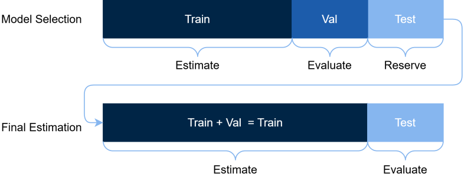
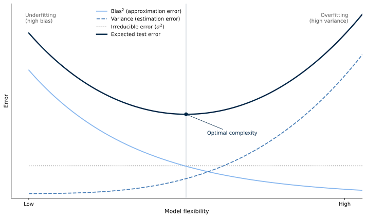

# Introduction {.divider}

## Research
- Contribute (incrementally) to the current surface of knowledge in a field
- Important and necessary to follow best practices of research,
  - Reproducibility --- including code and data
  - Replicability --- different data gives similar results
  - Avoiding off p-hacking and data snooping
  - Peer review

## Research Paper
- Title: "Empirical Asset Pricing via Machine Learning"
- Authors:

<!-- ::: {.overview} -->
::: {.overview style="margin-top: -0.4em;"}
::: {.ov-row-inline}
::: {.ov-label}
Shihao Gu
:::
::: {.ov-desc}
University of Chicago, Booth School of Business
:::
:::
::: {.ov-row-inline}
::: {.ov-label}
Bryan Kelly
:::
::: {.ov-desc}
AQR Capital Management, NBER, &amp; Yale University
:::
:::
::: {.ov-row-inline}
::: {.ov-label}
Dacheng Xiu
:::
::: {.ov-desc}
University of Chicago, Booth School of Business
:::
:::
:::

- Research question: Can machine learning methods improve forecasting of asset returns?

## Agenda

::: {.cards}
::: {.card-box}
[Authors and problem]{.t}
[Research question, overall findings]{.d}
:::
::: {.card-box}
[Implementation details]{.t}
[Authors' take on machine learning best practices]{.d}
:::
::: {.card-box}
[Model walk-through]{.t}
[The structure behind the models]{.d}
:::
::: {.card-box}
[Python implementation]{.t}
[Model estimation and assessment]{.d}
:::
:::

# Models

::: {.overview}
::: {.ov-row-inline}
::: {.ov-label}
Ordinary Least Squares (OLS)
:::
::: {.ov-desc}
Low and high-dimensional linear regression, Huber loss function
:::
:::
::: {.ov-row-inline}
::: {.ov-label}
Penalized Linear Regression
:::
::: {.ov-desc}
Elastic Net, Huber loss function
:::
:::
::: {.ov-row-inline}
::: {.ov-label}
Dimension Reduction
:::
::: {.ov-desc}
PCR and PLS
:::
:::
::: {.ov-row-inline}
::: {.ov-label}
Generalized Linear Regression
:::
::: {.ov-desc}
Splines
:::
:::
::: {.ov-row-inline}
::: {.ov-label}
Trees
:::
::: {.ov-desc}
Boosting and Random Forests
:::
:::
::: {.ov-row-inline}
::: {.ov-label}
Neural Networks
:::
::: {.ov-desc}
Feed Forward Neural Networks
:::
:::
:::

## Forecasting target
- The authors aim to forecast the exess returns of an asset
- Construct additive model,

$$r_{i,t+1} = \underbrace{\mathbb{E}[r_{i,t+1}]}_{g^\ast(z_{i,t})} + \varepsilon_{i,t+1}$$

- $r_{i,t+1}$ is the excess return of asset $i$ at time $t+1$ 
- $g^\ast(\cdot)$ is the forecasting function 
- $z_{i,t}$ is the information set for asset $i$ at time $t$ 
- $\varepsilon_{i,t+1}$ is the error term

## Forecasting function and loss evaluation
- Evaluate the forecast by the out-of-sample $R^2$,

$$R^2_{\text{oos}} = 1 - \frac{\sum_{(i,t)\in\mathcal{T}_3}(r_{i,t+1} - \hat{r}_{i,t+1})^2}{\sum_{(i,t)\in\mathcal{T}_3}r_{i,t+1}^2}$$ 

- where $\mathcal{T}_3$ signifies the test set.

## Huber Loss Function
- Least squares loss sensitive to outliers due to squaring
- Alternative: Huber loss function,

$$ H(x;\xi) = \begin{cases} x^2, & \text{ if } \lvert x\rvert \le \xi \\ 2\xi \lvert x\rvert - \xi^2, & \text{ if } \lvert x\rvert > \xi \end{cases} $$

- Squared loss for small errors, absolute loss for large errors

## Ordinary Least Squares (OLS) (Sec. 1.2)
- Operate under assumption that $g(z_{t,i};\theta)\approx z_{t,i}^\intercal\theta$
- That is, forecasting function (conditional expectation) can be approximated by a linear function of the information set

- The authors implement OLS with the Huber loss function,

$$ \mathcal{L}_H(\theta) = \frac{1}{NT} \sum_{i=1}^{N} \sum_{t=1}^{T} H(r_{i,t+1} - g(z_{i,t};\theta),\xi) $$

## Penalized Linear Regression (Sec. 1.3)
- Adding a penalty term, $\phi(\theta; \cdot)$, to the loss function
- Mitigating overfitting by introducing bias --- regularisation
- General functional form,

$$ \mathcal{L}(\theta; \cdot) = \mathcal{L}(\theta) + \phi(\theta;\cdot)$$

- Most typical penalty terms are the $\ell_1$ and $\ell_2$ norms applied to the parameter vector $\theta$
- This is known as LASSO and ridge regression, respectively
- Elastic net combines the two, 

$$ \phi(\theta;\lambda,\rho) = \lambda(1-\rho)\sum_{j = 1}^P\lvert\theta_j\rvert + \frac12\lambda\rho\sum_{j = 1}^P\theta_j^2$$

- $\lambda$ and $\rho$ are generally subject to hyperparameter tuning
  - The authors set $\rho = 0.5$ and select $\lambda\in\{10^{-4}, 10^{-1}\}$

## Training, Penalized Linear Regression
ff

## Training, Validation, and Testing

<!-- 
Training, Validation, and Testing
 -->

## Dimension Reduction I (Sec. 1.4)
- Principal Component Regression (PCR) and Partial Least Squares (PLS)
- PCR is based on principal component analysis (PCA), an unsupervised technique
- Rewrite linear regression in matrix notation,

$$ r_{i, t+1} = z_{i,t}^\intercal\theta + \varepsilon_{i,t+1} \Rightarrow R = Z\theta +E$$

- $R\in \mathbb{R}^{NT \times 1}$ vector of returns, $r_{i, t+1}$
- $Z\in \mathbb{R}^{NT \times P}$ matrix of stacked predictors, $z_{i,t}$ 
- $E\in \mathbb{R}^{NT\times 1}$ vector of residuals, $\varepsilon_{i,t+1}$

## Dimension Reduction II
- PCR and PLS reduce dimensionality, condensing the variable set from dimension $P$ to $K\ll P$,

$$R = (Z\Omega_K)\theta_K + \tilde{E}$$

- $\Omega_K\in \mathbb{R}^{P\times K}$ is a matrix with columns $\omega_1, ..., \omega_K$
- $\omega_k$ are linear combination weights used to create the $j$th predictive components 
- $Z\Omega_K \in\mathbb{R}^{P\times K}$ is the dimension-reduced version of the original predictor set
- $\theta_K\in\mathbb{R}^{K\times1}$ represents the new parameter vector

## PCR 
- In PCR, the $\omega_k$ are the principal components
- Selected to maximize the variance of the predictive components, $Z\Omega_k$
- Equivalently determine the $K$ linear combinations of $Z$ which most closely emulate the original predictor set
- The PCs are determined via singular value decomposition (SVD) of the predictor matrix $Z$
- The PCs are equivalent to the eigenvectors of the covariance matrix of $Z$, $Z^\intercal Z$ as well
- PC techniques are coursory, see Chapters 6.3, 6.4, 12.1-12.4 of [James et al., 2023 (ISLP)](https://www.statlearning.com/){target="_blank"} for details

## PLS
- In PLS, seek to determined the $K$ linear combinations of $Z$ which have most predictive power of the target
- Sacrifice accuracy relative to PCR in order to associate $\omega_k$ with the target variable, $R$
- In both PCR and PLS, the number of predictive components, $K$, is a hyperparameter to be tuned
- Then $\omega_k$ can be determined  for both PCR and PLS
- $\hat{\Omega}_K$ and $\hat\theta_K$ are estimated via OLS on via regression of $R$ on $Z\hat{\Omega}_K$

## Generalized Linear Regression (Sec. 1.5)

::: {.keypoint}
We are constrained on time, so we will not cover GLM in detail. See Resources for a more thorough introduction.
:::

## Bias-Variance Trade-Off I
- The forecast error of the model decomposes as,

$$ r_{i,t+1} - \hat{r}_{i,t+1} = \underbrace{g^\ast(z_{i,t}) - g(z_{i,t};\theta)}_{\text{sq. bias}} + \underbrace{g(z_{i,t};\theta) - g(z_{i,t};\hat\theta)}_{\text{variance}} + \underbrace{\varepsilon_{i,t+1}}_{\text{irr.error}} $$

- Bias arises from lack of flexibility and data
- Variance arises from overfitting and model complexity
- Irreducible error, inherent noise in data, e.g., news announcements, 

## Bias-Variance Trade-Off II

<!-- 
Training, Validation, and Testing
 -->

