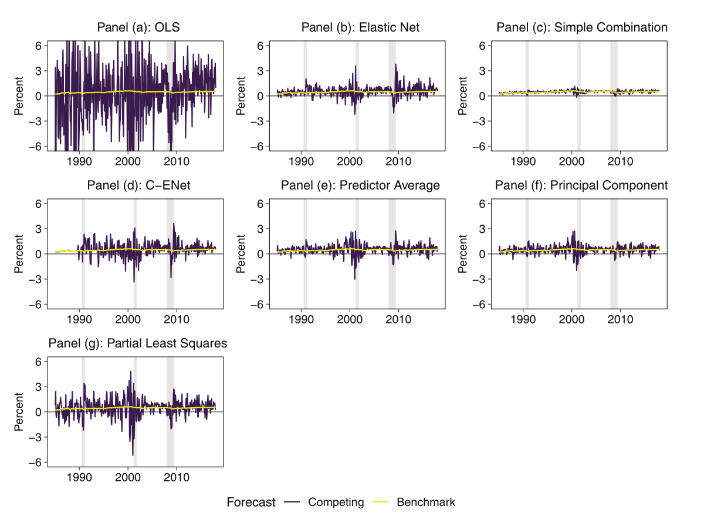
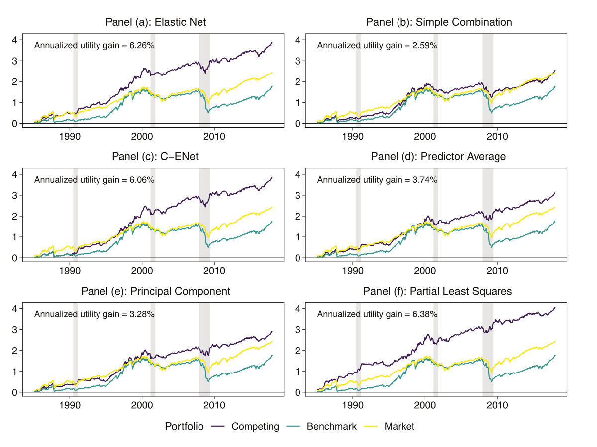

# Introduction {.divider}

## Today

:::: {.steplist}
::: {.step-row}
::: {.step-num}
1
:::
::: {.step-title}
The idea
:::
::: {.step-desc}
Anomalies, long-short portfolios, limits to arbitrage, and why anomaly returns could forecast the market
:::
:::
::: {.step-row}
::: {.step-num}
2
:::
::: {.step-title}
The methods
:::
::: {.step-desc}
Seven forecasts of the market return, the expanding window, and how forecasts are evaluated
:::
:::
::: {.step-row}
::: {.step-num}
3
:::
::: {.step-title}
The results
:::
::: {.step-desc}
Table II, Figures 1 and 2, and the gap between the short and the long leg, next to our replication
:::
:::
::::

::: {.keypoint}
Unlike in Lecture 5, the authors provide data and code, so a full replication is possible
:::

## Reading Guide

:::: {.steplist .align-md}
::: {.step-row}
::: {.step-title}
Introduction
:::
::: {.step-desc}
pp. 639--644: the question, the findings, the economic mechanism and a preview of the methods.
:::
:::
::: {.step-row}
::: {.step-title}
Section I (optional)
:::
::: {.step-desc}
pp. 644--651: a stylized model. Possibly read the first page, which gives the setup (Eqs. 1--3). The rest derives the sign of the predictive coefficient.
:::
:::
::: {.step-row}
::: {.step-title}
Section II
:::
::: {.step-desc}
pp. 651--656: the seven models and how they are evaluated.
:::
:::
::: {.step-row}
::: {.step-title}
Sections III--IV
:::
::: {.step-desc}
pp. 656--665: data (Table I) and the main results (Table II, Figures 1--3).
:::
:::
::: {.step-row}
::: {.step-title}
Section V (optional)
:::
::: {.step-desc}
pp. 666--676: further evidence on limits to arbitrage (Tables III--V, Figures 4--5).
:::
:::
::: {.step-row}
::: {.step-title}
Section VI
:::
::: {.step-desc}
pp. 676--677: conclusion.
:::
:::
::::

## Anomalies and the Expected Market Return (Dong et al., 2022)

Paper: "Anomalies and the Expected Market Return", *Journal of Finance*, 77(1), 639--681, 2022

Authors:

::: {.overview}
::: {.ov-row-inline}
::: {.ov-label}
Xi Dong
:::
::: {.ov-desc}
Baruch College, City University of New York
:::
:::
::: {.ov-row-inline}
::: {.ov-label}
Yan Li
:::
::: {.ov-desc}
Southwestern University of Finance and Economics
:::
:::
::: {.ov-row-inline}
::: {.ov-label}
David E. Rapach
:::
::: {.ov-desc}
Saint Louis University
:::
:::
::: {.ov-row-inline}
::: {.ov-label}
Guofu Zhou
:::
::: {.ov-desc}
Washington University in St. Louis
:::
:::
:::

:::{.spacer}
:::

::: {.keypoint}
Research question: **Do long-short anomaly returns predict the market excess return?**
:::

## The Authors' Main Findings

::: {.overview}
::: {.ov-row}
::: {.ov-label}
Shrinkage is necessary
:::
::: {.ov-desc}
OLS on all 100 anomaly returns overfits: its monthly market return forecasts go beyond ±6% in some months, and its $R^2_{\text{OOS}}$ is −2,513.86%
:::
:::
::: {.ov-row}
::: {.ov-label}
Anomaly returns predict the market
:::
::: {.ov-desc}
The six regularized forecast models beat the prevailing mean (the average past market return). Their monthly $R^2_{\text{OOS}}$ is 0.89% to 2.81%, above the 0.5% that Campbell and Thompson (2008) call economically meaningful, and the Clark and West test is significant for all of them
:::
:::
::: {.ov-row}
::: {.ov-label}
Economic value
:::
::: {.ov-desc}
A mean-variance investor would pay a fee of 2.59 to 6.38 percentage points of returns per year to use the forecasts (forgo returns of this amount to get the same utility as with the forecasts)
:::
:::
::: {.ov-row}
::: {.ov-label}
Slow correction of overpricing
:::
::: {.ov-desc}
The signal comes from the short leg (the overpriced stocks), and predictability is stronger when market frictions are high. 

This aligns with overpricing being corrected slowly (explained on the next slides)
:::
:::
::: {.ov-row}
::: {.ov-label}
A short-horizon signal
:::
::: {.ov-desc}
Predictability falls with the horizon, with no significant evidence at 12 months: the correction of mispricing plays out over a few months
:::
:::
:::

## Characteristics and Anomalies

:::: {.compare}
::: {.compare-col}
[Characteristic]{.cmp-title}

- A firm-level variable observed for every stock in every month
- Example: the **book-to-market ratio**, the book value of equity divided by its market value. High: cheap relative to the books (value). Low: expensive (growth)
- On its own it makes no claim about future returns
:::
::: {.compare-col .cmp-alt}
[Anomaly]{.cmp-title}

- A stock characteristic that has been documented to predict returns, which standard asset pricing models (e.g., the CAPM) do not explain
- Example: stocks that rose the most over the past year tend to keep outperforming stocks that fell the most (momentum)
- Buying past winners and selling past losers earns a significant alpha, the return not explained by market risk
:::
::::

:::{.notes}
The returns of the anomaly are regressed (usually the returns are in the shape of a long-short portfolio) on the Fama-French factors (MKT, SMB, HML). The factors absorb the part of the returns one could get by taking exposure to known risk factors. The intercept $\alpha$ is the average returns left over, it is the part of the anomaly the factors do not explain. Hence, in 71/100 cases, the Fama-French model does not manage to explain the anomaly returns. 
However, be aware of multiple testing. It is the three-factor model.

Book value: Assets minus liabilities, Market value: Price times shares outstanding.
Significant alpha. Regress the anomaly’s long-short return on risk factors, for example the market return in the CAPM or the three Fama-French factors. The intercept $\alpha$ is the average return the factors don’t explain. "Significant" means it is statistically different from zero, so the extra return is unlikely to be luck and isn’t just compensation for known risks. That is what makes it an anomaly.
:::

::: {.keypoint}
Every anomaly is a characteristic, but not every characteristic is an anomaly
:::

## The Long-Short Portfolio

- Each month, rank the stocks on a characteristic. The two extremes of the ranking are the **legs** of the portfolio
- **Long leg**: expect to earn high returns (cheap stocks): buy
- **Short leg**: expect to earn low returns (expensive stocks): sell (short). The shares are borrowed, sold now and bought back later, so the position gains if the price falls
- The short sale finances the purchases, so the net investment is approximately zero. 

::: {.keypoint}
Payoff = return of the long leg minus return of the short leg
:::

## Long-Short Payoffs Example

::: {.act-table style="font-size: 0.7em;"}
| Month | Long leg | Short leg | Long-short payoff |
|:------------------------------|:---------:|:----------:|:-----------------:|
| Market booms | +8% | +6% | +2% |
| Market crashes | −5% | −7% | +2% |
| Ranking right, market flat | +3% | −3% | +6% |
| Ranking wrong | +1% | +4% | −3% |
:::

::: {.keypoint}
Market moves hit both legs and cancel, so the payoff depends on the ranking.

It is positive only on average (mean 0.38% per month, standard deviation 4.37%, Table I)
:::

## Value-Weighted Decile Sorting

:::: {.steplist style="font-size: 0.8em;"}
::: {.step-row}
::: {.step-num}
1
:::
::: {.step-title}
Rank
:::
::: {.step-desc}
At the beginning of the month, rank all stocks on the characteristic (here the book-to-market ratio), which is known before the month's returns
:::
:::
::: {.step-row}
::: {.step-num}
2
:::
::: {.step-title}
Cut
:::
::: {.step-desc}
Split the ranking into 10 equal-sized groups (deciles). Decile 1 has the lowest values (expensive stocks, the short leg), decile 10 the highest (cheap stocks, the long leg)
:::
:::
::: {.step-row}
::: {.step-num}
3
:::
::: {.step-title}
Weight
:::
::: {.step-desc}
Inside a decile, weight each stock by its market capitalization: value-weighted
:::
:::
::: {.step-row}
::: {.step-num}
4
:::
::: {.step-title}
Hold
:::
::: {.step-desc}
Hold the decile portfolios for the month and record their returns. Next month, rank again
:::
:::
::::

::: {.act-table style="font-size: 0.58em;"}
| Decile | Stock | Book-to-market | Market cap (USD bn) | Return | Equal-weighted return | Value-weighted return |
|:------:|:-----:|:----------:|:----------:|:------:|:--------------:|:----------------------|
| 10 | A | 1.8 | 80 | +4% | | |
| 10 | B | 2.2 | 20 | +9% | 6.5% | $0.8 \times 4 + 0.2 \times 9 = 5.0\%$ |
| 1 | C | 0.3 | 50 | −2% | | |
| 1 | D | 0.4 | 50 | +2% | 0.0% | $0.5 \times (-2) + 0.5 \times 2 = 0.0\%$ |
:::

::: {.keypoint}
Long-short return: 5.0% − 0.0% = 5.0%.

Value-weighting lets large firms dominate each portfolio, as in the market itself
:::

:::{.notes}
Illustration with four stocks: only the stocks of decile 10 and decile 1 are shown, the other deciles are left out.

Equal-weighted: the simple average of the returns in the decile, every stock counts the same. Value-weighted: the average weighted by market capitalization, so a large firm counts more than a small one (80 of 100 in decile 10 above).
:::

## Decile Sorting in Code I

::: {.code-sm}
```{pyodide}
import numpy as np
import pandas as pd

rng = np.random.default_rng(39)
stocks = pd.DataFrame({"book_to_market": rng.uniform(0.1, 2.5, 12).round(2),
                       "cap": rng.integers(5, 100, 12),              # market cap, USD bn
                       "ret": rng.normal(3, 3, 12).round(1)})        # next month's return, %

stocks["rank"] = stocks["book_to_market"].rank(method="first").astype(int) # 1. rank: 1 = most expensive
stocks["decile"] = np.ceil(stocks["rank"] / (len(stocks) / 10)).astype(int)   # 2. 10 equal groups
stocks.sort_values("rank")
```
:::


## Decile Sorting in Code II {.compact}

```{pyodide}
# 3. weight = cap / total cap of the decile (e.g. 80 / 100 = 0.8)
stocks["weight"] = stocks["cap"] / stocks.groupby("decile")["cap"].transform("sum")
# 4. decile return = sum of weight x return (e.g. 0.8 x 4 + 0.2 x 9 = 5.0)
decile_ret = (stocks["weight"] * stocks["ret"]).groupby(stocks["decile"]).sum()

print(stocks[stocks["decile"].isin([1, 10])].sort_values("rank").round(2))
print("long leg (dec. 10):", round(decile_ret[10], 2), "  short leg (dec. 1):", round(decile_ret[1], 2))
print("long-short:", round(decile_ret[10] - decile_ret[1], 2))
```

- Decile 10 minus decile 1: long-short return for one anomaly in one month, one cell of the predictor table

::: {.notes}
`.sum()` because the weights for e.g., the market capitalization is the relevant market capitalization divided by the sum of all market capitalizations.
In the second case, sum because: a value-weighted return is a weighted average, and when the weights add up to 1, a weighted average is just a sum.
:::

## Cross-Section versus Time Series

::: {.act-table style="font-size: 0.66em;"}
| | Cross-sectional | Time series |
|:--------------|:----------------------------------------|:-------------------------------------------|
| Question | Which stocks beat which this month? | Will the market go up or down next month? |
| One observation | A stock, $r_{i,t+1}$ | A month, $r_{M,t+1}$ |
| Predictors | Characteristics $x_{i,t}$ of each stock (value, size, momentum) | Variables $z_t$ of each month (valuation ratios, interest rates, inflation) |
| Finding | Anomalies: sorted portfolios earn average returns that standard models (CAPM, Fama-French) do not explain | Few predictors beat the prevailing mean out of sample (Goyal and Welch, 2008) |
| Example | Gu et al. (2020, Lecture 5): a panel, every stock in every month | This paper |
:::

::: {.keypoint}
Anomalies are a cross-sectional phenomenon

This paper asks whether they say anything about the market as a whole
:::

## How the Paper Links the Cross-Section to the Time Series

:::: {.flow}
::: {.fn}
**Cross-section**

Month $t$: an anomaly and a return for every stock
:::
::: {.fn}
**Sort**

Decile 10 minus decile 1: one long-short return $r^{i}_{LS,t}$
:::
::: {.fn}
**Time series**

Every month, every anomaly: 100 series of long-short returns
:::
::: {.fn .fn-navy}
**Forecast**

Regress $r_{M,t+1}$ on the 100 long-short returns of month $t$
:::
::::

::: {.keypoint}
The paper takes the long-short returns of the cross-sectional literature and uses them as predictors in a time-series forecast of the market excess returns
:::

## Intuition: Limits to Arbitrage

- **Mispricing**: a price that deviates from fundamental value
- **Arbitrageurs** (e.g., hedge funds) buy underpriced and sell (short) overpriced stocks, which corrects the mispricing
- **Limits to arbitrage**: reasons why they cannot do this fully or immediately

:::: {.triad}
::: {.triad-card}
[Costs]{.tc-tag}

Trading costs and fees for borrowing shares
:::
::: {.triad-card}
[Risk]{.tc-tag}

Prices can move further away before they converge, and losses can force early liquidation
:::
::: {.triad-card}
[Limited capital]{.tc-tag}

Only a limited amount of money can be allocated to each mispriced stock
:::
::::

::: {.keypoint}
The result: mispricing is corrected gradually, over several months.

The paper calls this **mispricing correction persistence (MCP)**
:::

## Asymmetric Limits to Arbitrage

:::: {.compare}
::: {.compare-col}
[Underpriced stock: price 80\$, worth 100\$]{.cmp-title}

- Buy the stock
- The most you can lose is 80\$
- No borrowing, no fee
:::
::: {.compare-col .cmp-alt}
[Overpriced stock: price 120\$, worth 100\$]{.cmp-title}

- Must short it: borrow shares and pay a fee, if shares can be borrowed at all
- No limit on losses: the price can keep rising
- If the price rises to 140\$ before it falls, losses keep growing and may force you to close the position
- Some investors are not allowed to short
:::
::::

::: {.keypoint}
Asymmetry: frictions are more significant when shorting than when going long

$\to$ Overpricing is corrected more slowly (Miller, 1977): stronger MCP for the short leg
:::


## From Frictions to Predictability

:::: {.steplist style="font-size: 0.9em;"}
::: {.step-row}
::: {.step-num}
1
:::
::: {.step-title}
Frictions
:::
::: {.step-desc}
Short-selling frictions make it hard to correct overpricing of the stocks in the short leg
:::
:::
::: {.step-row}
::: {.step-num}
2
:::
::: {.step-title}
Slow correction
:::
::: {.step-desc}
Overpricing is corrected gradually: short-leg stocks that fell this month tend to fall again next month, because correction occurs slowly. The long leg is corrected quickly, so it carries little persistence
:::
:::
::: {.step-row}
::: {.step-num}
3
:::
::: {.step-title}
Signal
:::
::: {.step-desc}
A falling short leg raises the long-short return this month. The long leg also moves it, but that part does not persist
:::
:::
::: {.step-row}
::: {.step-num}
4
:::
::: {.step-title}
Market
:::
::: {.step-desc}
The short-leg stocks keep falling next month, and they are part of the market: the market return is lower
:::
:::
::::

::: {.keypoint}
In $r_{M,t+1} = \alpha + \beta\, r_{LS,t} + \varepsilon_{t+1}$, $\beta < 0$: a higher long-short return this month lowers the forecast of next month's market return
:::

::: {.notes}
Point 3, carries little persistence, there will not necessarily be any effects in the next month.
:::

## Why Should Anomaly Returns Predict the Market?

:::: {.triad}
::: {.triad-card}
[Slow correction]{.tc-tag}

[Mispricing correction persistence]{.tc-title}

If overpricing is corrected slowly, a fall in the short leg today is followed by more falls next month, in the market too: $\beta < 0$ (Sec. I, Eq. 15)
:::
::: {.triad-card}
[Long minus short]{.tc-tag}

[Noise reduction]{.tc-title}

The two legs share a common component unrelated to mispricing (Sec. I, Eq. 1). Taking the difference removes it
:::
::: {.triad-card}
[Many anomalies]{.tc-tag}

[Aggregation]{.tc-title}

Each anomaly return also contains noise of its own (Sec. I, Eq. 19). The noise is nearly uncorrelated across anomalies (average correlation 0.08, Table I), so combining the 100 series, as all seven models do, cancels much of it
:::
::::


# Methodology and Replication {.divider}

## Replication Plan

The authors' package provides data, R code, and output files

::: {.act-table style="font-size: 0.62em;"}
| Step | Task | From the authors | Detail to get right |
|:-----|:-----------|:-------|:-------|
| 1 Data | Long-short anomaly returns and the market excess return | Finished returns (data files) | The raw data (CRSP, Compustat) is proprietary |
| 2 Pre-processing | Impute NAs, lag predictors, build multi-period targets | R code |  |
| 3 Forecasting | Seven methods in an expanding window: one forecast per month, 1985:01--2017:12 (396 forecasts) | R code | Elastic net with AICc, OLS with dependent columns |
| 4 Comparison | $R^2_{\text{OOS}}$ and Clark-West statistics against Table II | Output files (forecasts and tables) |  |
:::

## Data and Forecasting Setup (Secs. II.A, III)

::: {.overview}
::: {.ov-row-inline}
::: {.ov-label}
Target
:::
::: {.ov-desc}
Next month's market excess return $r_{M,t+1}$: CRSP value-weighted return of all stocks minus the 1-month T-bill rate
:::
:::
::: {.ov-row-inline}
::: {.ov-label}
Predictors
:::
::: {.ov-desc}
The 100 long-short anomaly returns of month $t$, $r^{i}_{LS,t}$: decile 10 (long leg) minus decile 1 (short leg), value-weighted, rebalanced monthly
:::
:::
::: {.ov-row-inline}
::: {.ov-label}
Anomalies
:::
::: {.ov-desc}
From the cross-sectional literature, e.g., value, profitability, investment, issuance, momentum, and trading frictions
:::
:::
::: {.ov-row-inline}
::: {.ov-label}
Stocks
:::
::: {.ov-desc}
NYSE, AMEX and NASDAQ stocks, excluding stocks with a price below \$5
:::
:::
::: {.ov-row-inline}
::: {.ov-label}
Sample
:::
::: {.ov-desc}
1970:01--2017:12, 576 months per series
:::
:::
:::

::: {.keypoint}
The predictable part of the monthly market return is small (low signal-to-noise ratio), so the prevailing mean is hard to beat (Goyal and Welch, 2008)
:::

::: {.keypoint}
Table II also uses the 100 long-leg or the 100 short-leg anomaly returns as predictors instead
:::

## The Real Data in Code I {.compact}

```{pyodide}
import pandas as pd
import numpy as np

returns = pd.read_excel("assets/data/dataMarketRx.xlsx")
anomalies = pd.read_excel("assets/data/dataLongShortMissing.xlsx")

y = 100 * returns.iloc[:, 1].to_numpy()            # market excess return, %
X_na = 100 * anomalies.iloc[:, 1:].to_numpy()      # 100 anomaly returns, %, with NAs
X_all = np.where(np.isnan(X_na), np.nanmean(X_na, axis=1, keepdims=True), X_na)

# cont'd on next slide
```

- Column 0 of both files holds the dates. `X_all` replaces each NA by the average of the other anomalies that month

## The Real Data in Code II

```{pyodide}
# cont'd from previous slide

# Converting to dataframe
data = pd.DataFrame(X_all, index=anomalies.iloc[:, 0], columns=anomalies.columns[1:])
data["target: market, month t+1"] = pd.Series(y, index=data.index).shift(-1)
data.iloc[:, [0, 1, 2, -2, -1]].round(2).head()
```

- Each column is a time series. The cross-sectional sorting is done already inside each cell


## Benchmark versus Competing Forecasts (Sec. II.A)

- **Benchmark**, the prevailing mean: the average of the market returns observed up to $t$

$$\hat r^{\text{PM}}_{M,t+1} = \frac{1}{t}\sum_{s=1}^{t} r_{M,s}$$

- **Competing forecasts**: regressions of next month's market return on this month's 100 anomaly returns

$$r_{M,t+1} = \alpha + \sum_{i=1}^{100}\beta_i\, r^{i}_{LS,t} + \varepsilon_{t+1}$$

- The seven competing forecasts use the anomaly returns in different ways: all 100 at once (OLS, ENet), one at a time (Combine, C-ENet), or one constructed predictor (Avg, PCR, PLS)

## Training and Testing Samples (Sec. IV)

:::: {.splitbar}
::: {.sb-train style="flex: 10"}
Step 1: 1970:01--1979:12
:::
::: {.sb-test style="flex: 3"}
1980:01
:::
::: {style="flex: 38; text-align: left; color: #898781;"}
First univariate forecast for C-ENet
:::
::::

:::: {.splitbar}
::: {.sb-train style="flex: 15"}
Step 61: 1970:01--1984:12
:::
::: {.sb-test style="flex: 3"}
1985:01
:::
::: {style="flex: 33; text-align: left; color: #898781;"}
First evaluated forecast, all seven methods
:::
::::

:::: {.splitbar}
::: {.sb-train style="flex: 48"}
Step 456: 1970:01--2017:11
:::
::: {.sb-test style="flex: 3"}
2017:12
:::
::::

- Expanding window, monthly re-estimation frequency. 396 forecasts, 1985:01--2017:12
- 1980--1984, holdout: needed only by C-ENet, which selects anomalies by the past accuracy of their univariate forecasts. Defaults to estimation sample for the remaining models
- No validation sample: AICc chooses the elastic net penalty


::: {style="font-size: 0.62em; color: #666;"}
Dark: estimation sample. Light: the month that is forecast
:::

:::{.notes}
The holdout is necessary because we need to be able to compare with returns realizations. This is how we select the variables.  
:::

## Why Not OLS?

- Here: 101 coefficients, estimated from 179 months at the first evaluated forecast (1985:01)
- OLS fits the noise in the sample and forecasts it: $R^2_{\text{OOS}} = -2{,}513.86\%$ (Table II)

::: {.keypoint}
The six other forecasts restrict/regularize the regression in different ways
:::

## The Seven Models (Sec. II.A)

::: {.act-table style="font-size: 0.68em;"}
| Forecast | Construction | Shrinkage |
|:---------|:-----------------------------------------------------------|:--------------------------------------|
| OLS | Multiple regression on all 100 anomaly returns | None |
| ENet | The same regression with an elastic net penalty, size chosen by AICc | Penalty, sets some coefficients to zero |
| Combine | The average of 100 univariate regression forecasts, one per anomaly | Averaging |
| C-ENet | The average of the univariate forecasts that an elastic net selects | Selection, then averaging |
| Avg | Univariate regression on the average of the 100 anomaly returns | One equal-weighted predictor |
| PCR | Univariate regression on the first principal component | One component, ignores the target |
| PLS | Univariate regression on the first PLS component | One component, built to covary with the target |
:::

::: {.keypoint}
All six alternatives to OLS shrink the forecast towards the prevailing mean
:::

## OLS in Code

::: {style="font-size: 0.68em;"}
```python
def independent_columns(X):
    """Columns of X to keep when linearly dependent ones are dropped, in order (as lm in R)."""
    A = np.column_stack([np.ones(len(X)), X])
    tol = 1e-8 * np.abs(A).max() * max(A.shape)
    keep = [0]                                              # the intercept
    for j in range(1, A.shape[1]):
        if np.linalg.matrix_rank(A[:, keep + [j]], tol=tol) == len(keep) + 1:
            keep.append(j)
    return [j - 1 for j in keep[1:]]

def ols_forecaster(X_tr, y_tr, X_new):
    keep = independent_columns(X_tr)                      # drop linearly dependent columns, as lm() in R
    model = LinearRegression().fit(X_tr[:, keep], y_tr)   # estimate on the training months
    return model.predict(X_new[:, keep])[0]               # forecast for the next month
```
:::

- `ols_forecaster()` and the functions to follow receive the training data `X_tr`, `y_tr` and the new predictors `X_new`, and return the one-step-ahead forecast

::: {.notes}
The authors' code is in R, and `lm` drops linearly dependent columns (an anomaly missing in every training month is filled with the average of the others, an exact linear combination of the other columns). `LinearRegression` would instead return the minimum-norm solution
:::

## Elastic Net and AICc {.compact-xs}

$$\hat\beta_{\text{ENet}} = \underset{\beta}{\arg\min} \left\{ \sum_{t}\big(r_{M,t+1} - x_t^\top\beta\big)^2 + \lambda\left[\rho\sum_{j=1}^{100} |\beta_j| + (1-\rho)\sum_{j=1}^{100} \beta_j^2\right] \right\}$$

- $x_t$: predictors (anomaly returns of month $t$), $\lambda$: penalty strength, $\rho$: mixing parameter. The $\ell_1$ part shrinks the coefficients and sets some to zero, while the $\ell_2$ part shrinks as well
- $\lambda$ is chosen from a grid of 200 values by the *corrected* Akaike information criterion (AICc), with $n$ observations and $\text{df}(\lambda)$ non-zero coefficients,

$$\begin{aligned}
\text{AIC}(\lambda) &= n\log\big(\text{RSS}(\lambda)/n\big) + 2\,\text{df}(\lambda)\\ 
\text{AICc}(\lambda) &= \text{AIC}(\lambda) + \frac{2\,\text{df}(\lambda)\big(\text{df}(\lambda)+1\big)}{n-\text{df}(\lambda)-1}
\end{aligned}$$

::: {.keypoint}
The AICc replaces hyperparameter tuning via validation sample. Select the $\lambda$ minimizing the AICc
:::

::: {.small .faint}
The authors use `glmnet` in R, with mixing parameter `alpha` = 0.5. It writes the penalty as $\lambda[\alpha\lVert\beta\rVert_1 + \tfrac12(1-\alpha)\lVert\beta\rVert_2^2]$ and divides the squared errors by $2n$, so `alpha` = 0.5 is $\rho = 2/3$ above
:::

::: {.notes}
$\rho = 1$ is LASSO, $\rho = 0$ is ridge. 
:::

## Elastic Net in Code
::: {style="font-size: 0.8em;"}
```python
def enet_forecaster(X_tr, y_tr, X_new):
    intercept, coef = enet_aicc(X_tr, y_tr)
    return (intercept + X_new @ coef)[0] # Means intercept plus sum of coefficients times predictors
```
:::

- The authors implement elastic net via `glmnet` in `R`
- We must implement this manually (`enet_aicc`), because `ElasticNet` from `sklearn` does not match the approach exactly (the forecasts differ from the paper in about 7% of the months)
- `enet_forecaster` function relies on `enet_aicc()`, omitted because it is very long -- see lecture notebook


## Combine: Average of Univariate Forecasts

$$\hat r^{\,\text{Combine}}_{M,t+1} = \frac{1}{100}\sum_{i=1}^{100}\big(\hat\alpha_i + \hat\beta_i\, r^{i}_{LS,t}\big)$$

- Each term is the forecast of a univariate regression of $r_{M,s+1}$ on $r^{i}_{LS,s}$, one per anomaly

**Illustration with 4 anomalies**

::: {.act-table style="font-size: 0.66em;"}
| | Anomaly 1 | Anomaly 2 | Anomaly 3 | Anomaly 4 | Combine |
|:------------------|:----:|:----:|:----:|:----:|:---------:|
| Forecast of next month's market return | +0.9% | +0.3% | −0.2% | +0.5% | ¼ (0.9 + 0.3 − 0.2 + 0.5) = +0.38% |
:::

::: {.keypoint}
Each univariate forecast uses one noisy predictor. Averaging lets their errors offset, so *Combine* aids in isolating the signal from the noise 
:::

## C-ENet: Choosing Which Forecasts to Average

:::: {.steplist style="font-size: 0.78em;"}
::: {.step-row}
::: {.step-num}
1
:::
::: {.step-title}
Collect
:::
::: {.step-desc}
In every earlier month, 100 univariate forecasts were made and the market returns were later realized. Store both. 

This history is why forecasting starts in 1980, before the evaluation
:::
:::
::: {.step-row}
::: {.step-num}
2
:::
::: {.step-title}
Regress
:::
::: {.step-desc}
Regress the realized market returns on the 100 stored forecasts with an elastic net and non-negative coefficients (a Granger-Ramanathan regression)
:::
:::
::: {.step-row}
::: {.step-num}
3
:::
::: {.step-title}
Select
:::
::: {.step-desc}
Keep anomalies whose forecasts receive a non-zero coefficient
:::
:::
::: {.step-row}
::: {.step-num}
4
:::
::: {.step-title}
Average
:::
::: {.step-desc}
Average the forecasts -- as made in the *Combine* approach -- of the selected anomalies to produce the C-ENet forecast
:::
:::
::::

**The same 4 anomalies**

::: {.act-table style="font-size: 0.64em;"}
| | Anomaly 1 | Anomaly 2 | Anomaly 3 | Anomaly 4 | C-ENet |
|:----------------------|:-----:|:-----:|:-----:|:-----:|:-----:|
| Coefficients from the regression | 0.6 | 0 | 0.2 | 0 | selects 1 and 3 |
| Forecast | +0.9% | +0.3% | −0.2% | +0.5% | (0.9 + (−0.2)) / 2 = +0.35% |
:::

::: {.keypoint}
Averaging all 100 variables regularizes strongly.

C-ENet avoids over-shrinking by averaging only the selected anomalies
:::


## Combine and C-ENet in Code

::: {style="font-size: 0.74em;"}
```python
def univariate_forecasts(X_tr, y_tr, X_new):
    # One simple regression per anomaly: 100 forecasts 
    forecasts = []
    for j in range(X_tr.shape[1]):              # loop over the 100 anomalies
        x_tr_j = X_tr[:, [j]]                   # anomaly j in the training months, as a column
        x_new_j = X_new[:, [j]]                 # anomaly j this month
        model = LinearRegression().fit(x_tr_j, y_tr)
        forecasts.append(model.predict(x_new_j)[0])
    return np.array(forecasts)

def cenet_forecaster(uni_tr, y_tr, uni_new, pm):
    # uni_tr: past univariate forecasts, y_tr: associated targets, 
    # uni_new: current univariate forecasts, pm: prevailing mean
    _, coef = enet_aicc(uni_tr, y_tr, lower=0.0)
    selected = coef != 0
    return uni_new[0, selected].mean() if selected.any() else pm
```
:::

- Combine is the mean of the 100 univariate forecasts, `uni_new.mean()`
- `lower=0.0` imposes non-negative coefficients
- If C-ENet selects nothing, the forecast is the prevailing mean `pm`

## Principal Component Regression (PCR) {.compact}

- With many predictors $x_{1,t}, \dots, x_{p,t}$, we can compress them into $K \ll p$ constructed predictors, **the principal components**
- Each component is a weighted sum of the predictors: $Z_{k,t} = w_k^\top x_t$, $k = 1, \dots, K$ 
- The weights are chosen such that the components retain as much of the information in the predictors as possible: $Z_1$ explains the largest share of their variation, $Z_2$ the largest share of what is left, and so on. The components are uncorrelated by construction
- The predictors for both PCR and PLS require standardization
- Regression of the target on the $K$ components: $y_{t+1} = \alpha + \sum_{k=1}^{K} \beta_k Z_{k,t} + \varepsilon_{t+1}$
- In this paper, both PCR and PLS use **only the first component**, $K = 1$,

::: {.callout-tip}
We do not go into the construction of the components, as it is rather involved. Refer to the book [An Introduction to Statistical Learning in Python (ISLP)](https://www.statlearning.com/), James et al., 2023, chapters 6.3, 6.4, and 12.1-12.4. 
:::

## Partial Least Squares (PLS)

- Same idea as PCR: compress the predictors into $K$ weighted sums $Z_{k,t} = w_k^\top x_t$, and regress the target on them
- Difference: the components retain as much of the information that is relevant *for the target* as possible. $Z_1$ moves the most with the target, $Z_2$ the most among what remains, etc. The components are uncorrelated by construction
- For $Z_1$, each predictor is weighted by how much it moves with the target. A predictor unrelated to the target gets a weight near zero
- Regression of the target on the $K$ components: $y_{t+1} = \alpha + \sum_{k=1}^{K} \beta_k Z_{k,t} + \varepsilon_{t+1}$

::: {.keypoint}
Unsupervised: PCR constructs components retaining information considering only the *predictors*

Supervised: PLS retains the information in the predictors relevant for the *target*
:::

## Dimension Reduction

The 100 anomaly returns are collapsed into one predictor $Z_t$, followed by a univariate regression

$$r_{M,t+1} = \alpha + \beta Z_t + \varepsilon_{t+1}, \qquad Z_t = \sum_{i=1}^{100} w_i\, r^{i}_{LS,t}$$

:::: {.triad}
::: {.triad-card}
[Model *Avg*]{.tc-tag}

[Equal weights]{.tc-title}

$w_i = 1/100$: $Z_t$ is the (cross-sectional, i.e., row-wise) average of the anomaly returns
:::
::: {.triad-card}
[Model *PCR*]{.tc-tag}

[Principal components: largest variance]{.tc-title}

Weights chosen so that $Z_t$ has the largest variance explained, reducing dimensionality of the data while retaining as much information as possible. Does not account for the target
:::
::: {.triad-card}
[Model *PLS*]{.tc-tag}

[Partial least squares: most relevant for the target]{.tc-title}

Weights chosen so that $Z_t$ covaries as much as possible with the market return, retaining the information in the anomalies that is relevant for the target. Accounts for the target
:::
::::

## Dimension Reduction in Code {.compact}

::: {style="font-size: 0.7em;"}
```python
t = 180                                                       # months observed
S = StandardScaler().fit_transform(X_all[:t])                 # standardized anomalies
A = np.nanmean(X_na[:t], axis=1, keepdims=True)               # average of the 100 anomalies in each month

def avg_forecaster(A_tr, y_tr, A_new):
    model = LinearRegression().fit(A_tr, y_tr)        # regress on the average
    return model.predict(A_new)[0]

def pcr_forecaster(S_tr, y_tr, S_new):
    pca = PCA(n_components=1).fit(S_tr)               # fitting the model
    Z_tr, Z_new = pca.transform(S_tr), pca.transform(S_new) # obtaining the first principal component
    model = LinearRegression().fit(Z_tr, y_tr)        # regress on the component
    return model.predict(Z_new)[0]

def pls_forecaster(S_tr, y_tr, S_new):
    pls = PLSRegression(n_components=1, scale=False).fit(S_tr, y_tr)   # component and regression in one
    return pls.predict(S_new).item()
```
:::

- `S`: standardized anomaly returns, so that no anomaly dominates PCR and PLS due to its scale
- `A`: the one predictor of Avg, the average of the 100 anomaly returns in each month

::: {.notes}
180: number of observations
179: number of training months (the last month is used to forecast the next)
Without keepdims: shape (180,), a flat 1D array of 180 numbers.
With keepdims=True: shape (180, 1), a single column with 180 rows.
scale=False means that the pls_forecaster should not standardize the predictors again
pls.predict(S_new).item(): item means we extract a scalar instead of a 1x1 matrix
:::

## Implementing All Models for One Month I {.compact}
::: {style="font-size: 0.78em;"}
```python
def forecast_all(t, h, uni):
    i = t - R                                                # row of uni for month t
    y_all = target(t, h)                                     # the targets known at month t
    y_tr = y_all[1:]
    pm = y_all.mean()                                        # pm: the prevailing mean (benchmark)
    # Window function: extracts training windows accounting for multi-period targets/longer horizon forecasting
    X_tr, X_new = window(X_all[:t], t, h)                    # the 100 anomaly returns
    S_tr, S_new = window(StandardScaler().fit_transform(X_all[:t]), t, h)    # standardised
    A_tr, A_new = window(np.nanmean(X_na[:t], axis=1, keepdims=True), t, h)  # their average
    uni_tr, uni_new = uni[:i - (h - 1)], uni[i:i + 1]        # univariate forecasts: past and current
    # cont'd on next slide
```
:::

- `t`: the number of months observed when the forecast is made
- `h` is the horizon of the forecast in months
- `R`: the 120 months of the initial estimation sample
- `uni` has index initializing at `t = R`, meaning that month `t` has row `i = t - R`
- `uni`: the 100 univariate forecasts of every month after the initial estimation window, one row per month

::: {.notes}
`uni` is a table with one row per month since 1980:01, holding the 100 forecasts made that month: `uni_new` is this month's row, and `uni_tr` is all the rows above it whose outcomes we already know.
:::

## Implementing All Models for One Month II

::: {style="font-size: 0.78em;"}
```python
# cont'd from previous slide
    return {"OLS": ols_forecaster(X_tr, y_tr, X_new),
            "ENet": enet_forecaster(X_tr, y_tr, X_new),
            "Comb": uni_new.mean(),
            "CENet": cenet_forecaster(uni_tr, y_all[R:], uni_new, pm),
            "Avg": avg_forecaster(A_tr, y_tr, A_new),
            "PCR": pcr_forecaster(S_tr, y_tr, S_new),
            "PLS": pls_forecaster(S_tr, y_tr, S_new),
            "PM": pm}                                        # the benchmark, kept next to the forecasts
```
:::

- Only data up to time `t` enters, so every forecast is out of sample


## Implementing All Models for the Full Sample {.compact}

::: {style="font-size: 0.75em;"}
```python
R, hold, h = 120, 60, 1                 # initial window, holdout (months), horizon
names = ["OLS", "ENet", "Comb", "CENet", "Avg", "PCR", "PLS"]   # the seven methods
t_range = range(R + hold, len(y))       # t = 180, ..., 575: forecasts of 1985:01, ..., 2017:12

uni = past_univariate_forecasts(h)      # univariate forecasts for C-ENet (notebook)
results = Parallel(n_jobs=-1)(delayed(forecast_all)(t, h, uni) for t in t_range)
df = pd.DataFrame(results)              # one row per forecast month, one column per method

forecasts = df[names]                   # the seven forecasts
benchmark = df["PM"].to_numpy()         # the prevailing-mean forecast
realized = y[R + hold:]                 # the actual market return of each forecast month
```
:::


- A forecast only uses data up to its month `t`, so the 396 forecasts are independent
- `past_univariate_forecasts(h)`: runs `univariate_forecasts` in every month after the initial window and stacks the results in `uni`, one row per month
- The 396 forecasts take a few minutes to compute, so we run them in parallel (`Parallel` (joblib) computes them simultaneously on different processor cores)
- `realized`: the actual market return of each forecast month

::: {.notes}
(`n_jobs=-1`: all cores)
In the notebook, we do only `horizons = [1]` to save time
:::

## Up to you

:::: {.steplist}
::: {.step-row}
::: {.step-num}
1
:::
::: {.step-title}
Run
:::
::: {.step-desc}
Start the notebook with `horizons = [1]` while we continue
:::
:::
::: {.step-row}
::: {.step-num}
2
:::
::: {.step-title}
Compare
:::
::: {.step-desc}
Check each row of Table II against your output once the run is done
:::
:::
::: {.step-row}
::: {.step-num}
3
:::
::: {.step-title}
Consider
:::
::: {.step-desc}
Which forecasts do you expect to be significant, and why does OLS fail?
:::
:::
::::

## Evaluation: $R^2_{\text{OOS}}$ (Sec. II.B)

$$R^2_{\text{OOS}} = 1 - \frac{\sum_{t}\big(r_{M,t} - \hat r_{M,t}\big)^2}{\sum_{t}\big(r_{M,t} - \bar r_{M,t}\big)^2}$$

- The sums run over the 396 forecast months, 1985:01--2017:12. $\hat r_{M,t}$ is the competing forecast and $\bar r_{M,t}$ the prevailing mean, both made with data up to month $t-1$

::: {.keypoint}
The benchmark fits the application: the prevailing mean for the market return, zero for individual stock returns (Gu et al., 2020)
:::

## Evaluation: The Clark-West Test (Sec. II.B) {.compact}

:::: {style="font-size: 0.8em;"}
- The competing models nest the benchmark: with all coefficients at zero, it is the prevailing mean
- Even if the true coefficients are zero, they are estimated with noise, which inflates the forecast errors
- The Diebold-Mariano test compares the two MSEs directly. Under equal predictive ability, the noise makes the benchmark look better
- The test is **undersized**: it rejects less often than it should and misses real predictability
- Clark and West offset the noise penalty, and regress this *adjusted* loss differential on a constant

$$f_t = \big(r_{M,t} - \bar r_{M,t}\big)^2 - \big(r_{M,t} - \hat r_{M,t}\big)^2 + \big(\bar r_{M,t} - \hat r_{M,t}\big)^2 = \mu + \varepsilon_t$$

- $H_0$: $\mu \le 0$, no better than the prevailing mean. $H_1$: $\mu > 0$, better than the prevailing mean. One-sided $t$-test with HAC (Newey-West) standard errors
- Caveat: critical values are only approximate, justified by simulations. The test is modestly undersized (Clark and West, 2007)
- Implementation code is in the notebook
::::

::: {.notes}
Without the correction (Diebold-Mariano), the test rejects too rarely and misses real predictability. The t-statistic uses Newey-West standard errors. Critical values are only approximate (Clark and West, 2007).
::: 

## Evaluation: Economic Value (Sec. II.C) {.compact-xs}

- Does a better forecast translate to monetary gains? Consider an investor who each month splits wealth between the market and a risk-free asset
- **Mean-variance investor**: values a portfolio by two numbers only, its average return and its variance (returns: gains/losses, variance: risk)
- $\gamma$ expresses risk aversion, how strongly the investor dislikes risk

The share of wealth in the market is,

::: {.pull-up}
:::

$$w_{t+1|t}^\ast = \frac{1}{\gamma} \times \frac{\text{forecast return}}{\text{forecast variance}} = \frac{1}{\gamma}\times\frac{\hat r_{M,t+1|t}}{\hat\sigma^2_{t+1|t}}$$

::: {.act-table style="font-size: 0.65em;"}
| Forecast $\hat r$ (volatility 4.5%) | Weight $w^\ast$ | Position |
|:--:|:--:|:--|
| 0.6% | 0.99 | almost all wealth in the market |
| 0.3% | 0.49 | half in the market |
| -0.5% | -0.82 | short the market |
:::

::: {.keypoint}
Only $\hat r$ differs between the model and the prevailing mean, so better forecasts give better weights
:::

## Scoring the Investors: Sharpe Ratio and Utility Gain {.compact-xs}

The investor's excess return in month $t+1$: $r_{p,t+1} = w^\ast_{t+1|t}\, r_{M,t+1}$, weight times market excess return

:::: {.compare}
::: {.compare-col}
[Sharpe ratio]{.cmp-title}

- Average return / standard deviation of return, per year
- Return per unit of risk
- Example: 8% return, 16% volatility: Sharpe 0.5
- Paper: prevailing mean 0.45, ENet 0.81
:::
::: {.compare-col .cmp-alt}
[Utility gain]{.cmp-title}

- Utility = average return $-$ penalty for risk $\left(\tfrac{\gamma}{2} \times\text{variance}\right)$: a risk-adjusted return
- Gain: the increase in yearly utility when the investor uses the model instead of the prevailing mean, i.e., the annual fee the investor would pay to use the model instead of the prevailing mean
- Example: ENet gain 6.26%. The investor would give up 6.26% of return per year to use ENet's forecasts instead of the prevailing mean
:::
::::

$$\text{Sharpe} = \sqrt{12}\,\frac{\bar r_p}{\sigma_p} \qquad\quad U = \bar r_p - \frac{\gamma}{2}\,\sigma_p^2 \qquad\quad \text{Gain} = 12\,\big(U_{\text{model}} - U_{\text{PM}}\big)$$

::: {.small .faint}
$\bar r_p$, $\sigma_p$: monthly average and standard deviation of $r_{p,t+1}$. $\sqrt{12}$ and 12 annualize the Sharpe ratio and the utility
:::

::: {.keypoint}
Higher Sharpe ratio and positive utility gain: the forecast is worth money, not just a better $R^2_{\text{OOS}}$
:::

::: {.notes}
$\sigma$ is computed post-hoc based on realized returns therefore no hats
:::

## Economic Value in Code

::: {style="font-size: 0.74em;"}
```python
gamma, var_window, w_min, w_max = 3, 60, -1, 2     # risk aversion, variance window, weight constraints

t_ev = np.arange(R + hold, len(y))                 # 396 forecast months

def weights(forecast):
    # Equity weight and excess return of the mean-variance investor (h = 1)
    variance = []
    for t in t_ev:
        past = y[t - var_window:t]                 # the 60 months before the forecast
        variance.append(past.var(ddof=1))          # their sample variance
    variance = np.array(variance)

    weight = np.clip(100 * forecast / (gamma * variance), w_min, w_max)      # w = forecast / (gamma * variance)
    return weight, weight * y[t_ev]                                          # weights and r_p, excess returns

def utility_and_sharpe(r_p):
    r = r_p / 100
    utility = r.mean() - 0.5 * gamma * r.var(ddof=1)  # mean minus risk penalty
    sharpe = np.sqrt(12) * r.mean() / r.std(ddof=1)   # annualized Sharpe ratio
    return utility, sharpe
```
:::

::: {.notes}
ddof=1: is the sample variance
the var_window is the window used to estimate the variance, which is specified to be 60 by the authors
weight constraints: we can be short all of our wealth or long double our wealth
:::

# Results in the Paper {.divider}

## Figure 1: The Forecasts {.compact}

::: {.figblock .fb-s415}
::: {.fig-title}
Market excess return forecasts based on the 100 long-short anomaly returns
:::



::: {.fig-src}
Source: Dong et al. (2022), Figure 1. Purple: the model forecast. Yellow: the prevailing mean. Grey bars: NBER recessions. 1985:01--2017:12
:::
:::

- OLS oscillates beyond ±6% (overfitting)
- The other six models are shrunk towards the prevailing mean (benchmark), and are more volatile around recessions

## Table II: $R^2_{\text{OOS}}$ of the Market Excess Return Forecasts

::: {.act-table style="font-size: 0.64em;"}
| Predictors | OLS | ENet | Combine | C-ENet | Avg | PCR | PLS |
|:--------------|:---------:|:-----:|:-------:|:-------:|:------:|:------:|:-------:|
| Long-short return | −2,513.86 | 2.03\*\* | 0.89\*\*\* | 2.81\*\*\* | 1.89\*\* | 1.25\*\* | 2.06\*\*\* |
| Long-leg excess return | −344,960.22 | −0.90 | 0.29 | −0.68 | 0.26 | 0.24 | 0.41 |
| Short-leg excess return | −13,284.68 | 1.81\* | 0.72\* | 0.39\* | 0.75\* | 0.74\* | 0.84\* |
:::

::: {.small .faint}
Monthly $R^2_{\text{OOS}}$ in percent, 1985:01--2017:12. \*, \*\*, \*\*\*: Clark and West test at the 10%, 5% and 1% level
:::

- OLS: 101 coefficients from 179 months at the first evaluated forecast, so it fits noise and its forecasts oscillate wildly (overfitting, Figure 1)
- Long-short returns forecast better than either leg alone
- The short leg has some predictive power (all six forecasts significant at the 10% level), the long leg exhibits no significant predictive power

::: {.notes}
Returns versus excess returns in the rows of Table II.

Long-short row ("return"): long \$1 in decile 10, short \$1 in decile 1. The sale of the short side pays for the purchase, so you invest nothing. A return on a zero investment is already an excess return: there is nothing to subtract the risk-free rate from.

Leg rows ("excess return"): a leg is a fully invested position in stocks. Its raw return includes what a bill would pay without any risk. Subtracting the risk-free rate leaves the reward for bearing stock risk, which is what the market excess return measures too.

The rows are consistent: $r_L - r_S = (r_L - r_f) - (r_S - r_f)$, everything is measured relative to the risk-free rate. The short-leg return is the return of holding decile 1, not of shorting it. The paper does not spell out this reasoning; it is the standard convention, and Table I labels the legs "excess returns".
:::

## Our Replication vs. Table II

Monthly $R^2_{\text{OOS}}$ (percent) of the long-short anomaly returns, 1985:01--2017:12

::: {.act-table style="font-size: 0.72em;"}
| | OLS | ENet | Combine | C-ENet | Avg | PCR | PLS |
|:--------|:-------:|:-------:|:-------:|:-------:|:-------:|:-------:|:-------:|
| Ours | −2,513.86 | 2.03\*\* | 0.89\*\*\* | 2.81\*\*\* | 1.89\*\* | 1.25\*\* | 2.06\*\*\* |
| Paper | −2,513.86 | 2.03\*\* | 0.89\*\*\* | 2.81\*\*\* | 1.89\*\* | 1.25\*\* | 2.06\*\*\* |
:::

::: {.small .faint}
\*, \*\*, \*\*\*: Clark and West test at the 10%, 5% and 1% level. Ours: from the $t$-statistics with the one-sided critical values 1.28, 1.64 and 2.33
:::

::: {.keypoint}
All seven $R^2_{\text{OOS}}$ statistics and all significance levels agree with Table II
:::


## Other Horizons: Replication and Paper

Monthly $R^2_{\text{OOS}}$ (percent) by forecast horizon $h$ in months: **ours (paper)**

::: {.act-table style="font-size: 0.58em;"}
| Method | $h=1$ | $h=2$ | $h=3$ | $h=6$ | $h=12$ |
|:--------|:------:|:------:|:------:|:------:|:------:|
| ENet | 2.03 (2.03\*\*) | 2.47 (2.47\*\*\*) | 0.55 (0.55\*\*\*) | −0.47 (−0.47) | −2.11 (−2.11) |
| Combine | 0.89 (0.89\*\*\*) | 0.54 (0.54\*\*) | 0.57 (0.57\*\*\*) | 0.61 (0.61\*\*\*) | 0.09 (0.09) |
| C-ENet | 2.81 (2.81\*\*\*) | 0.08 (0.08\*\*) | 0.85 (0.85\*\*) | 0.77 (0.77) | −0.51 (−0.51) |
| Avg | 1.89 (1.89\*\*) | 1.01 (1.01\*\*) | 1.44 (1.44\*\*) | 1.36 (1.36\*\*) | −0.35 (−0.35) |
| PCR | 1.25 (1.25\*\*) | 0.60 (0.60\*) | 0.36 (0.36) | 0.66 (0.66\*) | −0.78 (−0.78) |
| PLS | 2.06 (2.06\*\*\*) | 0.17 (0.17\*\*) | −0.16 (−0.16) | 1.32 (1.32\*\*\*) | −5.94 (−5.94) |
:::

::: {.small .faint}
Paper: Table II for $h=1$, Internet Appendix Table IA.X for the other horizons. Significance from the Clark and West test (\*, \*\*, \*\*\*: 10%, 5%, 1%). OLS is far below zero at every horizon (−2,513.86 at $h=1$ to −188,308.44 at $h=6$) in both
:::

::: {.keypoint}
Predictability fades with the horizon, and no $R^2_{\text{OOS}}$ is significant at $h = 12$
:::

## Figure 2: Cumulative Portfolio Returns

::: {.figblock}
::: {.fig-title}
Log cumulative excess return of portfolios based on the forecasts
:::



::: {.fig-src}
Source: Dong et al. (2022), Figure 2, 1985:01--2017:12. Purple: investor using model forecast. 

Teal: investor using prevailing-mean forecast. Yellow: investor holding the market.
:::
:::

## Economic Value: Replication and Paper

Annualized Sharpe ratio and utility gain (percent per year)

::: {.act-table style="font-size: 0.6em;"}
| | Prevailing mean | OLS | ENet | Combine | C-ENet | Avg | PCR | PLS | Market |
|:----------------|:-----:|:-----:|:-----:|:-----:|:-----:|:-----:|:-----:|:-----:|:-----:|
| Sharpe, ours | 0.42 | 0.23 | 0.81 | 0.59 | 0.79 | 0.65 | 0.62 | 0.80 | 0.57 |
| Sharpe, paper | 0.45 | 0.23 | 0.81 | 0.59 | 0.79 | 0.65 | 0.62 | 0.80 | -- |
| Gain, ours | | −4.97 | 6.26 | 2.59 | 6.06 | 3.74 | 3.28 | 6.38 | |
| Gain, paper | | −4.97 | 6.26 | 2.59 | 6.06 | 3.74 | 3.28 | 6.38 | |
:::

::: {.small .faint}
Paper: Figure 2 and Internet Appendix Table IA.IV (our numbers are compared with the paper's reported values, not with the authors' output files). The paper reports no Sharpe ratio for the market
:::

- Every shrinkage forecast beats the prevailing-mean investor, and the OLS does worst overall
- All gains and Sharpe ratios match, except the Sharpe ratio of the prevailing-mean investor (0.42 against 0.45), which we cannot explain. The bootstrap tests are not replicated


# Wrapping Up {.divider}

## Conclusion of Replication

:::: {.triad}
::: {.triad-card}
[Forecasts]{.tc-tag}

[Table II matches exactly]{.tc-title}

All seven forecasts match Table II, and the other horizons match the authors' output files 
:::
::: {.triad-card}
[Economic value]{.tc-tag}

[Figure 2 matches, one exception]{.tc-title}

Utility gains and Sharpe ratios match Figure 2 and Table IA.IV, except the Sharpe ratio of the prevailing-mean investor (0.42 against 0.45)
:::
::: {.triad-card}
[Details matter]{.tc-tag}

[Exact match needs R's solver]{.tc-title}

Exact agreement needed the coordinate descent of `glmnet` for the elastic net and an OLS that drops dependent columns, as `lm` does (see the appendix)
:::
::::

The authors' output files tell us when we get it right, which was not possible for Gu et al. (2020)

::: {.small .faint}
Not replicated: the bootstrap tests of the utility gains, the long-leg and short-leg rows of Table II, the limits-to-arbitrage evidence (Sec. V), and the construction of the anomaly returns from CRSP, Compustat and I/B/E/S (we start from the finished anomaly long-short returns)
:::

::: {.keypoint}
Ultimately, **the replication is a success**: we match the paper's results
:::

## References

::: {style="font-size: 0.58em;"}
- Campbell, J. Y. and Thompson, S. B. (2008). Predicting excess stock returns out of sample. *Review of Financial Studies*, 21(4), 1509--1531. [doi:10.1093/rfs/hhm055](https://doi.org/10.1093/rfs/hhm055)
- Clark, T. E. and West, K. D. (2007). Approximately normal tests for equal predictive accuracy in nested models. *Journal of Econometrics*, 138(1), 291--311. [doi:10.1016/j.jeconom.2006.05.023](https://doi.org/10.1016/j.jeconom.2006.05.023)
- Dong, X., Li, Y., Rapach, D. E. and Zhou, G. (2022). Anomalies and the expected market return. *Journal of Finance*, 77(1), 639--681. [doi:10.1111/jofi.13099](https://doi.org/10.1111/jofi.13099)
- Replication package of Dong et al. (2022): data, R code and output files, in the supporting information of the article at the link above (folder "Replication code-20200266")
- Goyal, A. and Welch, I. (2008). A comprehensive look at the empirical performance of equity premium prediction. *Review of Financial Studies*, 21(4), 1455--1508. [doi:10.1093/rfs/hhm014](https://doi.org/10.1093/rfs/hhm014)
- Gu, S., Kelly, B. and Xiu, D. (2020). Empirical asset pricing via machine learning. *Review of Financial Studies*, 33(5), 2223--2273. [doi:10.1093/rfs/hhaa009](https://doi.org/10.1093/rfs/hhaa009)
- James, G., Witten, D., Hastie, T., Tibshirani, R. and Taylor, J. (2023). *An Introduction to Statistical Learning: with Applications in Python*. Springer Texts in Statistics. Springer, Cham. [statlearning.com](https://www.statlearning.com/)
- McLean, R. D. and Pontiff, J. (2016). Does academic research destroy stock return predictability? *Journal of Finance*, 71(1), 5--32. [doi:10.1111/jofi.12365](https://doi.org/10.1111/jofi.12365)
- Shleifer, A. and Vishny, R. W. (1997). The limits of arbitrage. *Journal of Finance*, 52(1), 35--55. [doi:10.1111/j.1540-6261.1997.tb03807.x](https://doi.org/10.1111/j.1540-6261.1997.tb03807.x)
- Miller, E. M. (1977). Risk, uncertainty, and divergence of opinion. *Journal of Finance*, 32(4), 1151--1168. [doi:10.1111/j.1540-6261.1977.tb03317.x](https://doi.org/10.1111/j.1540-6261.1977.tb03317.x)
- Friedman, J., Hastie, T. and Tibshirani, R. (2010). Regularization paths for generalized linear models via coordinate descent. *Journal of Statistical Software*, 33(1), 1--22. [doi:10.18637/jss.v033.i01](https://doi.org/10.18637/jss.v033.i01)
:::

# Appendix {.divider}

## Multi-Period Targets

- For horizon $h > 1$ the target is the average market return over the next $h$ months. The paper uses $h = 1, 2, 3, 6, 12$, the main results are $h = 1$
- The training sample loses $h - 1$ additional rows, because their targets are not yet complete

Example at $t = 6$ and $h = 2$:

::: {.act-table style="font-size: 0.72em;"}
| Training rows | Training targets | Forecast from | Target of the forecast |
|:--:|:--|:--:|:--|
| months 1--4 | $\tfrac12(r_2 + r_3), \dots, \tfrac12(r_5 + r_6)$ | month 6 | $\tfrac12(r_7 + r_8)$ |
:::

::: {.keypoint}
Needed only for the horizon results (see *Other Horizons*): the signal fades after a few months
:::

## Elastic Net as in glmnet

- The authors' code uses R's `glmnet` with `alpha` = 0.5 and 200 values of $\lambda$
- The $\lambda$ grid starts at the smallest value that sets all coefficients to zero and decreases geometrically, down to $10^{-4}$ times the start (or $10^{-2}$ if there are more predictors than observations)
- At each $\lambda$, coordinate descent cycles over the active variables until the largest squared change in a coefficient is below $10^{-7}$
- The path stops when the fit stops improving (glmnet's rule). We also stop when AICc has not improved for 100 values of $\lambda$, which does not change the result

::: {.small .faint}
`enet_aicc(X, y)` is defined in the notebook, in the section "Elastic net as in R's `glmnet`". It returns the intercept and the coefficients at the AICc-optimal $\lambda$, and `lower=0` imposes non-negative coefficients. ENet and C-ENet call it
:::


## Why Not scikit-learn's ElasticNet?

- AICc picks the penalty from the number of non-zero coefficients, $\text{df}$
- The `ElasticNet` of scikit-learn solves the same problem, but it stops at a different tolerance and cycles through the variables in a different order
- That changes which coefficients are exactly zero, hence $\text{df}$, hence the selected $\lambda$. The forecasts then differ from the paper's in about 7% of the months
- The fix is to re-implement the coordinate descent of R's `glmnet` (same $\lambda$ grid, threshold, active-set cycling and stopping rule), as on the previous slide

::: {.keypoint}
Same lesson as in Lecture 5: the solver can decide the result
:::

## The Model Behind the Idea (Sec. I) {.compact}

Each leg's return = a common part + a change in mispricing:

$$r_{l,t} = f_t + \Delta u_{l,t}\ \ (l = L, S), \qquad r_{LS,t} = \Delta u_{L,t} - \Delta u_{S,t}$$

- $f_t$: market-wide news, common to both legs. It cancels in the long-short return
- $u_{L,t} \le 0$: underpricing (long leg). $u_{S,t} \ge 0$: overpricing (short leg)
- In $r_{M,t+1} = \alpha + \beta\, r_{LS,t} + \varepsilon_{t+1}$, $\beta < 0$ when

$$\operatorname{cov}(\Delta u_{S,t+1}, \Delta u_{S,t}) > \operatorname{cov}(\Delta u_{L,t+1}, \Delta u_{L,t})$$

- That is, the correction of overpricing persists more from month to month than the correction of underpricing

::: {.small .faint}
Paper pp. 644--651, Eqs. (1), (2), (13), (15). Noise reduction (Eqs. 16--17) and aggregation (Eqs. 19--22): see "Why Should Anomaly Returns Predict the Market?"
:::